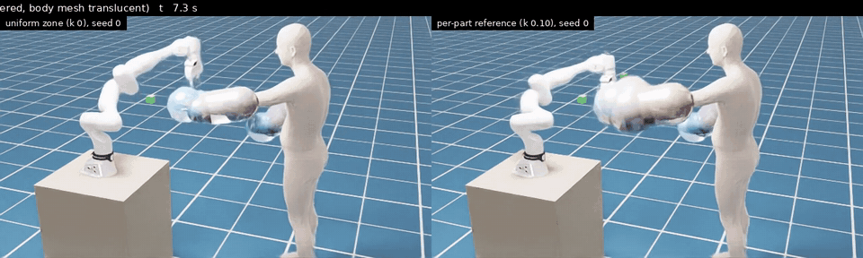
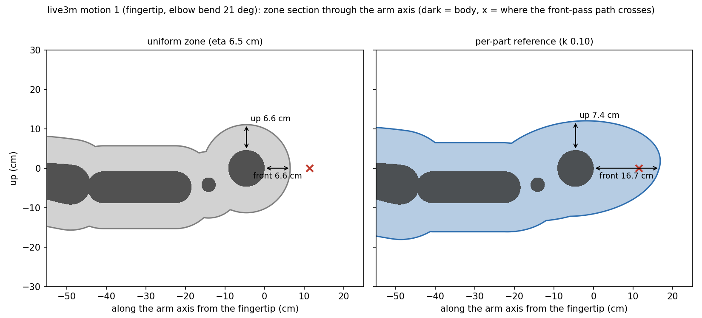
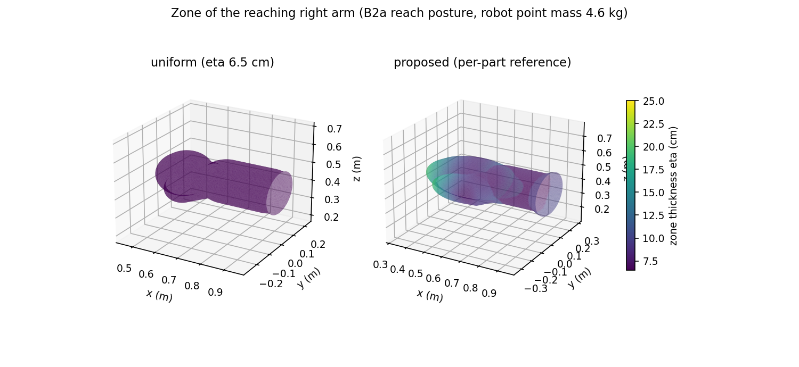
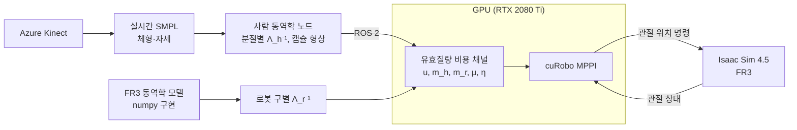

> **English summary.** Human-avoidance MPC for a Franka FR3 in which the avoidance zone around each body part changes shape with the directional effective mass of the human (body shape, posture, collision direction), compared against uniform avoidance under the same settings.
> Pipeline: Azure Kinect + real-time SMPL → per-segment directional effective mass → reduced mass μ → GPU MPPI cost → FR3 in Isaac Sim 4.5.
> The zone rule now compares μ with a per-body-part reference mass (ISO/TS 15066 body-region masses). Results: simulation with replayed human data (static arms, moving hand, hand-over, crossing, synthetic camera faults) and a real Azure Kinect recording of three arm motions replayed at real time. With a static human shape the two methods differ clearly (fingertip-front gap about 6 cm vs about 11 cm). On motions recorded with a live RGB-D camera, the first robot path did not match the approach direction and the difference was 0.9-1.5 cm. After the path was corrected on the same recording so that the robot passes in front of the fingertip along its pointing direction, the difference grew to 7.7 cm (uniform 5.8 cm, per-part 13.5 cm; elbow 3.2 cm, 5.6 vs 8.8 cm). The path was set after the recording, so a comparison in which the person sets posture and direction is planned in the hardware experiment. The real FR3 is not tested yet. Analyses: [analysis/README.md](analysis/README.md), [analysis/live/README.md](analysis/live/README.md). The repository does not run on its own: Isaac Sim, cuRobo, the SMPL model and the ROS 2 human-dynamics package are not included.

# effmass-mpc: 유효질량으로 회피 구역을 바꾸는 사람 회피 MPC

사람의 체형·자세·충돌 방향에 따라 달라지는 유효질량을 이용해 회피 구역의 모양을 바꾸는 MPC를 개발한다. 현재 Isaac Sim 의 Franka FR3 에서 검증하고 있으며, 실물 FR3 적용을 목표로 한다.



*실제 Kinect 로 녹화한 편 팔을 제 속도로 다시 틀고, 로봇이 손끝 앞을 지나가게 했다. 왼쪽 균일 회피(6.5 cm 고정), 오른쪽 부위별 기준(k_gain 0.10). 반투명 몸 = SMPL 메시, 팔 둘레 = 회피 구역, seed 0. 부위별 기준의 구역이 손끝 앞으로 더 두껍지만, 이 실행의 손끝 최소 간격 차이는 0.5 cm(6.4 대 6.9 cm)다. 컬러 영상과 함께 본 원본: [analysis/live/media/front_motion1.mp4](analysis/live/media/front_motion1.mp4)*

> ### [실제 Kinect 녹화로 본 손·팔꿈치 회피 → analysis/live/README.md](analysis/live/README.md)
> 같은 녹화에서 로봇의 길을 보정하자 부위별 기준이 균일보다 편 팔 손끝에서 7.7 cm, 팔꿈치에서 3.2 cm 더 멀리 지나갔다. 처음 정한 길에서는 손끝 앞 +0.9~1.5 cm, 팔 옆 +0.2~0.5 cm 였다. 차이가 작았던 이유, 길 보정 비교, 구역 모양 그림, 세 화면 영상(컬러·균일·부위별)이 있다.
>
> ### [시뮬레이션 결과 분석 전체 → analysis/README.md](analysis/README.md)
> 자세·방향별 구역, 정지한 팔 9개 장면, 움직이는 손, 건네기·가로지르기, 빠른 손과 움직임 예측, 카메라 지연·떨림·누락. 일부 그림·영상은 이전 식 결과이며, 각 항목에 표시했다.

> **이전 연구**
> - 석사 연구 [human-robot-safety-system](https://github.com/ukhyeon/human-robot-safety-system): SMPL 기반 개인별·방향별 사람 유효질량을 실시간으로 추정해 Indy7 의 충돌 위험 평가와 속도 조절에 적용했다. 이 저장소의 사람 유효질량 계산은 이 연구에서 이어진다.
> - [franka-depth-mppi](https://github.com/ukhyeon/franka-depth-mppi): Isaac Sim Franka 의 cuRobo MPPI 에 손 ROI 근접 비용을 더하고, 가정한 손 유효질량에 따라 활성 거리를 바꿔 비교했다. 이 저장소의 비용 채널 구조는 이 프로젝트에서 이어진다.

## 1. 목표

- 사람의 체형, 자세, 충돌 방향에 따라 달라지는 유효질량으로 회피 구역의 모양을 바꾸는 사람 회피 MPC를 Isaac Sim에서 설계하고, 실물 Franka FR3에 적용한다.
- 비교 기준은 **균일 회피**(사람의 질량 정보를 쓰지 않고 모든 부위·방향에 같은 간격을 두는 방식)이며, 제안 방법과 같은 설정에서 비교한다.
- 논문용 통계보다 "회피 구역의 모양 차이를 한눈에 보이게" 하는 것을 우선한다.

## 2. 핵심 아이디어

**설계 질문: 로봇이 사람의 어느 부위에 어느 방향으로 접근하느냐에 따라 충돌 시 유효질량이 다를 때, 그 방향으로 얼마만큼의 간격을 두어야 하는가?**

충돌 방향 u 는 로봇 구 중심에서 사람 형상의 가장 가까운 점을 향하는 방향이다. 이 방향으로 사람 분절의 유효질량 m_h, 로봇 구 위치의 유효질량 m_r 을 구하고, 둘을 묶은 환산질량 μ 로 그 쌍의 간격 η 를 정한다.

```
m_h = 1 / (uᵀ Λ_h⁻¹ u)        Λ_h⁻¹ : 사람 분절의 3x3 작업공간 역관성 (SMPL 체형·자세에서 계산)
m_r = 1 / (uᵀ Λ_r⁻¹ u)        Λ_r⁻¹ : 로봇 구 중심의 3x3 작업공간 역관성 (FR3 모델)
μ   = 1 / (uᵀ Λ_h⁻¹ u + uᵀ Λ_r⁻¹ u)
μ_iso = 1 / (1 / m_iso(부위) + 1 / m_r)      m_iso : ISO/TS 15066 의 부위별 기준 질량

η = clamp( d_base + k_gain · max( sqrt(μ / μ_iso) − 1, 0 ),  d_base,  η_max )
```

| 매개변수 | 기본값 | 뜻 |
|---|---|---|
| d_base | 0.065 m | 기본 간격 (균일 회피의 간격과 같음) |
| k_gain | 0.10 m | 질량 이득. **k_gain = 0 이면 균일 회피와 같다** |
| μ_iso | 부위별 | 그 부위가 혼자 부딪힐 때의 환산질량. 이보다 가벼운 충돌은 기본 간격만 둔다 |
| η_max | 0.25 m | 간격 상한 |

MPPI 비용은 rollout 의 각 시점에서 (로봇 구, 사람 형상) 쌍마다 간격 d 가 η 보다 작으면 벌점을 주고(d < η 구간에서 (η − d)²/(2η), 겹치면 선형), 그 시점의 최댓값을 더한다. 사람 근처(형상 기준 0.4 m 안)에서는 로봇 구 속도 상한 0.5 m/s 비용을 함께 쓴다 (T 단계).

이전 식은 모든 부위에 같은 기준 μ_ref = 0.53 kg 을 썼다. 손은 두 식이 거의 같고, 아래팔·위팔·몸통·머리는 지금 식에서 구역이 얇다(팔 옆이나 몸통 쪽에서 불필요하게 멀리 돌지 않는다). 바뀐 숫자는 [goal1/public_draft/changed_numbers.md](goal1/public_draft/changed_numbers.md) 에 모았다.

같은 손이라도 방향에 따라 구역 두께가 달라진다. 녹화된 세 자세의 단면(점 로봇 4.6 kg):

| 자세 | 손끝(팔꿈치) 앞, 균일 | 부위별 | 위쪽, 균일 | 부위별 |
|---|---|---|---|---|
| 편 팔 | 6.6 cm | 16.7 cm | 6.6 cm | 7.4 cm |
| 굽힌 손 | 6.6 cm | 11.2 cm | 6.6 cm | 7.5 cm |
| 팔꿈치 내밀기 | 6.6 cm | 10.0 cm | 6.6 cm | 7.8 cm |





## 3. 현재 단계 (갱신: 2026-11-19)

| 단계 | 내용 | 상태 |
|---|---|---|
| 1-2 | 유효질량을 MPC에 공급 | 완료 |
| 1-3 | 비용 구현 | 완료 |
| B2a | 정지 자세에서 방향 효과 확인 | 완료 |
| T | 사람 근처 속도 상한(0.5 m/s) 적용과 가중치 조정 | 완료 |
| V1, V2 | 기본 간격 + 질량 이득 식, 정적 시연 | 완료 |
| R1 | 움직이는 손 재생 | 완료 |
| 시험 | 자세 7개·방향별 구역, 정지 장면 9개, 협업 동작, 인지 불완전성(합성) | 완료 (이전 식) |
| 부위별 기준 | 구역 식의 기준을 부위별 ISO 질량으로 변경, 정지·움직이는 손·협업 일부 재실행 | 완료 |
| R2 | 실시간 Kinect + 가상 Franka (실시간 실행, 녹화, 제 속도 다시 틀기 비교, 길을 보정한 비교) | 완료 (손·팔꿈치 세 동작. 길 보정 비교는 편 팔 손끝·팔꿈치) |
| R3 | 실물 연결 준비: 계산 시간, 60 → 1000 Hz 잇기, 안전 장치 | 진행 중 |
| G2 | 실물 FR3 적용 | 예정 |

단계별 확인 내용과 근거 로그는 [docs/progress.md](docs/progress.md) 에 있다.

## 4. 결과 요약


*같은 녹화(편 팔 손끝)를 두 방식에 다시 튼 장면. 왼쪽부터 컬러 영상, 균일 방식, 부위별 기준 방식. 로봇의 길은 녹화 뒤에 정했다.*

| 동작 | 균일 | 부위별 기준 | 차이 |
|---|---|---|---|
| 편 팔 손끝 | 5.8 cm | 13.5 cm | +7.7 cm |
| 팔꿈치 | 5.6 cm | 8.8 cm | +3.2 cm |

정지한 사람 형상에서는 두 방식의 차이가 분명했다(손끝 정면 간격 약 6 cm 대 약 11 cm). 실시간 RGB-D 카메라로 녹화한 동작에서는, 처음 정한 길로는 접근 방향이 맞지 않아 차이가 0.9~1.5 cm였다. 같은 녹화에서 로봇이 손끝이 가리키는 방향의 앞을 지나가도록 길을 보정하자 차이가 7.7 cm(균일 5.8 cm, 부위별 기준 13.5 cm)로 커졌다. 길은 녹화 뒤에 정한 것이므로, 사람이 직접 자세와 방향을 맞추는 비교는 실제 하드웨어 실험에서 진행할 계획이다.

표의 값은 가장 가까웠을 때의 간격이다(방식마다 6회의 중앙값). 굽힌 손 동작은 반대쪽 손이 길을 막아 같은 조건을 만들지 못했다. 자세한 내용: [analysis/live/README.md 의 "길을 보정한 비교"](analysis/live/README.md#길을-보정한-비교)

- **실제 녹화, 처음 정한 길의 손끝 앞 통과:** 부위별 기준이 균일보다 0.9 / 1.5 / 1.2 cm 더 멀리 지나갔다(편 팔 / 굽힌 손 / 팔꿈치, seed 3개 중앙값).
- **실제 녹화, 팔 옆 접근:** 0.2 / 0.5 / 0.4 cm 로 거의 같다. 팔 옆 방향은 움직이는 질량이 작아 부위별 기준에서도 구역이 얇기 때문이며, 뜻한 대로의 결과다.
- **정지 장면 V2 정면(앞으로 뻗은 팔의 손끝 앞):** 균일 5.9 cm 대 부위별 10.7 cm(seed 3개 평균, 통과 구간 규칙).
- **아래팔 옆 장면:** 이전 식은 12.1 cm 를 두었지만 부위별 기준은 6.5 cm(균일 5.6)로, 가벼운 방향에서 불필요한 우회를 줄였다.

## 5. 한계와 주의

1. **실제 녹화 비교의 길은 녹화 뒤에 정했다.** 보정한 길도 마찬가지다. 가상 로봇의 받침 위치를 동작마다 옮겼다. 길 보정 비교는 자세가 유지되는 3~4초 구간에서만 쟀고, 굽힌 손 동작은 조건을 만들지 못했다. 녹화된 사람은 로봇에 반응하지 않고, 비교 영상의 Isaac 화면은 실행 기록으로 다시 그린 것이다. 실시간 실행 당시에는 화면이 실제의 약 0.6배로 흘렀다.
2. **빠른 손 + 지연은 미해결.** 손이 1.0 m/s 로 움직이고 지연 100 ms 가 겹치면, 제안이 균일보다 낫다는 것이 확인되지 않았다(이전 식 결과).
3. **가로지르기 0.5 m/s 에서 부위별 기준의 이점이 없다.** 아래팔 쪽에서 다가오는 장면이라 구역이 균일과 비슷하다(최소 간격 0.2~1.2 대 0.0~1.2 cm).
4. **카메라 결함 결과는 이전 식, 대부분 seed 1개, 합성 잡음 기준이다.**
5. **속도 상한 0.5 m/s 는 설계값이며 규격 적합 주장이 아니다.** 충돌력 측정과 규격 검증은 범위 밖이다.
6. **실물 로봇 결과는 아직 없다.** 사람 한 명의 녹화 한 번이다.
7. **구역이 두꺼워도 실제 간격은 그보다 작을 수 있다.** 로봇은 구역이 얇은 쪽(비스듬한 쪽, 위쪽)으로 비켜 지나간다. 실제 녹화의 손끝 동작에서도 처음 정한 길에서는 가장 가까운 방향이 대부분 손 위쪽이어서 차이가 정지 장면보다 작았다.
8. **구역 그림과 두께는 로봇을 4.6 kg 의 점으로 놓고 계산했다.**

## 6. 시스템 구성



## 7. 실행 환경과 필요한 것

**이 저장소만으로는 실행이 재현되지 않는다.** 아래 구성 요소가 저장소에 들어 있지 않다.

| 필요한 것 | 비고 |
|---|---|
| Ubuntu 22.04, NVIDIA GPU (개발 환경: RTX 2080 Ti) | |
| Isaac Sim 4.5 | 별도 설치 |
| GPU MPPI 라이브러리: cuRobo | 별도 설치 (NVIDIA 라이선스). Isaac Sim 4.5 지원 버전 사용 |
| NVIDIA Warp | 비용 채널 커널 |
| SMPL / SMPL-H 모델 | **라이선스상 미포함.** 공식 사이트에서 직접 내려받아야 한다 |
| ROS 2 Humble | 사람 동역학 노드 |
| Pinocchio | 로봇 유효질량 계산 검증 (MPC 루프 안에서는 numpy 구현 사용) |
| 사람 동역학 노드(ROS 2 패키지) | 미포함 (아래 "미포함 항목" 참고) |

`env_check/scripts/`, `goal1/scripts/` 의 스크립트는 개발 환경의 폴더 배치(절대 경로 포함)를 가정한다. 로그 파일에도 개발 환경의 경로가 남아 있다.

## 8. 저장소 구조

| 경로 | 설명 |
|---|---|
| `env_check/scripts/` | MPC 실행 노드(`step2b_mpc_isaac.py`, Isaac Sim 안에서 MPPI 실행), 장면·실행 스크립트, 환경 점검 단계 스크립트 |
| `goal1/scripts/` | 실험 실행 래퍼, 유효질량 비용 채널(`g1_meff_gpu.py`), 분석·그림·영상 합성 스크립트 |
| `goal1/config/` | T 단계 조정 결과 프로파일 (`tuned_t1.yml`), 시험용 변형 프로파일 |
| `goal1/scene_g1.json`, `goal1/b2a/g2/scene_*.json` | 장면 정의 (목표 자세, 경로 끝점, 시작 관절값) |
| `goal1/logs/*.json` | 1-2 검증 로그 (사람·로봇 유효질량, FR3 모델 점검) |
| `goal1/logs/meff_isaac/` | 요약 로그 json (1-2d, 1-3, B2a-4, B2a-5, T, V1, V2, R1, 이후 시험 `on_wp*`) |
| `goal1/b2a/b2a5_fig*.png` | B2a-5 그림 |
| `goal1/zone/*.png` | 구역 그림 (V1, V2, 이전 식) |
| `goal1/r1/*.png`, `goal1/overnight/` | R1 그림, 이후 시험의 그림과 작업 기록 (`REPORT.md`, `DECISIONS.md`) |
| `analysis/` | 결과 분석 문서, 그림·영상 사본 |
| `analysis/live/` | 실제 Kinect 녹화 비교 글, 그림, 세 화면 영상 |
| `goal1/live/live3m/` | 녹화 live3m 의 비교 결과(표 json, 그림, 영상). `corrected/` 는 길 보정 비교의 보고서와 요약. 원본 컬러 프레임과 사람 자세 자료는 미포함 |
| `goal1/part_regen/` | 부위별 기준으로 바꾼 식의 재실행 요약과 그림 |
| `goal1/public_draft/` | 이번 공개 갱신의 처리표, 바뀐 숫자 목록, 점검 기록 |
| `goal1/overnight2/` | 실물 연결 준비 기록(계산 시간, 60 → 1000 Hz 잇기 모의 시험, 안전 장치, 표면 점 유효질량) |
| `goal1/step1_2_report.md`, `goal1/step1_3_report.md` | 단계별 작업 기록 (작성 당시 원문 유지) |
| `media/` | 이전 대표 GIF 와 원본 mp4 (V2, 이전 식) |
| `docs/` | 단계별 진행 기록, 커밋 규칙 |

## 9. 문서

- 연구일지: https://app.notion.com/p/MPC-Franka-41afcf2876fa80ceb6fffa02d7205a02
- 전체 계획: https://app.notion.com/p/419fcf2876fa806593b9d49d7d07a0ce
- Franka ROS 2 세팅: https://app.notion.com/p/Franka-ROS-2-41bfcf2876fa805f9f9fc1dea7914fd1

## 10. 미포함 항목과 이유

| 항목 | 이유 |
|---|---|
| SMPL / SMPL-H 모델 파일 | 모델 라이선스상 재배포 불가 |
| 사람 데이터 (Kinect 원본 컬러 프레임, Kinect 녹화에서 나온 자세·위치, 메시 정점, SMPL 매개변수가 든 npz, 구역 메시 npz) | 개인 데이터와 SMPL 파생 데이터 |
| cuRobo, Isaac Sim, CUDA, Franka 설명 파일·USD 등 타사 코드와 로봇 에셋 | 각 원저작자 배포본을 써야 함 |
| 사람 동역학 ROS 2 패키지 (`ws/`) | 기존 연구실 코드에 기반한 파일이 포함되어 공개 범위 검토 중 |
| ISO/TS 15066 수치 파일 | 규격 문서의 수치를 담고 있어 공개 범위 검토 중 |
| 가상환경, 캐시, 프레임·녹화 폴더, 25 MB 넘는 영상 | 다시 만들 수 있거나 용량이 큼 |

## 11. 참고문헌

1. ISO/TS 15066:2016, Robots and robotic devices - Collaborative robots.
2. G. Williams et al., "Information theoretic MPC for model-based reinforcement learning," ICRA, 2017.
3. B. Sundaralingam et al., "cuRobo: Parallelized collision-free minimum-jerk robot motion generation," arXiv:2310.17274, 2023.
4. M. Loper et al., "SMPL: A skinned multi-person linear model," ACM Trans. Graphics, vol. 34, no. 6, 2015.
5. D. Kulic and E. A. Croft, "Real-time safety for human-robot interaction," Robotics and Autonomous Systems, vol. 54, no. 1, 2006.
