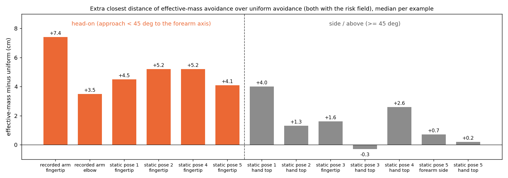
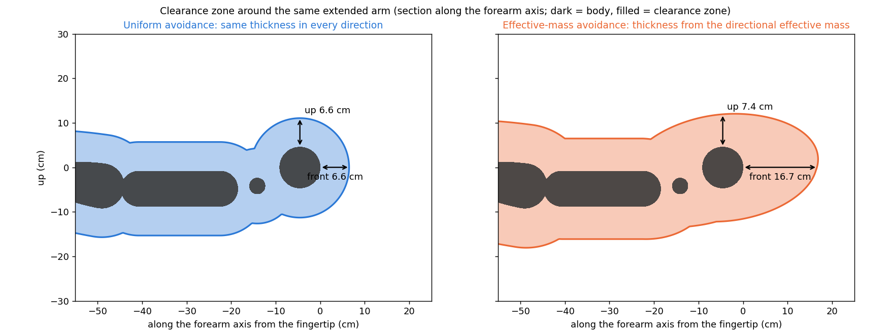

> **English summary.** Human-avoidance MPC (GPU MPPI, NVIDIA GPU MPC library) for a Franka FR3 in Isaac Sim. Two methods use the same MPC and the same cost (a clearance zone plus a risk field) and differ only in how thick the clearance zone is: **uniform avoidance** (the same in every direction) and **effective-mass avoidance** (thicker where the human's directional effective mass is large).
> **Result.** Head-on fingertip (simulation, median of 6 runs, uniform → effective-mass): min clearance 8.1 → 15.5 cm, avoidance onset 13.5 → 19.1 cm. Head-on, where the human's effective mass is large, effective-mass avoidance keeps much more distance and starts avoiding earlier; from the side or above, the two methods stay close.
> These are simulation results; the real-robot comparison is in effmass-mpc-franka. This repository does not run on its own (see 4).

# effmass-mpc: 유효질량으로 이격 구역을 바꾸는 사람 회피 MPC


*같은 녹화, 같은 seed, 같은 시각에 로봇이 편 팔의 손끝 정면을 지나간다. 왼쪽 균일 회피, 오른쪽 유효질량 회피.*
**정면 손끝: 최소 간격 8.1 → 15.5 cm, 회피 시작 거리 13.5 → 19.1 cm** (균일 → 유효질량, 6번 실행 중앙값). 회피 시작 거리는 로봇이 사람 비용 없는 길에서 벗어나기 시작할 때의 간격이다.

## 1. 핵심 결과

| 예시 | 접근 방향 | 균일 회피 | 유효질량 회피 | 차이 |
|---|---|---|---|---|
| 편 팔 손끝 (실제 녹화) | 정면 | 8.1 | 15.5 | +7.4 |
| 팔꿈치 (실제 녹화) | 정면 | 7.8 | 11.3 | +3.5 |
| 손 위·팔 옆 (정지 자세 7장면) | 옆·위 | 4.5 – 10.3 | 8.5 – 11.9 | −0.3 ~ +4.0 |
| 편 팔 손끝 / 팔꿈치, 실물 조건(d_base 0.10 m) | 정면 | 10.7 / 10.6 | 21.1 / 14.7 | +10.4 / +4.1 |

가장 가까운 간격(cm)의 중앙값이다. 실제 녹화는 방식마다 6회(seed 3개 × 출발 2곳), 정지 자세는 장면마다 3회이고, 두 방식 모두 같은 위험 필드를 썼다.



*예시마다 유효질량 회피가 더 둔 간격. 정면(가장 가까울 때 로봇 방향이 아래팔 축과 45° 미만)은 모두 크고, 옆·위는 대부분 작다. 오른쪽 끝 막대는 목표가 손 바로 위라 유효질량 회피가 목표 직전에 멈춘 장면이다.*

자세한 결과 → [analysis/field/README.md](analysis/field/README.md)

## 2. 두 방식은 무엇이 다른가

| 같은 것 | 다른 것 |
|---|---|
| MPC 와 설정 (NVIDIA GPU MPC 라이브러리의 MPPI, 같은 프로파일) | 이격 구역 두께 η 를 정하는 질량 |
| 비용 구조: 이격 구역 + 위험 필드 | 균일 회피: 모든 방향에서 d_base |
| 위험 필드 높이 W (폭은 각 방식의 η 로 정해짐) | 유효질량 회피: 방향별 유효질량으로 η 를 정함 |
| 사람 입력(같은 녹화·자세), seed, 로봇 경로 | |
| 사람 근처 속도 상한 비용 | |



*같은 편 팔에서 두 방식의 이격 구역 단면. 손끝 정면의 두께는 크게 다르고, 위쪽은 거의 같다.*

```math
\mu = \frac{1}{u^\top \Lambda_h^{-1} u + u^\top \Lambda_r^{-1} u}
```

```math
\eta = \operatorname{clamp}\left(d_{\text{base}} + k_{\text{gain}} \max\left(\sqrt{\mu / \mu_{\text{iso}}} - 1,\ 0\right),\ d_{\text{base}},\ \eta_{\max}\right)
```

```math
J = \max_{\text{pairs}} \Big[\, w\, c_{\text{zone}}(d, \eta) + W\, c_{\text{field}}(d, \eta) \,\Big]
```

```math
c_{\text{zone}} = \begin{cases} \eta/2 - d & d < 0 \\ (\eta - d)^2 / (2\eta) & 0 \le d < \eta \\ 0 & d \ge \eta \end{cases} \qquad c_{\text{field}} = \begin{cases} 1 & d < \eta \\ \left(1 - \dfrac{d - \eta}{\eta}\right)^2 & \eta \le d < 2\eta \\ 0 & d \ge 2\eta \end{cases}
```

- u: 로봇 구에서 사람 형상의 가장 가까운 점을 향하는 방향
- Λ_h⁻¹, Λ_r⁻¹: 사람 분절과 로봇 구 위치의 작업공간 역관성
- μ: 방향 u 의 환산질량. μ_iso: 같은 식에 그 부위의 ISO/TS 15066 기준 질량을 넣은 값
- d: 로봇 구와 사람 형상 사이의 간격. η: 이격 구역 두께. c_zone: 이격 구역 비용, c_field: 위험 필드
- J: rollout 각 시점의 사람 비용. (로봇 구, 사람 형상) 쌍마다 계산해 가장 큰 값을 쓴다

| 매개변수 | 값 | 뜻 |
|---|---|---|
| d_base | 0.065 m (시뮬), 0.10 m (실물 조건) | 기본 두께. 균일 회피의 두께와 같다 |
| k_gain | 0.10 m | 질량 이득. **k_gain = 0 이면 균일 회피** |
| η_max | 0.25 m | 두께 상한 |
| W | 100 | 위험 필드 높이 (구역 비용 가중치 w = 1e5 와 같은 단위), 두 방식에 같음 |
| 속도 상한 | 0.5 m/s | 사람 형상 0.4 m 안에서 로봇 구 속도 비용 |

## 3. 시스템 구성


*실물 구성. 메인 PC 에서 사람 인식과 MPC 가 GPU 를 나눠 쓰고(NVIDIA MPS), 관절 목표가 게이트웨이와 ros2_control 브리지를 거쳐 FR3 로 간다. 시뮬에서는 Isaac Sim 의 FR3 가 제어 PC 와 로봇 자리를 대신한다.*

## 4. 실행 환경

이 저장소만으로는 실행되지 않는다. 아래 구성 요소가 들어 있지 않다(이유: [analysis/field/README.md](analysis/field/README.md#미포함-항목과-이유-readme-에서-옮김)).

| 필요한 것 | 비고 |
|---|---|
| Ubuntu 22.04, NVIDIA GPU (개발: RTX 2080 Ti) | |
| Isaac Sim 4.5 | 별도 설치 |
| cuRobo (NVIDIA GPU MPC 라이브러리) | 별도 설치, NVIDIA 라이선스 |
| NVIDIA Warp | 비용 채널 커널 |
| SMPL / SMPL-H 모델 | 라이선스상 미포함 |
| ROS 2 Humble, Pinocchio | 사람 동역학 노드, 로봇 유효질량 검증 |
| 사람 동역학 노드(ROS 2 패키지) | 미포함 |

## 5. 저장소 구조

```
goal1/scripts/g1_meff_gpu.py   유효질량 비용 채널 (이격 구역 + 위험 필드)
env_check/scripts/             MPC 실행 노드와 실행 스크립트
analysis/field/                지금 판의 상세 결과, 그림, 영상, 공개 예시 실행기 (tools/)
analysis/, analysis/live/      이전 판 분석 문서
docs/                          단계별 진행 기록
media/                         이전 대표 GIF
```

## 6. 한계

1. 시뮬레이션 비교다. 실물 비교는 effmass-mpc-franka 에서 다룬다.
2. 정지 자세와 녹화 한 번(사람 한 명)의 자세 범위에서 얻은 결과다.
3. 속도 상한은 설계값이며 표준 준수 주장이 아니다.
4. 목표가 위험 필드 안에 있으면 로봇이 목표 직전에 멈출 수 있다.

나머지 한계와 이전 판 결과: [analysis/field/README.md](analysis/field/README.md)

## 7. 관련 저장소와 참고문헌

- effmass-mpc-franka: 실물 Franka FR3 구성과 실물 비교 (준비 중)
- [human-robot-safety-system](https://github.com/ukhyeon/human-robot-safety-system): 석사 연구. SMPL 기반 개인별·방향별 사람 유효질량을 실시간으로 추정해 Indy7 의 충돌 위험 평가와 속도 조절에 적용했다. 이 저장소의 사람 유효질량 계산은 여기서 이어진다.
- [franka-depth-mppi](https://github.com/ukhyeon/franka-depth-mppi): Isaac Sim Franka 의 MPPI 에 손 근접 비용을 더하고, 가정한 손 유효질량에 따라 활성 거리를 바꿔 비교했다. 비용 채널 구조는 여기서 이어진다.

1. ISO/TS 15066:2016, Robots and robotic devices - Collaborative robots.
2. G. Williams et al., "Information theoretic MPC for model-based reinforcement learning," ICRA, 2017.
3. B. Sundaralingam et al., "cuRobo: Parallelized collision-free minimum-jerk robot motion generation," arXiv:2310.17274, 2023.
4. M. Loper et al., "SMPL: A skinned multi-person linear model," ACM Trans. Graphics, vol. 34, no. 6, 2015.
5. D. Kulic and E. A. Croft, "Real-time safety for human-robot interaction," Robotics and Autonomous Systems, vol. 54, no. 1, 2006.
