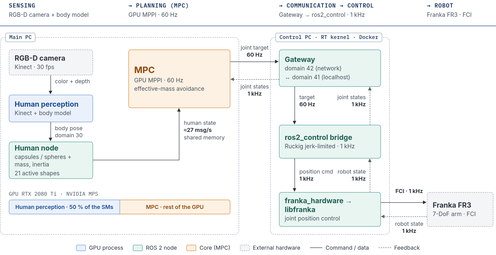

> **English summary.** Human-avoidance MPC (GPU MPPI, NVIDIA GPU MPC library) for a Franka FR3 in Isaac Sim: the clearance zone around each body part is thicker where the human's directional effective mass is large (**effective-mass avoidance**), compared with a zone of the same thickness in every direction (**uniform avoidance**).
> In simulation, for a head-on fingertip, the minimum clearance grows from 8.1 to 15.5 cm and avoidance starts at 19.1 cm instead of 13.5 cm (median of 6 runs).
> The real-robot setup is in [effmass-mpc-franka](https://github.com/ukhyeon/effmass-mpc-franka).

# effmass-mpc: 유효질량으로 이격 구역을 바꾸는 사람 회피 MPC

effmass-mpc는 사람의 방향별 유효질량으로 이격 구역의 두께를 바꾸는 사람 회피 MPC다. Isaac Sim의 Franka FR3에서 NVIDIA GPU MPC 라이브러리의 MPPI로 실행된다.

[실물 저장소: effmass-mpc-franka](https://github.com/ukhyeon/effmass-mpc-franka) · [석사 연구: human-robot-safety-system](https://github.com/ukhyeon/human-robot-safety-system) · [이전 프로젝트: franka-depth-mppi](https://github.com/ukhyeon/franka-depth-mppi) · [상세 결과](analysis/field/README.md)


*같은 녹화를 두 방식에 재생한 장면이다. 로봇이 편 팔의 손끝 정면을 지나간다. 왼쪽은 균일 회피, 오른쪽은 유효질량 회피다.*

사람 근처를 지나는 로봇은 보통 사람 몸 둘레에 모든 방향으로 같은 두께의 이격 구역을 두고 그 안에 들어가지 않는다(**균일 회피**, 비교 기준). **유효질량 회피**는 로봇이 부딪혔을 때 사람 몸이 받아내는 질량(방향별 유효질량)을 매 순간 계산한다. 무거운 방향(예: 뻗은 손끝 정면)은 이격 구역을 두껍게 두고 가벼운 방향(손 위, 팔 옆)은 균일 회피와 같은 두께로 둔다.

이 저장소에는 다음이 들어 있다.

- **유효질량 비용 채널**: 이격 구역과 위험 필드를 GPU에서 계산한다(`goal1/scripts/g1_meff_gpu.py`).
- **MPC 실행 노드**: Isaac Sim 안에서 MPPI를 실행하는 노드와 실행 스크립트다(`env_check/scripts/`).
- **공개 예시 실행기와 결과**: 위험 필드를 켠 예시 실행기와 결과 표·그림·영상이다(`analysis/field/`).

## 1. 결과

**정면 손끝: 최소 간격 8.1 → 15.5 cm, 회피 시작 거리 13.5 → 19.1 cm** (균일 → 유효질량, 6번 실행 중앙값). 회피 시작 거리는 로봇이 사람 비용 없는 길에서 벗어나기 시작할 때의 간격이다.

| 예시 | 접근 방향 | 균일 회피 | 유효질량 회피 | 차이 |
|---|---|---|---|---|
| 편 팔 손끝 (실제 녹화) | 정면 | 8.1 | 15.5 | +7.4 |
| 팔꿈치 (실제 녹화) | 정면 | 7.8 | 11.3 | +3.5 |
| 손 위·팔 옆 (정지 자세 7장면) | 옆·위 | 4.5 – 10.3 | 8.5 – 11.9 | −0.3 ~ +4.0 |
| 편 팔 손끝 / 팔꿈치, 실물 조건(d_base 0.10 m) | 정면 | 10.7 / 10.6 | 21.1 / 14.7 | +10.4 / +4.1 |

가장 가까운 간격(cm)의 중앙값이다. 실제 녹화는 방식마다 6회(seed 3개 × 출발 2곳), 정지 자세는 장면마다 3회 실행했다. 두 방식 모두 같은 위험 필드를 썼다. 대표 영상은 같은 녹화, 같은 seed, 같은 시각의 장면이다. 모두 시뮬레이션 결과이고 실물 비교는 [effmass-mpc-franka](https://github.com/ukhyeon/effmass-mpc-franka)에서 다룬다.


*예시마다 유효질량 회피가 더 둔 간격이다. 정면(가장 가까울 때 로봇 방향이 아래팔 축과 45° 미만)은 모두 크고 옆·위는 대부분 작다. 오른쪽 끝 막대는 목표가 손 바로 위라서 유효질량 회피가 목표 직전에 멈춘 장면이다.*

자세한 결과: [analysis/field/README.md](analysis/field/README.md)

## 2. 방법: 유효질량으로 이격 구역 두께 정하기

같은 사람이라도 부딪히는 방향에 따라 몸이 받아내는 질량이 다르다. 팔 길이 방향으로 뻗은 손끝을 밀면 팔 전체의 관성이 실려 무겁다. 손을 위에서 누르거나 팔을 옆에서 치면 그 부위만 밀려나 가볍다. 유효질량 회피는 이 차이를 이격 구역에 넣는다. 구역의 모양을 고정하지 않고 사람의 체형·자세와 로봇 위치에서 계산한 **방향별 유효질량**으로 매 제어 주기마다 바꾼다. 무겁고 가벼움은 그 부위의 ISO/TS 15066 기준 질량과 비교해 정하므로, 기준보다 가벼운 방향은 균일 회피와 같은 두께로 남는다. 두 방식 모두 구역 바깥에 **위험 필드**(경계 전부터 미리 돌아가게 하는 비용)를 둔다.


*같은 편 팔에서 두 방식의 이격 구역 단면이다. 손끝 정면의 두께는 크게 다르고 위쪽은 거의 같다.*

```math
\mu = \frac{1}{u^\top \Lambda_h^{-1} u + u^\top \Lambda_r^{-1} u}
```

```math
\eta = \mathrm{clamp}\left(d_{\text{base}} + k_{\text{gain}} \max\left(\sqrt{\mu / \mu_{\text{iso}}} - 1,\ 0\right),\ d_{\text{base}},\ \eta_{\max}\right)
```

```math
J = \max_{\text{pairs}} \Big[\, w\, c_{\text{zone}}(d, \eta) + W\, c_{\text{field}}(d, \eta) \,\Big]
```

```math
c_{\text{zone}} = \begin{cases} \eta/2 - d & d < 0 \\ (\eta - d)^2 / (2\eta) & 0 \le d < \eta \\ 0 & d \ge \eta \end{cases} \qquad c_{\text{field}} = \begin{cases} 1 & d < \eta \\ \left(1 - \dfrac{d - \eta}{\eta}\right)^2 & \eta \le d < 2\eta \\ 0 & d \ge 2\eta \end{cases}
```

- u: 로봇 구에서 사람 형상의 가장 가까운 점을 향하는 방향
- Λ_h⁻¹, Λ_r⁻¹: 사람 분절과 로봇 구 위치의 작업공간 역관성
- μ: 방향 u의 환산질량. μ_iso: 같은 식에 그 부위의 ISO/TS 15066 기준 질량을 넣은 값
- d: 로봇 구와 사람 형상 사이의 간격. η: 이격 구역 두께. c_zone: 이격 구역 비용, c_field: 위험 필드
- J: rollout 각 시점의 사람 비용. (로봇 구, 사람 형상) 쌍마다 계산해 가장 큰 값을 쓴다

| 기호 | 옵션 | 값 | 뜻 |
|---|---|---|---|
| d_base | `--meff-dbase` | 0.065 m (시뮬), 0.10 m (실물 조건) | 기본 두께. 균일 회피의 두께와 같다 |
| k_gain | `--meff-gain` | 0.10 m | 질량 이득. **k_gain = 0이면 균일 회피** |
| η_max | `--meff-eta-max` | 0.25 m | 두께 상한 |
| μ_iso | `--meff-muref-mode part` | 부위별 ISO/TS 15066 기준 | 부위마다 기준 질량을 따로 쓴다 |
| w | `--meff-w` | 1e5 | 이격 구역 비용 가중치 |
| W | `--gh-hf-wt` (예시 실행기) | 100 | 위험 필드 높이(w와 같은 단위). 두 방식에 같다 |
| 속도 상한 | `--speed-cap on`, `--speed-cap-v`, `--speed-cap-dist` | 0.5 m/s, 0.4 m | 사람 형상 0.4 m 안에서 로봇 구 속도 비용 |

**비교 조건.** 두 방식은 이격 구역 두께를 정하는 방법만 다르고 나머지는 모두 같다.

| 같은 것 | 다른 것 |
|---|---|
| MPC와 설정 (NVIDIA GPU MPC 라이브러리의 MPPI, 같은 프로파일) | 이격 구역 두께 η를 정하는 질량 |
| 비용 구조: 이격 구역 + 위험 필드 | 균일 회피: 모든 방향에서 d_base |
| 위험 필드 높이 W (폭은 각 방식의 η로 정해짐) | 유효질량 회피: 방향별 유효질량으로 η를 정함 |
| 사람 입력(같은 녹화·자세), seed, 로봇 경로 | |
| 사람 근처 속도 상한 비용 | |

## 3. 시스템 구성



*실물 구성이다. 메인 PC에서 사람 인식과 MPC가 GPU를 나눠 쓰고(NVIDIA MPS), 관절 목표가 게이트웨이와 ros2_control 브리지를 거쳐 FR3로 간다. 시뮬레이션에서는 Isaac Sim의 FR3가 제어 PC와 로봇 자리를 대신한다.*

## 4. 요구 사항

Ubuntu 22.04와 RTX 2080 Ti에서 개발하고 시험했다. 실행하려면 아래가 필요하다. "미포함"은 이 저장소에 들어 있지 않은 것이다(이유: [analysis/field/README.md](analysis/field/README.md#미포함-항목과-이유-readme-에서-옮김)).

| 필요한 것 | 비고 |
|---|---|
| Ubuntu 22.04, NVIDIA GPU | 개발: RTX 2080 Ti |
| Isaac Sim 4.5 | 별도 설치 |
| cuRobo (NVIDIA GPU MPC 라이브러리) | 별도 설치, NVIDIA 라이선스 |
| NVIDIA Warp | 비용 채널 커널 |
| SMPL / SMPL-H 모델 | 라이선스상 미포함 |
| ROS 2 Humble, Pinocchio | 사람 동역학 노드, 로봇 유효질량 검증 |
| 사람 동역학 노드(ROS 2 패키지) | 미포함 |

## 5. 실행

1. 위 요구 사항을 갖추고 이 저장소를 `~/effmass_mpc`에 둔다. 예시 실행기는 이 경로의 실행 노드를 부른다.
2. 공개 예시 실행기로 실행한다. 아래는 정지 자세 V2 정면, 유효질량 회피, 위험 필드 W 100, seed 0이다. 균일 회피는 `--meff-gain 0.0`으로 바꾼다.

   ```bash
   env_check/scripts/run_isaac_ros.sh analysis/field/tools/step2b_mpc_isaac_field.py --gh-hf-wt 100 --scene g1 --robot fr3v2_1 --no-diag \
     --warmup 10 --tag v2_front_pf_s0 --ros --ros-pose-topic none --human --human-mode full --human-source precomputed \
     --scene g2 --shapes v2 --human-pre goal1/data/human_b2a_reach.npz --human-dir goal1/b2a/g2 --human-viz none --u-def nearest \
     --meff on --meff-mode gain --meff-dbase 0.065 --meff-muref 0.53 --meff-eta-max 0.25 --meff-agg max_all --meff-muref-mode part \
     --b1-log 1 --cost-agg 1 --profile t1 --scene-json goal1/b2a/g2/scene_b2a4_front_0.38h1.json --single-pass 1 --meff-gain 0.10 \
     --mppi-seed 0 --steps 304
   ```

3. 정상이면 시작할 때 `[step2b] (gh_field) risk field on: W 100.0 ...` 줄이 출력된다.

사람 입력 파일(`goal1/data/human_b2a_reach.npz`)은 공개하지 않았다. 같은 형식의 사람 데이터를 넣어야 한다. 실행기의 설명은 [tools/step2b_mpc_isaac_field.py](analysis/field/tools/step2b_mpc_isaac_field.py) 머리에 있다.

## 6. 저장소 구조

```
goal1/scripts/g1_meff_gpu.py   유효질량 비용 채널 (이격 구역 + 위험 필드)
env_check/scripts/             MPC 실행 노드와 실행 스크립트
analysis/field/                현재 방법의 상세 결과, 그림, 영상, 공개 예시 실행기 (tools/)
analysis/, analysis/live/      이전 비용 식의 분석 문서
docs/                          단계별 진행 기록
media/                         이전 대표 GIF
```

## 7. 한계

1. 비교는 사람 한 명의 결과다. 실시간 카메라 앞에서 움직인 팔을 기록하고, 같은 속도로 재생해 두 방식에 똑같이 넣었다. 재생된 사람은 로봇에 반응하지 않는다.
2. 목표가 위험 필드 안에 있으면 로봇이 목표 앞에서 멈출 수 있다. 손 위 장면에서 seed 3개 중 2개가 목표 1.5–2.7 cm 앞에서 멈췄다. 위험 필드 비용과 목표 비용이 맞서기 때문이다.
3. 유효질량 회피는 더 돌아가므로 지나가는 시간이 길어질 수 있다(팔꿈치 1.92 → 2.93 s).
4. 속도 상한은 설계값이며 표준 준수 주장이 아니다.

나머지 한계와 이전 결과: [analysis/field/README.md](analysis/field/README.md)

## 8. 관련 저장소와 참고문헌

- [effmass-mpc-franka](https://github.com/ukhyeon/effmass-mpc-franka): 실물 Franka FR3 구성(메인 PC 코드, 실시간 데모)
- [human-robot-safety-system](https://github.com/ukhyeon/human-robot-safety-system): 석사 연구. SMPL 기반 개인별·방향별 사람 유효질량을 실시간으로 추정해 Indy7의 충돌 위험 평가와 속도 조절에 적용했다. 이 저장소의 사람 유효질량 계산은 여기서 이어진다.
- [franka-depth-mppi](https://github.com/ukhyeon/franka-depth-mppi): Isaac Sim Franka의 MPPI에 손 근접 비용을 더하고 가정한 손 유효질량에 따라 활성 거리를 바꿔 비교했다. 비용 채널 구조는 여기서 이어진다.

1. ISO/TS 15066:2016, Robots and robotic devices - Collaborative robots.
2. G. Williams et al., "Information theoretic MPC for model-based reinforcement learning," ICRA, 2017.
3. B. Sundaralingam et al., "cuRobo: Parallelized collision-free minimum-jerk robot motion generation," arXiv:2310.17274, 2023.
4. M. Loper et al., "SMPL: A skinned multi-person linear model," ACM Trans. Graphics, vol. 34, no. 6, 2015.
5. D. Kulic and E. A. Croft, "Real-time safety for human-robot interaction," Robotics and Autonomous Systems, vol. 54, no. 1, 2006.
