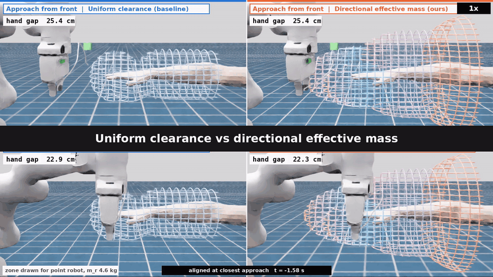
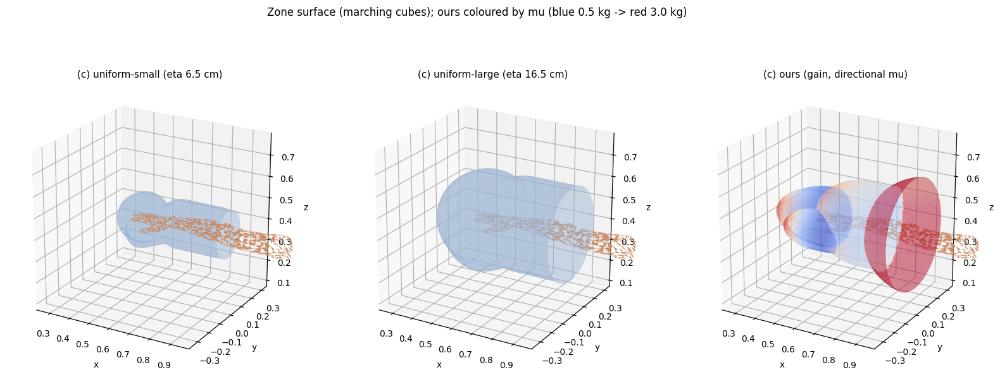
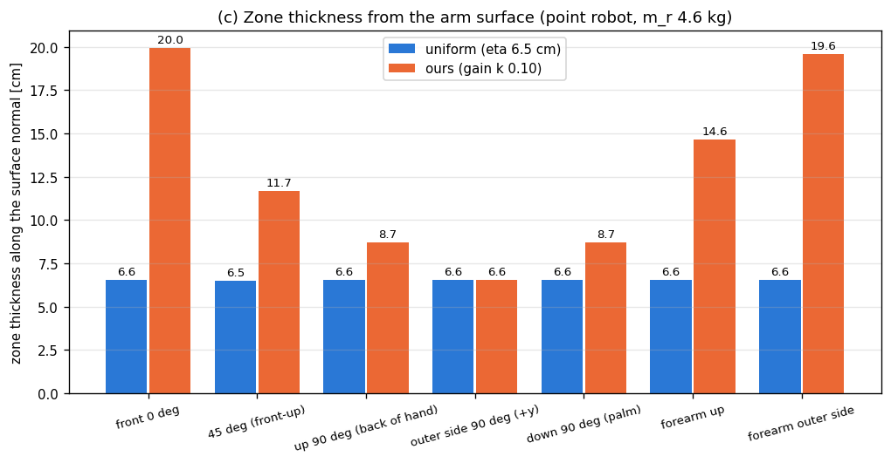
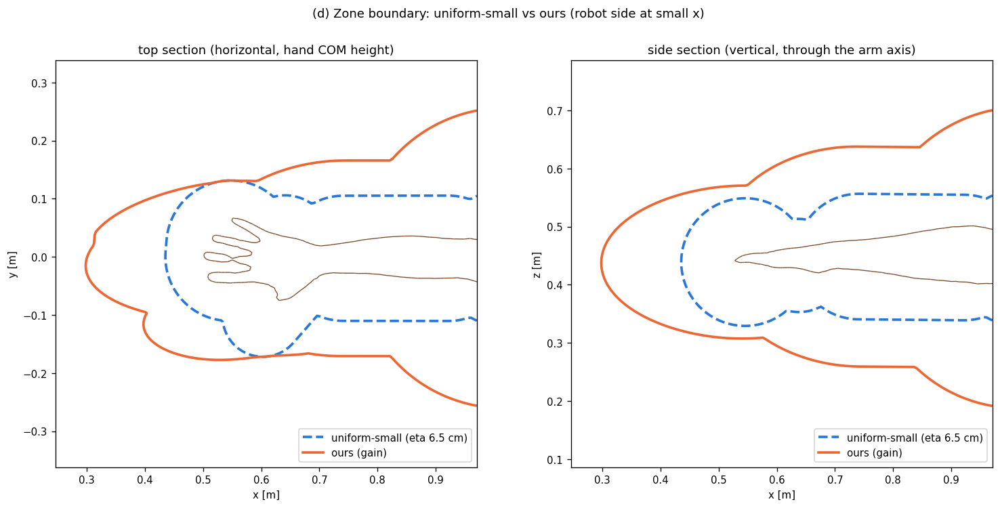
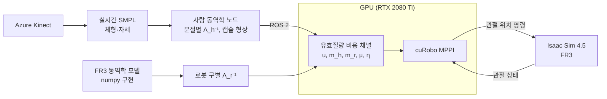

> **English summary.** Human-avoidance MPC for a Franka FR3 in which the avoidance zone around each body part changes shape with the directional effective mass of the human (body shape, posture, collision direction), compared against uniform avoidance under the same settings.
> Pipeline: Azure Kinect + real-time SMPL → per-segment directional effective mass → reduced mass μ → GPU MPPI cost → FR3 in Isaac Sim 4.5.
> Results so far are simulation results with replayed, precomputed human data: static arm poses, a moving hand, hand-over and crossing motions, and synthetic camera lag / jitter / dropout. Live Kinect input and the real FR3 are not tested yet. Full analysis: [analysis/README.md](analysis/README.md). The repository does not run on its own: Isaac Sim, cuRobo, the SMPL model and the ROS 2 human-dynamics package are not included.

# effmass-mpc: 유효질량으로 회피 구역을 바꾸는 사람 회피 MPC

사람의 체형·자세·충돌 방향에 따라 달라지는 유효질량을 이용해 회피 구역의 모양을 바꾸는 MPC를 개발한다. 현재 Isaac Sim 의 Franka FR3 에서 검증하고 있으며, 실물 FR3 적용을 목표로 한다.



*왼쪽: 균일 회피 (η 6.5 cm 고정), 오른쪽: 제안 (k_gain 0.10). 위 줄 = 정면 접근, 아래 줄 = 위 접근. 같은 장면·같은 MPC 설정·seed 0. 원본 영상: [media/v2_main.mp4](media/v2_main.mp4)*

> ### [결과 분석 전체 보기 → analysis/README.md](analysis/README.md)
> 자세·방향별 구역, 정지한 팔 9개 장면, 움직이는 손, 건네기·가로지르기, 빠른 손과 움직임 예측, 카메라 지연·떨림·누락까지 질문별로 그림·영상·근거 로그와 함께 정리했다.

> **이전 연구**
> - 석사 연구 [human-robot-safety-system](https://github.com/ukhyeon/human-robot-safety-system): SMPL 기반 개인별·방향별 사람 유효질량을 실시간으로 추정해 Indy7 의 충돌 위험 평가와 속도 조절에 적용했다. 이 저장소의 사람 유효질량 계산은 이 연구에서 이어진다.
> - [franka-depth-mppi](https://github.com/ukhyeon/franka-depth-mppi): Isaac Sim Franka 의 cuRobo MPPI 에 손 ROI 근접 비용을 더하고, 가정한 손 유효질량에 따라 활성 거리를 바꿔 비교했다. 이 저장소의 비용 채널 구조는 이 프로젝트에서 이어진다.

## 1. 목표

- 사람의 체형, 자세, 충돌 방향에 따라 달라지는 유효질량으로 회피 구역의 모양을 바꾸는 사람 회피 MPC를 Isaac Sim에서 설계하고, 실물 Franka FR3에 적용한다.
- 비교 기준은 **균일 회피**(사람의 질량 정보를 쓰지 않고 모든 부위·방향에 같은 간격을 두는 방식)이며, 제안 방법과 같은 설정에서 비교한다.

## 2. 핵심 아이디어

**설계 질문: 로봇이 사람의 어느 부위에 어느 방향으로 접근하느냐에 따라 충돌 시 유효질량이 다를 때, 그 방향으로 얼마만큼의 간격을 두어야 하는가?**

충돌 방향 u 는 로봇 구 중심에서 사람 형상의 가장 가까운 점을 향하는 방향이다. 이 방향으로 사람 분절의 유효질량 m_h, 로봇 구 위치의 유효질량 m_r 을 구하고, 둘을 묶은 환산질량 μ 로 그 쌍의 회피 간격 η 를 정한다.

```
m_h = 1 / (uᵀ Λ_h⁻¹ u)        Λ_h⁻¹ : 사람 분절의 3x3 작업공간 역관성 (SMPL 체형·자세에서 계산)
m_r = 1 / (uᵀ Λ_r⁻¹ u)        Λ_r⁻¹ : 로봇 구 중심의 3x3 작업공간 역관성 (FR3 모델)
μ   = 1 / (uᵀ Λ_h⁻¹ u + uᵀ Λ_r⁻¹ u)

η = clamp( d_base + k_gain · max( sqrt(μ / μ_ref) − 1, 0 ),  d_base,  η_max )
```

| 매개변수 | 기본값 | 뜻 |
|---|---|---|
| d_base | 0.065 m | 기본 간격 (균일 회피의 간격과 같음) |
| k_gain | 0.10 m | 질량 이득. 설계자가 정하는 조절 변수. **k_gain = 0 이면 균일 회피와 같다** |
| μ_ref | 0.53 kg | 이보다 가벼운 충돌은 기본 간격만 둔다 |
| η_max | 0.25 m | 간격 상한 |

MPPI 비용은 rollout 의 각 시점에서 (로봇 구, 사람 형상) 쌍마다 간격 d 가 η 보다 작으면 벌점을 주고(d < η 구간에서 (η − d)²/(2η), 겹치면 선형), 그 시점의 최댓값을 더한다. 사람 근처(형상 기준 0.4 m 안)에서는 로봇 구 속도 상한 0.5 m/s 비용을 함께 쓴다 (T 단계).

같은 손이라도 방향에 따라 구역 두께가 달라진다. 아래 값은 점 로봇(m_r 4.6 kg)으로 그린 구역의 팔 표면 법선 방향 두께다 (`goal1/logs/meff_isaac/v2_thickness.json`).

| 방향 | 균일 | 제안 (k_gain 0.10) |
|---|---|---|
| 손 정면 (0°) | 6.6 cm | 20.0 cm |
| 정면-위 45° | 6.5 cm | 11.7 cm |
| 손등 위 (90°) | 6.6 cm | 8.7 cm |
| 바깥 옆 (90°) | 6.6 cm | 6.6 cm |
| 손바닥 아래 (90°) | 6.6 cm | 8.7 cm |
| 아래팔 위 | 6.6 cm | 14.6 cm |
| 아래팔 바깥 옆 | 6.6 cm | 19.6 cm |



*구역 표면. 왼쪽부터 균일 η 6.5 cm, 균일 η 16.5 cm, 제안(색 = μ, 파랑 0.5 kg → 빨강 3.0 kg).*





*수평·수직 단면에서 본 구역 경계. 파란 점선 = 균일 η 6.5 cm, 주황 실선 = 제안.*

## 3. 현재 단계 (갱신: 2026-11-18)

| 단계 | 내용 | 상태 |
|---|---|---|
| 1-2 | 유효질량을 MPC에 공급 | 완료 |
| 1-3 | 비용 구현 | 완료 |
| B2a | 정지 자세에서 방향 효과 확인 | 완료 |
| T | 사람 근처 속도 상한(0.5 m/s) 적용과 가중치 조정 | 완료 |
| V1 | 기본 간격 + 질량 이득 식 | 완료 |
| V2 | 정적 시연과 질량 이득 조절 | 완료 |
| R1 | 움직이는 손 재생 | 완료 |
| 시험 | 자세 7개·방향별 구역, 정지 장면 9개, 협업 동작(건네기·가로지르기), 인지 불완전성(지연·떨림·누락, 합성) | 완료 |
| R2 | 실시간 Kinect + 가상 Franka | 예정 |
| R3 | 계산 분담 재측정 | 예정 |
| G2 | 실물 FR3 적용 | 예정 |
| 병행 | 제어용 PC의 franka_ros2 환경 구성 | 진행 중 |

단계별 확인 내용과 근거 로그는 [docs/progress.md](docs/progress.md) 에 있다.

## 4. 정적 단계 결과 (V2)

- 앞으로 뻗은 팔의 손끝 앞을 로봇이 지나갈 때, 손 최소 간격은 균일 6.0 cm 대 제안 12.0 cm 다(seed 3개 평균, 같은 설정).
- 손 위를 지나갈 때는 5.4 대 8.2 cm 로, 제안은 방향에 따라 간격이 달라진다(정면 − 위: 균일 +0.5, 제안 +3.8 cm).
- 질량 이득 k_gain 을 0 → 0.15 로 올리면 간격이 6.3 → 13.5 cm 로 늘지만, 0.15 에서는 로봇이 손 위로 넘어가며 포화된다(seed 0).

**조건별 손 최소 간격 (seed 3개 평균, 괄호 = seed 범위)**

| 장면 | 균일 (η 6.5 cm) 형상 기준 | 제안 (k_gain 0.10) 형상 기준 | 균일 메시 기준 | 제안 메시 기준 |
|---|---|---|---|---|
| 정면 접근 | 6.0 cm (5.3~6.3) | 12.0 cm (11.4~12.5) | 6.0 cm | 12.7 cm |
| 위 접근 | 5.4 cm (4.8~5.8) | 8.2 cm (7.6~8.9) | 4.8 cm | 10.5 cm |

근거: `goal1/logs/meff_isaac/v2_summary.json`, `v2_runs.json`. 질량 이득 영상, 경로 그림, 다른 자세·움직이는 손·협업 동작 결과는 [analysis/README.md](analysis/README.md) 에 있다.

## 5. 한계와 주의

[analysis/README.md 8번](analysis/README.md#8-한계와-주의)과 같은 내용이다.

1. **빠른 손 + 지연은 미해결.** 손이 1.0 m/s 로 움직이고 지연 100 ms 가 겹치면, 제안이 균일보다 낫다는 것이 확인되지 않았다(최소 간격 제안 1.9~5.0 cm 대 균일 0.6~6.2 cm, 각 4개 실행). 이 조건에서 간격과 속도 상한을 함께 지키는 설정도 찾지 못했다.
2. **가로지르기의 이점은 우회가 아니라 대기다.** 제안은 손을 비켜 돌아가지 않고 손이 경로를 비울 때까지 기다리거나 늦게 지나가서 간격을 지켰다. 그래서 60 s 동안 지나간 횟수가 0.25 m/s 에서 12~14 대 16~18 로 줄었다. 경로 모양을 프레임 단위로 비교하지는 않았다.
3. **카메라 관련 결과는 대부분 seed 1개이고 합성 잡음 기준이다.** 지연·떨림·누락은 재생 데이터에 넣은 단순한 모형(고정 지연, 가우스 떨림, 마지막 프레임 유지)이고, 실제 Kinect 데이터가 아니다. 속도 필터 계수 0.2 는 실제 데이터에서 다시 정해야 한다.
4. **균일을 크게 잡으면 가벼운 방향까지 막는다.** 균일 두께를 16.5 cm 로 키우면(2절 구역 표면 그림 가운데), 제안이 6.6 cm 만 두는 손 바깥 옆 같은 가벼운 방향까지 16.5 cm 를 둔다. 균일을 키우는 것만으로는 방향에 따른 차이를 만들 수 없다.
5. **속도 상한 0.5 m/s 는 설계값이며 규격 적합 주장이 아니다.** 충돌력 측정과 규격 검증은 범위 밖이다. 한 번 지나가는 정지 장면 54개 실행 중 2개(균일)에서 사람 근처 속도 p99 가 0.546 / 0.518 m/s 로 0.5 m/s 를 넘었다.
6. **모두 시뮬레이션이다.** 한 사람의 체형으로 미리 계산한 자세를 재생했고, 실제 사람·실시간 Kinect·실물 FR3 결과는 아직 없다.
7. **구역이 두꺼워도 실제 간격은 그보다 작을 수 있다.** 앞으로 뻗은 팔의 손끝 앞 구역은 20 cm 인데 실제 간격은 12 cm 다. 로봇이 구역이 얇은 비스듬한 쪽(약 43도)으로 비켜 지나가기 때문이다. k_gain 0.15 에서는 로봇이 손 위로 넘어가는 길로 바꿔 간격 증가가 포화된다.
8. **메시 기준과 형상 기준이 다를 수 있다.** MPC 는 캡슐 몸 모델로 계산하므로 실제 몸 표면까지의 간격은 장면에 따라 다르다. 앞으로 뻗은 팔에서 손끝 앞과 손 위의 차이는 메시 기준이 형상 기준보다 작았다(제안 +2.2 대 +3.8 cm).
9. **장면 범위가 좁다.**
   - 아래팔 옆 장면은 건네는 자세 하나뿐이다.
   - 몸통과 경로 사이 거리를 0.35 m 에서 0.25 m, 0.18 m 로 줄인 장면이 있다.
   - 굽힌 팔의 손 위처럼 μ 가 기준값 근처인 방향에서는 제안과 균일의 차이가 없다.
   - 건네는 자세의 손 위 장면(몸통 0.18 m)은 제안에 몸통 비용이 걸려, 팔에 대한 효과를 말하지 못한다.
   - 구역 그림과 두께는 로봇을 4.6 kg 의 점으로 놓고 계산했다.

## 6. 시스템 구성



지금까지(B2a~R1과 이후 시험)는 Kinect 대신 미리 계산한 사람 자세와 움직임을 재생해 입력했다. 실시간 Kinect 입력은 R2 단계에서 적용한다.

## 7. 실행 환경과 필요한 것

**이 저장소만으로는 실행이 재현되지 않는다.** 아래 구성 요소가 저장소에 들어 있지 않다.

| 필요한 것 | 비고 |
|---|---|
| Ubuntu 22.04, NVIDIA GPU (개발 환경: RTX 2080 Ti) | |
| Isaac Sim 4.5 | 별도 설치 |
| GPU MPPI 라이브러리: cuRobo | 별도 설치 (NVIDIA 라이선스). Isaac Sim 4.5 지원 버전 사용 |
| NVIDIA Warp | 비용 채널 커널 |
| SMPL / SMPL-H 모델 | **라이선스상 미포함.** 공식 사이트에서 직접 내려받아야 한다 |
| ROS 2 Humble | 사람 동역학 노드 |
| Pinocchio | 로봇 유효질량 계산 검증 (MPC 루프 안에서는 numpy 구현 사용) |
| 사람 동역학 노드(ROS 2 패키지) | 미포함 (아래 "미포함 항목" 참고) |

`env_check/scripts/`, `goal1/scripts/` 의 스크립트는 개발 환경의 폴더 배치(절대 경로 포함)를 가정한다. 로그 파일에도 개발 환경의 경로가 남아 있다.

## 8. 저장소 구조

| 경로 | 설명 |
|---|---|
| `env_check/scripts/` | MPC 실행 노드(`step2b_mpc_isaac.py`, Isaac Sim 안에서 MPPI 실행), 장면·실행 스크립트, 환경 점검 단계 스크립트 |
| `goal1/scripts/` | 실험 실행 래퍼, 유효질량 비용 채널(`g1_meff_gpu.py`), 분석·그림·영상 합성 스크립트 |
| `goal1/config/` | T 단계 조정 결과 프로파일 (`tuned_t1.yml`), 시험용 변형 프로파일 |
| `goal1/scene_g1.json`, `goal1/b2a/g2/scene_*.json` | 장면 정의 (목표 자세, 경로 끝점, 시작 관절값) |
| `goal1/logs/*.json` | 1-2 검증 로그 (사람·로봇 유효질량, FR3 모델 점검) |
| `goal1/logs/meff_isaac/` | 요약 로그 json (1-2d, 1-3, B2a-4, B2a-5, T, V1, V2, R1, 이후 시험 `on_wp*`) |
| `goal1/b2a/b2a5_fig*.png` | B2a-5 그림 |
| `goal1/zone/*.png` | 구역 그림 (V1, V2) |
| `goal1/r1/*.png`, `goal1/overnight/` | R1 그림, 이후 시험의 그림과 작업 기록 (`REPORT.md`, `DECISIONS.md`) |
| `analysis/` | 결과 분석 문서, 그림·영상 사본 |
| `goal1/step1_2_report.md`, `goal1/step1_3_report.md` | 단계별 작업 기록 (작성 당시 원문 유지) |
| `media/` | 대표 GIF 와 원본 mp4 |
| `docs/` | 단계별 진행 기록, 커밋 규칙 |

## 9. 문서

- 연구일지: https://app.notion.com/p/MPC-Franka-41afcf2876fa80ceb6fffa02d7205a02
- 전체 계획: https://app.notion.com/p/419fcf2876fa806593b9d49d7d07a0ce
- Franka ROS 2 세팅: https://app.notion.com/p/Franka-ROS-2-41bfcf2876fa805f9f9fc1dea7914fd1

## 10. 미포함 항목과 이유

| 항목 | 이유 |
|---|---|
| SMPL / SMPL-H 모델 파일 | 모델 라이선스상 재배포 불가 |
| 사람 데이터 (Kinect 녹화에서 나온 자세·위치, 메시 정점, SMPL 매개변수가 든 npz, 구역 메시 npz) | 개인 데이터와 SMPL 파생 데이터 |
| cuRobo, Isaac Sim, CUDA, Franka 설명 파일·USD 등 타사 코드와 로봇 에셋 | 각 원저작자 배포본을 써야 함 |
| 사람 동역학 ROS 2 패키지 (`ws/`) | 기존 연구실 코드에 기반한 파일이 포함되어 공개 범위 검토 중 |
| ISO/TS 15066 수치 파일 | 규격 문서의 수치를 담고 있어 공개 범위 검토 중 |
| 가상환경, 캐시, 프레임·녹화 폴더, 25 MB 넘는 영상 | 다시 만들 수 있거나 용량이 큼 |

## 11. 참고문헌

1. ISO/TS 15066:2016, Robots and robotic devices - Collaborative robots.
2. G. Williams et al., "Information theoretic MPC for model-based reinforcement learning," ICRA, 2017.
3. B. Sundaralingam et al., "cuRobo: Parallelized collision-free minimum-jerk robot motion generation," arXiv:2310.17274, 2023.
4. M. Loper et al., "SMPL: A skinned multi-person linear model," ACM Trans. Graphics, vol. 34, no. 6, 2015.
5. D. Kulic and E. A. Croft, "Real-time safety for human-robot interaction," Robotics and Autonomous Systems, vol. 54, no. 1, 2006.
