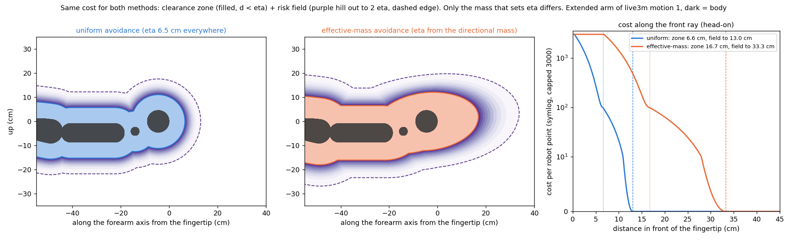
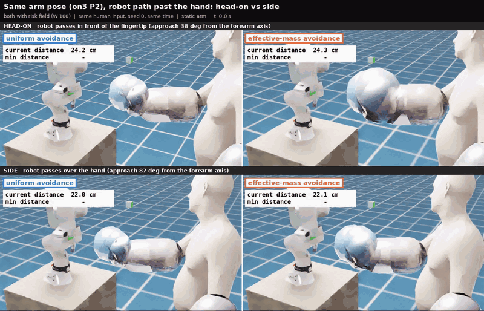
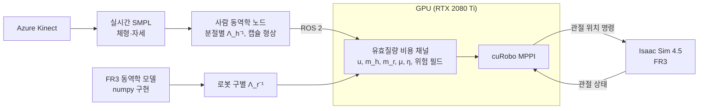

> **English summary.** Human-avoidance MPC (GPU MPPI) for a Franka FR3. Two methods are compared with the same MPC and the same cost: a clearance zone around each body part plus a risk field outside it. They differ only in the mass that sets the clearance. **Uniform avoidance** keeps 6.5 cm in every direction. **Effective-mass avoidance** makes the clearance larger where the human's directional effective mass is large (e.g., in front of an extended fingertip) and keeps 6.5 cm where it is small (e.g., above the hand or beside the arm). The risk field is a cost hill from the clearance boundary out to twice the clearance, so the robot starts to turn away before it reaches the boundary; its width follows each method's clearance.
>
> **Result.** On a real Azure Kinect recording replayed in Isaac Sim 4.5, with the robot passing head-on in front of the extended fingertip, effective-mass avoidance kept a minimum distance of 15.5 cm versus 8.1 cm for uniform avoidance and started to avoid at 19.1 versus 13.5 cm (elbow: 11.3 vs 7.8 cm; medians of 6 runs, both with the risk field). The difference is large head-on and small from the side (static arm: +4.1 to +5.2 cm head-on; −0.3 to +2.6 cm from the side in 6 of 7 side scenes). On the real FR3 only effective-mass avoidance was run (one person, a few runs); its minimum distance to the arm was 7.5 cm.
>
> **Status and limits.** The comparison is in simulation only. The robot path was set after the recording (one person, one recording). The repository does not run on its own: Isaac Sim, cuRobo, the SMPL model and the ROS 2 human-dynamics package are not included. Details: [analysis/field/README.md](analysis/field/README.md).

# effmass-mpc: 유효질량으로 이격 구역을 바꾸는 사람 회피 MPC

사람 근처를 지나는 로봇은 보통 몸 둘레에 같은 두께의 이격 구역을 둔다(**균일 회피**, 이 저장소에서는 6.5 cm). 이 저장소의 방법(**유효질량 회피**)은 이격 구역의 두께를 방향마다 다르게 정한다. 로봇이 부딪혔을 때 사람 몸이 무겁게 받아내는 방향(예: 편 팔의 손끝 정면. 팔 전체의 관성이 실린다)에서는 구역을 두껍게 하고, 가볍게 밀려나는 방향(예: 손 위, 팔 옆)에서는 균일 회피와 거의 같은 두께를 둔다. 무겁고 가벼움은 그 부위의 ISO/TS 15066 기준 질량과 비교해 정한다.

**두 방식의 차이는 이격 구역을 정하는 질량뿐이다.** 두 방식은 같은 MPC 와 같은 비용 구조(이격 구역 + **위험 필드**, 같은 W)를 쓴다. 위험 필드는 이격 구역 바깥에 둔 비용 언덕으로, 로봇이 구역 경계에 닿기 전부터 미리 돌아가게 한다. 필드의 폭은 각 방식의 구역 두께로 정해진다. 이 문서에서 **구역 두께**는 식이 정한 값이고, **간격**은 로봇이 실제로 가장 가까이 지나간 거리다.

Isaac Sim 의 Franka FR3 에서 두 방식을 비교했고, 실물 FR3 에서는 유효질량 회피를 시험하고 있다.


*같은 녹화, 같은 seed(0), 같은 시각. 로봇이 편 팔의 손끝 정면을 지나간다(head-on). 화면의 current / min distance 는 지금 간격과 그때까지 가장 작았던 간격이다.*

| 정면으로 지나갈 때 | 균일 회피 | 유효질량 회피 |
|---|---|---|
| 편 팔 손끝: 가장 가까운 간격 | 8.1 cm | 15.5 cm |
| 편 팔 손끝: 회피 시작 거리 | 13.5 cm | 19.1 cm |
| 팔꿈치: 가장 가까운 간격 | 7.8 cm | 11.3 cm |
| 팔꿈치: 회피 시작 거리 | 10.4 cm | 13.6 cm |
| 실물 설정(d_base 0.10 m): 손끝 / 팔꿈치 가장 가까운 간격 | 10.7 / 10.6 cm | 21.1 / 14.7 cm |

값은 방식마다 6회(seed 0·1·2 × 출발 A·B)의 중앙값이고, 두 방식 모두 위험 필드(W 100)를 썼다. 회피 시작 거리는 로봇 끝(TCP)이 사람 비용 없이 같은 길을 간 실행의 경로에서 3 cm 넘게 벗어나 0.2 s 이어진 첫 순간의 간격이다. 로봇의 길은 녹화 뒤에 정했다.

질량 효과는 정면에서 크고 옆에서 작다. 정지한 팔에서 로봇이 손끝 정면을 지나가면 유효질량 회피가 4.1–5.2 cm 더 멀고(장면 4개), 손 위나 팔 옆을 지나가면 차이가 −0.3 ~ +2.6 cm 다(장면 7개 중 6개, 예외는 [4절](#4-결과-요약)).

> ### [결과 상세 → analysis/field/README.md](analysis/field/README.md)
> 비용 모양 그림, 두 방식을 같은 입력·seed 로 비교한 예시(실제 녹화의 보정한 길, 정지한 팔 11개 장면의 정면·옆, 움직이는 손), 정면 대 옆 영상, 실물 설정 결과, 한계.

> ### [실제 Kinect 녹화로 본 손·팔꿈치 회피 (이전 판, 이격 구역만) → analysis/live/README.md](analysis/live/README.md)
> 위험 필드를 넣기 전의 비교. 길 보정, 처음 정한 길에서 차이가 작았던 이유, 구역 모양 그림, 세 화면 영상(컬러·균일 회피·유효질량 회피)이 있다.
>
> ### [시뮬레이션 결과 분석 전체 (이전 판, 이격 구역만) → analysis/README.md](analysis/README.md)
> 자세·방향별 구역, 정지한 팔 9개 장면, 움직이는 손, 건네기·가로지르기, 빠른 손과 움직임 예측, 카메라 지연·떨림·누락. 일부 그림·영상은 이전 식 결과이며, 각 항목에 표시했다.

> **이전 연구**
> - 석사 연구 [human-robot-safety-system](https://github.com/ukhyeon/human-robot-safety-system): SMPL 기반 개인별·방향별 사람 유효질량을 실시간으로 추정해 Indy7 의 충돌 위험 평가와 속도 조절에 적용했다. 이 저장소의 사람 유효질량 계산은 이 연구에서 이어진다.
> - [franka-depth-mppi](https://github.com/ukhyeon/franka-depth-mppi): Isaac Sim Franka 의 cuRobo MPPI 에 손 ROI 근접 비용을 더하고, 가정한 손 유효질량에 따라 활성 거리를 바꿔 비교했다. 이 저장소의 비용 채널 구조는 이 프로젝트에서 이어진다.

## 1. 목표

- 사람의 체형, 자세, 충돌 방향에 따라 달라지는 유효질량으로 이격 구역의 모양을 바꾸는 사람 회피 MPC를 Isaac Sim에서 설계하고, 실물 Franka FR3에 적용한다.
- 비교 기준은 **균일 회피**(사람의 질량 정보를 쓰지 않고 모든 부위·방향에 같은 두께의 구역을 두는 방식)이며, 유효질량 회피와 같은 MPC, 같은 비용 구조(이격 구역 + 위험 필드)에서 비교한다.
- 논문용 통계보다 "이격 구역의 모양 차이를 한눈에 보이게" 하는 것을 우선한다.

## 2. 핵심 아이디어

**설계 질문: 로봇이 사람의 어느 부위에 어느 방향으로 접근하느냐에 따라 충돌 시 유효질량이 다를 때, 그 방향으로 얼마만큼의 간격을 두어야 하는가?**

로봇이 어느 방향에서 부딪히느냐에 따라 사람 몸이 받아내는 질량(유효질량)이 다르다. 팔 길이 방향으로 손끝을 밀면 팔 전체가 실려 무겁고, 손을 위에서 누르거나 팔을 옆에서 치면 그 부위만 밀려나 가볍다. 유효질량 회피는 무거운 방향일수록 구역을 두껍게 하고, 가벼운 방향에서는 기본 두께만 둔다.

이격 구역의 두께(cm): 몸 표면에서 구역 경계까지, 녹화된 세 자세

| 방식, 자세 | 손끝(팔꿈치) 앞 | 위쪽 |
|---|---|---|
| 균일 회피 (세 자세 모두) | 6.6 | 6.6 |
| 유효질량 회피, 편 팔 | 16.7 | 7.4 |
| 유효질량 회피, 굽힌 손 | 11.2 | 7.5 |
| 유효질량 회피, 팔꿈치 내밀기 | 10.0 | 7.8 |

같은 부위라도 앞쪽은 두껍고 위쪽은 균일 회피와 거의 같다.

- 균일 회피의 구역 두께는 6.5 cm 다. 표의 6.6 은 두께를 1 mm 간격으로 재면서 구역 경계를 처음 넘은 점을 적은 값이다.
- 두께는 로봇을 4.6 kg 의 점으로 놓고 계산했다.
- 자세가 달라 값이 다르다: 여기 16.7 cm 는 녹화된 편 팔이고, [analysis/README.md 2-1](analysis/README.md#2-1-같은-손에서-방향별-두께) 의 20.0 cm 는 앞으로 뻗은 정지 자세다.


*녹화된 편 팔의 구역 단면. 그림 제목의 per-part = 유효질량 회피.*


*앞으로 뻗은 정지 자세의 구역 표면. 그림 제목의 proposed (per-part reference) = 유효질량 회피.*

충돌 방향 u 는 로봇 구 중심에서 사람 형상의 가장 가까운 점을 향하는 방향이다. 이 방향으로 사람 분절의 유효질량 m_h, 로봇 구 위치의 유효질량 m_r 을 구하고, 둘을 묶은 환산질량 μ 로 그 쌍의 구역 두께 η 를 정한다.

```
m_h = 1 / (uᵀ Λ_h⁻¹ u)        Λ_h⁻¹ : 사람 분절의 3x3 작업공간 역관성 (SMPL 체형·자세에서 계산)
m_r = 1 / (uᵀ Λ_r⁻¹ u)        Λ_r⁻¹ : 로봇 구 중심의 3x3 작업공간 역관성 (FR3 모델)
μ   = 1 / (uᵀ Λ_h⁻¹ u + uᵀ Λ_r⁻¹ u)
μ_iso = 1 / (1 / m_iso(부위) + 1 / m_r)      m_iso : ISO/TS 15066 의 부위별 기준 질량

η = clamp( d_base + k_gain · max( sqrt(μ / μ_iso) − 1, 0 ),  d_base,  η_max )
```

| 매개변수 | 기본값 | 뜻 |
|---|---|---|
| d_base | 0.065 m | 기본 두께 (균일 회피의 구역 두께와 같음) |
| k_gain | 0.10 m | 질량 이득. **k_gain = 0 이면 균일 회피와 같다** |
| μ_iso | 부위별 | 그 부위가 혼자 부딪힐 때의 환산질량. 이보다 가벼운 충돌은 기본 두께만 둔다 |
| η_max | 0.25 m | 두께 상한 |

MPPI 비용은 두 방식에 같다. rollout 의 각 시점에서 (로봇 구, 사람 형상) 쌍마다 간격 d 로 이격 구역 비용과 위험 필드를 더하고, 그 시점의 최댓값을 더한다.

```
이격 구역  c_zone  = w · (η − d)² / (2η)        (0 ≤ d < η),   w · (η/2 − d)  (d < 0),   0  (d ≥ η)
위험 필드  c_field = W · (1 − (d − η) / η)²     (η ≤ d < 2η),  W  (d < η),                0  (d ≥ 2η)
```

| 매개변수 | 기본값 | 뜻 |
|---|---|---|
| w | 1e5 | 이격 구역 비용의 가중치 |
| W | 100 | 위험 필드 높이(w 와 같은 비용 단위). 두 방식에 같은 값 |

위험 필드는 두 방식을 가르는 변수가 아니라 두 방식에 공통인 제어기 설계다. 구역 경계 전부터 비용이 생겨서 로봇이 미리 돌아간다. 필드 폭은 그 방향의 구역 두께 η 와 같아서, 유효질량 회피에서는 질량이 큰 방향일수록 더 멀리서부터, 균일 회피에서는 모든 방향에서 d_base ~ 2 d_base 에 비용이 생긴다. 균일 회피의 구역 두께 6.5 cm 는 유효질량 회피의 기본 두께 d_base 와 같다(V1 단계에서 정한 기본값. k_gain = 0 인 유효질량 회피가 곧 균일 회피다). 사람 근처(형상 기준 0.4 m 안)에서는 로봇 구 속도 상한 0.5 m/s 비용을 함께 쓴다.



*녹화된 편 팔 자세의 아래팔 축 단면. 왼쪽 균일 회피, 가운데 유효질량 회피, 채운 영역 = 이격 구역(d < η), 보라색 = 위험 필드(점선까지, d = 2η), 오른쪽 = 손끝 정면 방향의 비용. 손끝 정면에서 구역은 6.6 / 16.7 cm, 필드는 13.0 / 33.3 cm 까지 닿는다.*

> **이전 판 (이격 구역만, 2026-11-19 까지).** 위험 필드 없이 구역 안(d < η)에서만 비용을 주었다(W = 0 과 같다). (용어: 이 저장소에서 "이전 판"은 위험 필드가 없는 판이고, [analysis/README.md](analysis/README.md) 의 "이전 식"은 모든 부위에 같은 기준 질량 0.53 kg 을 쓴 더 앞의 구역 식이다.) 같은 녹화의 보정한 길에서 편 팔 손끝 균일 5.8 / 유효질량 13.5 cm, 팔꿈치 5.6 / 8.8 cm 였다. 이 판의 분석과 영상은 [analysis/README.md](analysis/README.md), [analysis/live/README.md](analysis/live/README.md) 에 그대로 있다.

## 3. 현재 단계 (갱신: 2026-11-21)

| 단계 | 상태 |
|---|---|
| 유효질량을 MPC 비용으로 구현 | 완료 |
| 정지한 사람 형상에서 방향 효과 확인 | 완료 |
| 움직이는 손, 협업 동작, 카메라 결함(합성) 시험 | 완료 (일부는 이전 식) |
| 실제 Kinect 녹화로 비교 (가상 로봇) | 완료 (편 팔 손끝, 팔꿈치) |
| 실물 연결 준비 (60 → 1000 Hz 잇기, 안전 장치) | 완료 |
| 위험 필드(두 방식 공통 비용)를 넣고 시뮬 비교 다시 만들기 | 완료 |
| 실물 FR3 적용 (유효질량 회피) | 진행 중 (사람 한 명, 실행 몇 번) |

단계별 확인 내용과 근거 로그는 [docs/progress.md](docs/progress.md) 에 있다.

## 4. 결과 요약

두 방식 모두 위험 필드(W 100)를 쓰고, 같은 입력·seed 로 비교했다. 값은 가장 가까운 간격의 중앙값(cm)이다. 자세한 표와 그림: [analysis/field/README.md](analysis/field/README.md)

| 예시 | 접근 방향 | 균일 회피 | 유효질량 회피 | 차이 |
|---|---|---|---|---|
| 실제 녹화, 보정한 길, 편 팔 손끝 (6회) | 정면 | 8.1 | 15.5 | +7.4 |
| 실제 녹화, 보정한 길, 팔꿈치 (6회) | 정면 | 7.8 | 11.3 | +3.5 |
| 정지한 팔, 손끝 정면 (장면 4개, 각 3회) | 정면 | 8.9 – 10.5 | 13.4 – 14.6 | +4.1 ~ +5.2 |
| 정지한 팔, 손 위·팔 옆 (장면 7개, 각 3회) | 옆 | 4.5 – 10.3 | 8.5 – 11.9 | −0.3 ~ +2.6, V2 손 위만 +4.0 |
| 움직이는 손 0.25 / 0.5 / 1.0 m/s (각 3회) | | 5.8 / 5.2 / 2.2 | 9.1 / 6.9 / 4.6 | +3.3 / +1.7 / +2.4 |
| 실물 설정(d_base 0.10 m), 보정한 길 손끝 / 팔꿈치 (각 6회) | 정면 | 10.7 / 10.6 | 21.1 / 14.7 | +10.4 / +4.1 |


- 접근 방향은 데이터로 정했다. 가장 가까울 때 로봇이 있는 방향과 아래팔 축이 이루는 각이 45° 미만이면 정면, 이상이면 옆이다(정지한 팔: 사람 비용 없는 실행 또는 균일 회피 실행의 seed 3개 중앙값). 장면 이름이 "손끝 앞"인 P3 는 49° 라 옆으로 셌다. 보정한 길은 사람 비용 없는 실행에서 손끝 15–23°, 팔꿈치 1–15°(위팔 축 기준)였다.
- V2 손 위만 옆인데도 +4.0 cm 다. 끝점이 손 바로 위라 유효질량 회피는 seed 3개 중 2개가 끝점 앞에서 멈췄다(5절 9번).
- 모든 실행에서 겹침 0 스텝, 실행 불가능 0 스텝이다.



*같은 팔 자세, 같은 seed(0). 위 줄은 로봇이 손끝 정면을 지나가고(38°), 아래 줄은 손 위를 지나간다(87°). 가장 가까운 간격은 정면 9.1 / 15.1 cm, 옆 8.6 / 10.3 cm 다.*

**실물 FR3 에서 제안 방법의 동작 (2026-11-20).** 실물에서는 유효질량 회피만 돌렸다(d_base 0.10 m, W 100). 실물에서 균일 회피와 비교하지는 않았다. 실물 실행 real_ym_1120_202059 에서 사람 팔과의 가장 가까운 간격은 7.5 cm 였고, 간격이 10 cm 미만인 스텝은 34개, 끝점 도착은 4번이었다. 사람 한 명, 실행 몇 번의 결과다.

## 5. 한계와 주의

1. **실제 녹화 비교의 길은 녹화 뒤에 정했다.** 보정한 길도 마찬가지다. 가상 로봇 베이스의 위치를 동작마다 옮겼다. 길 보정 비교는 자세가 유지되는 3~4초 구간에서만 쟀고, 굽힌 손 동작은 조건을 만들지 못했다. 녹화된 사람은 로봇에 반응하지 않고, 비교 영상의 Isaac 화면은 실행 기록으로 다시 그린 것이다. 실시간 실행 당시에는 화면이 실제의 약 0.6배로 흘렀다.
2. **빠른 손 + 지연은 미해결.** 손이 1.0 m/s 로 움직이고 지연 100 ms 가 겹치면, 유효질량 회피가 균일 회피보다 낫다는 것이 확인되지 않았다(이전 식 결과).
3. **가로지르기 0.5 m/s 에서 유효질량 회피의 이점이 없다.** 아래팔 쪽에서 다가오는 장면이라 구역이 균일 회피와 비슷하다(이전 판 결과, 최소 간격 0.2~1.2 대 0.0~1.2 cm).
4. **카메라 결함 결과는 이전 식, 대부분 seed 1개, 합성 잡음 기준이다.**
5. **속도 상한 0.5 m/s 는 설계값이며 규격 적합 주장이 아니다.** 충돌력 측정과 규격 검증은 범위 밖이다.
6. **실물에서는 유효질량 회피만 돌렸다(사람 한 명, 실행 몇 번).** 두 방식의 비교는 시뮬에서만 했다. 실제 녹화 비교는 사람 한 명의 녹화 한 번이다.
7. **구역이 두꺼워도 실제 간격은 그보다 작을 수 있다.** 로봇은 구역이 얇은 쪽(비스듬한 쪽, 위쪽)으로 비켜 지나간다. 실제 녹화의 손끝 동작에서도 처음 정한 길에서는 가장 가까운 방향이 대부분 손 위쪽이어서 차이가 정지 장면보다 작았다.
8. **구역 그림과 두께는 로봇을 4.6 kg 의 점으로 놓고 계산했다.**
9. **위험 필드는 길을 늘이고, 끝점이 필드 안에 있으면 끝점 앞에서 멈출 수 있다.** 정지한 팔 손 위 장면(V2)에서 유효질량 회피는 seed 3개 중 2개가 끝점 1.5–2.7 cm 앞에서 섰다. 팔꿈치 보정한 길에서 한 번 지나가는 시간은 균일 회피 1.92 s, 유효질량 회피 2.93 s 였다.
10. **W 100 은 실물 기록 재생에서 정했고, 두 방식에 같은 값을 쓴다.** 시뮬에서는 겹침·실행 불가능·통과 횟수 감소가 없어 그대로 썼다. 공개 예시는 실행 노드를 바꾸지 않고 시작할 때 위험 필드를 켜는 실행기 [analysis/field/tools/step2b_mpc_isaac_field.py](analysis/field/tools/step2b_mpc_isaac_field.py) 로 돌렸고, 같은 실행기로 재현한다.

## 6. 시스템 구성



## 7. 실행 환경과 필요한 것

**이 저장소만으로는 실행이 재현되지 않는다.** 아래 구성 요소가 저장소에 들어 있지 않다.

| 필요한 것 | 비고 |
|---|---|
| Ubuntu 22.04, NVIDIA GPU (개발 환경: RTX 2080 Ti) | |
| Isaac Sim 4.5 | 별도 설치 |
| GPU MPPI 라이브러리: cuRobo | 별도 설치 (NVIDIA 라이선스). Isaac Sim 4.5 지원 버전 사용 |
| NVIDIA Warp | 비용 채널 커널 |
| SMPL / SMPL-H 모델 | **라이선스상 미포함.** 공식 사이트에서 직접 내려받아야 한다 |
| ROS 2 Humble | 사람 동역학 노드 |
| Pinocchio | 로봇 유효질량 계산 검증 (MPC 루프 안에서는 numpy 구현 사용) |
| 사람 동역학 노드(ROS 2 패키지) | 미포함 (아래 "미포함 항목" 참고) |

`env_check/scripts/`, `goal1/scripts/` 의 스크립트는 개발 환경의 폴더 배치(절대 경로 포함)를 가정한다. 로그 파일에도 개발 환경의 경로가 남아 있다.

## 8. 저장소 구조

| 경로 | 설명 |
|---|---|
| `env_check/scripts/` | MPC 실행 노드(`step2b_mpc_isaac.py`, Isaac Sim 안에서 MPPI 실행), 장면·실행 스크립트, 환경 점검 단계 스크립트 |
| `goal1/scripts/` | 실험 실행 래퍼, 유효질량 비용 채널(`g1_meff_gpu.py`), 분석·그림·영상 합성 스크립트 |
| `goal1/config/` | T 단계 조정 결과 프로파일 (`tuned_t1.yml`), 시험용 변형 프로파일 |
| `goal1/scene_g1.json`, `goal1/b2a/g2/scene_*.json` | 장면 정의 (목표 자세, 경로 끝점, 시작 관절값) |
| `goal1/logs/*.json` | 1-2 검증 로그 (사람·로봇 유효질량, FR3 모델 점검) |
| `goal1/logs/meff_isaac/` | 요약 로그 json (1-2d, 1-3, B2a-4, B2a-5, T, V1, V2, R1, 이후 시험 `on_wp*`) |
| `goal1/b2a/b2a5_fig*.png` | B2a-5 그림 |
| `goal1/zone/*.png` | 구역 그림 (V1, V2, 이전 식) |
| `goal1/r1/*.png`, `goal1/overnight/` | R1 그림, 이후 시험의 그림과 작업 기록 (`REPORT.md`, `DECISIONS.md`) |
| `analysis/` | 결과 분석 문서, 그림·영상 사본 |
| `analysis/live/` | 이전 판(이격 구역만)의 실제 Kinect 녹화 비교 글, 그림, 세 화면 영상 |
| `analysis/field/` | 지금 판(이격 구역 + 위험 필드)의 두 방식 비교 글, 그림, 두 화면 영상 |
| `goal1/live/live3m/` | 녹화 live3m 의 비교 결과(표 json, 그림, 영상). `corrected/` 는 길 보정 비교의 보고서와 요약. 원본 컬러 프레임과 사람 자세 자료는 미포함 |
| `goal1/part_regen/` | 기준 질량을 부위별로 바꾼 식의 재실행 요약과 그림 |
| `goal1/public_draft/` | 이번 공개 갱신의 처리표, 바뀐 숫자 목록, 점검 기록 |
| `goal1/overnight2/` | 실물 연결 준비 기록(계산 시간, 60 → 1000 Hz 잇기 모의 시험, 안전 장치, 표면 점 유효질량) |
| `goal1/step1_2_report.md`, `goal1/step1_3_report.md` | 단계별 작업 기록 (작성 당시 원문 유지) |
| `media/` | 이전 대표 GIF 와 원본 mp4 (V2, 이전 식) |
| `docs/` | 단계별 진행 기록, 커밋 규칙 |

## 9. 문서

- 연구일지: https://app.notion.com/p/MPC-Franka-41afcf2876fa80ceb6fffa02d7205a02
- 전체 계획: https://app.notion.com/p/419fcf2876fa806593b9d49d7d07a0ce
- Franka ROS 2 세팅: https://app.notion.com/p/Franka-ROS-2-41bfcf2876fa805f9f9fc1dea7914fd1

## 10. 미포함 항목과 이유

| 항목 | 이유 |
|---|---|
| SMPL / SMPL-H 모델 파일 | 모델 라이선스상 재배포 불가 |
| 사람 데이터 (Kinect 원본 컬러 프레임, Kinect 녹화에서 나온 자세·위치, 메시 정점, SMPL 매개변수가 든 npz, 구역 메시 npz) | 개인 데이터와 SMPL 파생 데이터 |
| cuRobo, Isaac Sim, CUDA, Franka 설명 파일·USD 등 타사 코드와 로봇 에셋 | 각 원저작자 배포본을 써야 함 |
| 사람 동역학 ROS 2 패키지 (`ws/`) | 기존 연구실 코드에 기반한 파일이 포함되어 공개 범위 검토 중 |
| ISO/TS 15066 수치 파일 | 규격 문서의 수치를 담고 있어 공개 범위 검토 중 |
| 가상환경, 캐시, 프레임·녹화 폴더, 25 MB 넘는 영상 | 다시 만들 수 있거나 용량이 큼 |

## 11. 참고문헌

1. ISO/TS 15066:2016, Robots and robotic devices - Collaborative robots.
2. G. Williams et al., "Information theoretic MPC for model-based reinforcement learning," ICRA, 2017.
3. B. Sundaralingam et al., "cuRobo: Parallelized collision-free minimum-jerk robot motion generation," arXiv:2310.17274, 2023.
4. M. Loper et al., "SMPL: A skinned multi-person linear model," ACM Trans. Graphics, vol. 34, no. 6, 2015.
5. D. Kulic and E. A. Croft, "Real-time safety for human-robot interaction," Robotics and Autonomous Systems, vol. 54, no. 1, 2006.
