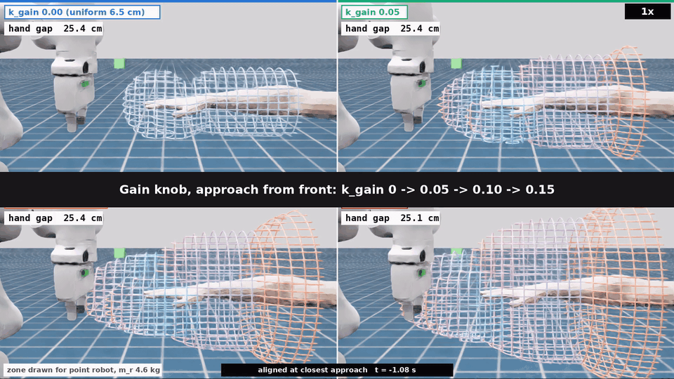
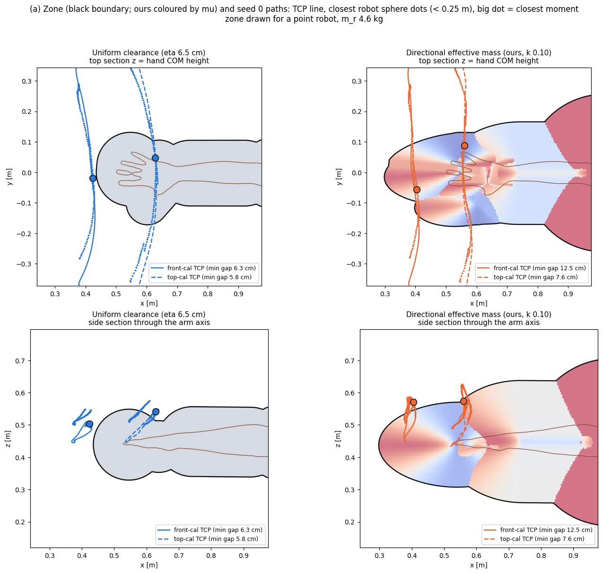
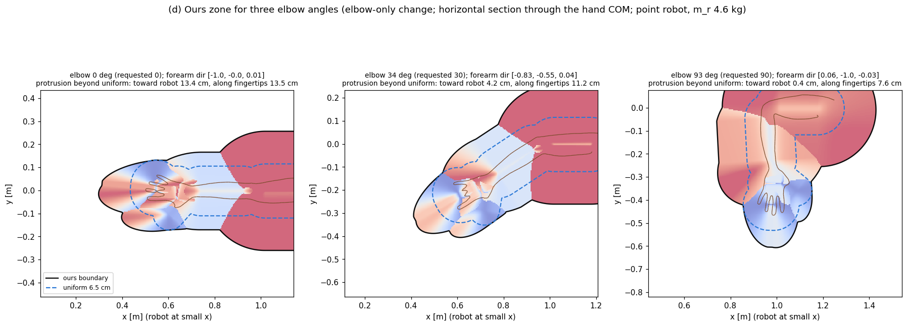
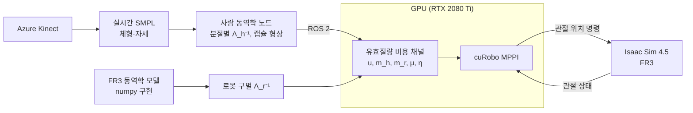

> **English summary.** Human-avoidance MPC for a Franka FR3 in which the avoidance zone around each body part changes shape with the directional effective mass of the human (body shape, posture, collision direction), compared against uniform avoidance under the same settings.
> Pipeline: Azure Kinect + real-time SMPL → per-segment directional effective mass → reduced mass μ → GPU MPPI cost → FR3 in Isaac Sim 4.5. This tag (`v0.1-static`) covers the static-pose stages up to the V2 demo.
> This repository is a learning/engineering log, not a statistical claim; it does not run on its own (Isaac Sim, cuRobo, SMPL model and the ROS 2 human-dynamics package are not included).

# effmass-mpc: 유효질량으로 회피 구역을 바꾸는 사람 회피 MPC

사람의 체형·자세·충돌 방향에 따라 달라지는 유효질량으로 회피 구역의 모양을 바꾸는 MPC를 Isaac Sim의 Franka FR3에서 설계하고 있다.


*왼쪽: 균일 회피 (η 6.5 cm 고정), 오른쪽: 제안 (k_gain 0.10). 위 줄 = 정면 접근, 아래 줄 = 위 접근. 같은 장면·같은 MPC 설정·seed 0. 원본 영상: [media/v2_main.mp4](media/v2_main.mp4)*

## 1. 최종 목표

- 사람의 체형, 자세, 충돌 방향에 따라 달라지는 유효질량으로 회피 구역의 모양을 바꾸는 사람 회피 MPC를 Isaac Sim에서 설계하고, 실물 Franka FR3에 적용한다.
- 논문용 통계 입증보다 제어를 익히고 시뮬레이션과 실물에 적용하는 것이 목적이다.
- 비교 대상은 하나다: **균일 회피**(사람의 질량을 모르는 기존 방식, 모든 부위·방향에 같은 간격) 대 **제안**.

## 2. 핵심 아이디어

**식이 답하는 질문: 로봇이 사람의 이 부위에 이 방향으로 부딪힌다면, 그 충돌이 얼마나 "무거운" 충돌인가에 맞춰 얼마나 더 떨어져 지나가야 하는가?**

충돌 방향 u 는 로봇 구 중심에서 사람 형상의 가장 가까운 점을 향하는 방향이다. 이 방향으로 사람 분절의 유효질량 m_h, 로봇 구 위치의 유효질량 m_r 을 구하고, 둘을 묶은 환산질량 μ 로 그 쌍의 회피 간격 η 를 정한다.

```
m_h = 1 / (uᵀ Λ_h⁻¹ u)        Λ_h⁻¹ : 사람 분절의 3x3 작업공간 역관성 (SMPL 체형·자세에서 계산)
m_r = 1 / (uᵀ Λ_r⁻¹ u)        Λ_r⁻¹ : 로봇 구 중심의 3x3 작업공간 역관성 (FR3 모델)
μ   = 1 / (uᵀ Λ_h⁻¹ u + uᵀ Λ_r⁻¹ u)

η = clamp( d_base + k_gain · max( sqrt(μ / μ_ref) − 1, 0 ),  d_base,  η_max )
```

| 매개변수 | 기본값 | 뜻 |
|---|---|---|
| d_base | 0.065 m | 기본 간격 (균일 회피의 간격과 같음) |
| k_gain | 0.10 m | 질량 이득. 설계자가 정하는 손잡이. **k_gain = 0 이면 균일 회피와 같다** |
| μ_ref | 0.53 kg | 이보다 가벼운 충돌은 기본 간격만 둔다 |
| η_max | 0.25 m | 간격 상한 |

MPPI 비용은 rollout 의 각 시점에서 (로봇 구, 사람 형상) 쌍마다 간격 d 가 η 보다 작으면 벌점을 주고(d < η 구간에서 (η − d)²/(2η), 겹치면 선형), 그 시점의 최댓값을 더한다. 사람 근처(형상 기준 0.4 m 안)에서는 로봇 구 속도 상한 0.5 m/s 비용을 함께 쓴다 (T 단계).

같은 손이라도 방향에 따라 구역 두께가 달라진다. 아래 값은 점 로봇(m_r 4.6 kg)으로 그린 구역의 팔 표면 법선 방향 두께다 (`goal1/logs/meff_isaac/v2_thickness.json`).

| 방향 | 균일 | 제안 (k_gain 0.10) |
|---|---|---|
| 손 정면 (0°) | 6.6 cm | 20.0 cm |
| 정면-위 45° | 6.5 cm | 11.7 cm |
| 손등 위 (90°) | 6.6 cm | 8.7 cm |
| 바깥 옆 (90°) | 6.6 cm | 6.6 cm |
| 손바닥 아래 (90°) | 6.6 cm | 8.7 cm |
| 아래팔 위 | 6.6 cm | 14.6 cm |
| 아래팔 바깥 옆 | 6.6 cm | 19.6 cm |


*구역 표면. 왼쪽부터 균일 η 6.5 cm, 균일 η 16.5 cm, 제안(색 = μ, 파랑 0.5 kg → 빨강 3.0 kg).*


*수평·수직 단면에서 본 구역 경계. 파란 점선 = 균일 η 6.5 cm, 주황 실선 = 제안.*

## 3. 현재 단계 (갱신: 2026-11-17)

| 단계 | 내용 | 상태 |
|---|---|---|
| 1-2 | 유효질량을 MPC에 공급 | 완료 |
| 1-3 | 비용 구현 | 완료 |
| B2a | 정지 자세에서 방향 효과 확인 | 완료 |
| T | 사람 근처 속도 상한 0.5 m/s 와 조정 | 완료 |
| V1 | 기본 간격 + 질량 이득 식 | 완료 |
| V2 | 정적 시연과 이득 손잡이 | 완료 |
| R1 | 움직이는 손 재생 | 진행 중 |
| R2 | 실시간 Kinect + 가상 Franka | 예정 |
| R3 | 계산 분담 재측정 | 예정 |
| G2 | 실물 FR3 적용 | 예정 |
| 병렬 | 제어용 PC에서 franka_ros2 세팅 | 진행 중 |

단계별 확인 내용과 근거 로그는 [docs/progress.md](docs/progress.md) 에 있다.

## 4. 정적 단계 결과 (V2)

장면: 앞으로 뻗은 오른팔(정지 자세) 근처를 로봇이 A 에서 B 로 한 번 지나간다. "정면" 은 손끝 앞을 가로지르는 경로, "위" 는 손 위를 가로지르는 경로다. 균일 대 제안, 같은 설정 (같은 장면, 같은 MPC 설정, 같은 속도 상한 프로파일 t1, 같은 seed 0·1·2). 간격 = 지나가는 동안 로봇 구와 손 사이 최소 간격.

**표 1. 조건별 손 최소 간격 (seed 3개 평균, 괄호 = seed 범위)**

| 장면 | 균일 (η 6.5 cm) 형상 기준 | 제안 (k_gain 0.10) 형상 기준 | 균일 메시 기준 | 제안 메시 기준 |
|---|---|---|---|---|
| 정면 접근 | 6.0 cm (5.3~6.3) | 12.0 cm (11.4~12.5) | 6.0 cm | 12.7 cm |
| 위 접근 | 5.4 cm (4.8~5.8) | 8.2 cm (7.6~8.9) | 4.8 cm | 10.5 cm |
| 방향 대비 (정면 − 위) | +0.5 cm | +3.8 cm | +1.2 cm | +2.2 cm |

- 형상 기준 = MPC 가 쓰는 캡슐 형상까지의 간격, 메시 기준 = SMPL 메시까지의 간격.
- 모든 실행이 목표에 도달했고 infeasible 은 0 이다. 사람 근처 로봇 속도 p99 는 0.45~0.52 m/s.
- 근거: `goal1/logs/meff_isaac/v2_summary.json` (`by_scene_cond`, `front_minus_top`), `v2_runs.json`.

**표 2. 이득 손잡이 (정면 접근, seed 0, 나머지 설정 같음)**

| k_gain | 최소 간격 순간의 η | 손 최소 간격 (형상) | 손 최소 간격 (메시) | 지나간 쪽 |
|---|---|---|---|---|
| 0 (= 균일) | 6.5 cm | 6.3 cm | 6.3 cm | 손 정면 |
| 0.05 | 10.4 cm | 9.7 cm | 10.2 cm | 손 정면 |
| 0.10 (기본) | 12.4 cm | 12.5 cm | 13.3 cm | 손 정면 |
| 0.15 | 14.4 cm | 13.5 cm | 14.5 cm | 손 위로 넘어감 |

근거: `goal1/logs/meff_isaac/v2_summary.json` (`gain_knob`). 영상: [media/v2_gain_knob.gif](media/v2_gain_knob.gif) ([mp4](media/v2_gain_knob.mp4)).





*구역(검은 경계, 제안은 μ 로 색칠)과 seed 0 의 TCP 경로. 큰 점 = 최소 간격 순간.*




*팔꿈치만 0°/34°/93° 로 바꾼 자세의 제안 구역(수평 단면). 균일 대비 로봇 쪽으로 더 나온 길이 13.4 / 4.2 / 0.4 cm, 손끝 방향 13.5 / 11.2 / 7.6 cm (`v2_posture.json`). 이 그림은 구역 계산이며 MPC 실행이 아니다.*

## 5. 한계와 주의

1. 정면 구역은 20 cm 인데 실제 간격은 12 cm 다. 로봇이 구역이 얇은 쪽(u 각 약 43도)으로 비켜 지나가기 때문이다.
2. k_gain 0.15 에서는 로봇이 손 위로 넘어가는 길로 바꿔 간격 증가가 포화된다.
3. 손등 위 장면에서 제안의 간격이 늘어난 것은 손이 아니라 전완 구역 때문이다.
4. 메시 기준으로는 방향 대비가 형상 기준보다 작다.
5. 속도 상한 0.5 m/s 는 설계값이며 규격 적합 주장이 아니다. 충돌력 측정과 규격 검증은 범위 밖이다.

그 밖에: 정적 단계 결과는 정지 자세 하나와 seed 3개에서 얻은 것이다. 통계적 일반화를 주장하지 않는다.

## 6. 시스템 구성



정적 단계(B2a~V2)에서는 Kinect 대신 미리 계산한 정지 자세를 넣었다. 실시간 Kinect 입력은 R2 단계에서 한다.

## 7. 실행 환경과 필요한 것

**이 저장소만으로는 실행이 재현되지 않는다.** 아래 구성 요소가 저장소에 들어 있지 않다.

| 필요한 것 | 비고 |
|---|---|
| Ubuntu 22.04, NVIDIA GPU (작성 PC: RTX 2080 Ti) | |
| Isaac Sim 4.5 | 별도 설치 |
| GPU MPPI 라이브러리: cuRobo | 별도 설치 (NVIDIA 라이선스). Isaac Sim 4.5 지원 버전 사용 |
| NVIDIA Warp | 비용 채널 커널 |
| SMPL / SMPL-H 모델 | **라이선스상 미포함.** 공식 사이트에서 직접 내려받아야 한다 |
| ROS 2 Humble | 사람 동역학 노드 |
| Pinocchio | 로봇 유효질량 계산 검증 (MPC 루프 안에서는 numpy 구현 사용) |
| 사람 동역학 노드(ROS 2 패키지) | 미포함 (아래 "미포함 항목" 참고) |

`goal1/scripts/` 의 스크립트는 작성 당시 PC 의 폴더 배치(절대 경로 포함)를 가정한다. 로그 파일에도 당시 경로가 남아 있다.

## 8. 저장소 구조

| 경로 | 설명 |
|---|---|
| `env_check/scripts/` | MPC 실행 노드(`step2b_mpc_isaac.py`, Isaac Sim 안에서 MPPI 실행), 장면·실행 스크립트, 환경 점검 단계 스크립트 |
| `goal1/scripts/` | 실험 실행 래퍼, 유효질량 비용 채널(`g1_meff_gpu.py`), 분석·그림·영상 합성 스크립트 |
| `goal1/config/` | T 단계 조정 결과 프로파일 (`tuned_t1.yml`) |
| `goal1/scene_g1.json`, `goal1/b2a/g2/scene_*.json` | 장면 정의 (목표 자세, 경로 끝점, 시작 관절값) |
| `goal1/logs/*.json` | 1-2 검증 로그 (사람·로봇 유효질량, FR3 모델 점검) |
| `goal1/logs/meff_isaac/` | 요약 로그 json (1-2d, 1-3, B2a-4, B2a-5, T, V1, V2) |
| `goal1/b2a/b2a5_fig*.png` | B2a-5 그림 |
| `goal1/zone/*.png` | 구역 그림 (V1, V2) |
| `goal1/step1_2_report.md`, `goal1/step1_3_report.md` | 단계 작업 기록 (당시 그대로, 한국어·영어 혼용) |
| `media/` | 대표 GIF 와 원본 mp4 |
| `docs/` | 단계별 진행 기록, 커밋 규칙 |

## 9. 문서

- 연구일지: https://app.notion.com/p/MPC-Franka-41afcf2876fa80ceb6fffa02d7205a02
- 전체 계획: https://app.notion.com/p/419fcf2876fa806593b9d49d7d07a0ce
- Franka ROS 2 세팅: https://app.notion.com/p/Franka-ROS-2-41bfcf2876fa805f9f9fc1dea7914fd1

## 10. 미포함 항목과 이유

| 항목 | 이유 |
|---|---|
| SMPL / SMPL-H 모델 파일 | 모델 라이선스상 재배포 불가 |
| 사람 데이터 (Kinect 녹화에서 나온 자세·위치, 메시 정점, SMPL 매개변수가 든 npz, 구역 메시 npz) | 개인 데이터와 SMPL 파생 데이터 |
| cuRobo, Isaac Sim, CUDA, Franka 설명 파일·USD 등 타사 코드와 로봇 에셋 | 각 원저작자 배포본을 써야 함 |
| 사람 동역학 ROS 2 패키지 (`ws/`) | 연구실 코드를 복사·수정한 파일이 들어 있어 공개 여부를 따로 정해야 함 |
| ISO/TS 15066 수치 파일 | 규격 문서의 수치라 공개 여부를 따로 정함 |
| 가상환경, 캐시, 프레임·녹화 폴더, 25 MB 넘는 영상 | 재생성 가능하거나 용량이 큼 |
| R1 단계 산출물 | 진행 중 |

## 11. 참고문헌

1. ISO/TS 15066:2016, Robots and robotic devices - Collaborative robots.
2. G. Williams et al., "Information theoretic MPC for model-based reinforcement learning," ICRA, 2017.
3. B. Sundaralingam et al., "cuRobo: Parallelized collision-free minimum-jerk robot motion generation," arXiv:2310.17274, 2023.
4. M. Loper et al., "SMPL: A skinned multi-person linear model," ACM Trans. Graphics, vol. 34, no. 6, 2015.
5. D. Kulic and E. A. Croft, "Real-time safety for human-robot interaction," Robotics and Autonomous Systems, vol. 54, no. 1, 2006.
