# 결과 분석: 유효질량으로 회피 구역을 바꾸는 사람 회피 MPC

이 문서는 시뮬레이션 결과를 질문별로 모은 것이다. 비교는 모두 **균일 대 제안, 같은 설정**이다. 같은 장면, 같은 MPC 설정, 같은 seed 로 돌렸고, 다른 것은 회피 구역을 정하는 식뿐이다.
모든 결과는 Isaac Sim 4.5 의 Franka FR3 와, 미리 계산해 재생한 사람 데이터로 얻었다. 실제 사람과 실물 로봇 결과는 아직 없다.

목차
1. [읽는 법](#1-읽는-법)
2. [자세와 방향에 따라 구역이 어떻게 달라지나](#2-자세와-방향에-따라-구역이-어떻게-달라지나)
3. [가만히 있는 팔 옆을 지나갈 때](#3-가만히-있는-팔-옆을-지나갈-때)
4. [손이 움직일 때](#4-손이-움직일-때)
5. [협업 동작: 건네기, 가로지르기](#5-협업-동작-건네기-가로지르기)
6. [손이 빠를 때와 움직임 예측](#6-손이-빠를-때와-움직임-예측)
7. [카메라가 불완전할 때: 지연, 떨림, 누락](#7-카메라가-불완전할-때-지연-떨림-누락)
8. [한계와 주의](#8-한계와-주의)
9. [설정과 근거 파일, 내부 이름 대응표](#9-설정과-근거-파일-내부-이름-대응표)

---

## 1. 읽는 법

- **MPC(모델 예측 제어)**: 로봇이 앞으로의 짧은 시간 동안 움직임 후보를 여러 개 만들어 보고, 비용이 가장 낮은 쪽으로 움직이는 제어 방식이다. 여기서는 GPU 에서 후보를 무작위로 뽑는 MPPI 를 쓴다.
- **seed**: MPPI 가 후보를 뽑을 때 쓰는 난수의 시작값이다. 같은 조건을 seed 만 바꿔 여러 번 돌려 결과가 얼마나 흔들리는지 본다.
- **회피 구역**: 사람 몸 둘레에 두는 "들어가지 않으려는" 영역이다. 로봇이 이 안으로 들어오면 비용이 커져, MPC 가 그쪽을 피한다.
- **구역 두께 η**: 몸 표면에서 구역 바깥 경계까지의 거리다. 두께가 클수록 로봇이 더 멀리 돌아간다.
- **유효질량**: 로봇과 사람이 어느 방향으로 부딪히느냐에 따라 "실제로 받아내는" 질량이다. 같은 팔이라도 팔 길이 방향으로 밀면 무겁고, 팔을 옆으로 치면 가볍다.
- **환산질량 μ**: 사람 쪽 유효질량과 로봇 쪽 유효질량을 하나로 묶은 값(μ = 1 / (1/m_사람 + 1/m_로봇))이다. 충돌의 세기를 가늠하는 값으로 쓴다.
- **균일(기존 방식)**: 사람의 질량 정보를 쓰지 않고, 모든 부위·방향에 같은 두께 6.5 cm 를 둔다.
- **제안(내 방식)**: 방향마다 μ 를 구해 두께를 정한다. η = clamp(6.5 cm + k_gain·max(√(μ/0.53 kg) − 1, 0), 6.5 cm, 25 cm), k_gain = 0.10 m.
  μ 가 0.53 kg 이하인 가벼운 방향은 균일과 같은 6.5 cm 이고, 무거운 방향일수록 두꺼워진다. k_gain = 0 이면 균일과 같다.
- **간격**: 로봇 충돌 구 표면과 사람 몸 사이의 거리다. 결과의 "최소 간격"은 로봇이 한 번 지나가는 동안 가장 가까웠던 거리이고, 음수면 겹친 것(침투)이다.
  - **형상 기준**: MPC 가 계산에 쓰는 캡슐(원기둥 양 끝에 반구를 붙인 모양) 몸 모델까지의 간격. 따로 적지 않으면 이것이다.
  - **메시 기준**: 실제 몸 표면 모델(SMPL 메시)까지의 간격.
- **간격/η**: 실제 간격이 구역 두께를 얼마나 따라갔는지를 나타낸다. 1 에 가까우면 구역 경계를 따라 지나간 것이다.
- **사람 근처 속도 p99**: 사람 몸에서 0.4 m 안에 있을 때 로봇 충돌 구 속도의 99번째 백분위수다. 이 저장소의 설계값 상한은 0.5 m/s 다(8번 참고).
- 그림 안의 영어 표기는 uniform = 균일, ours = 제안이다. 그림 제목과 범례에 남은 줄임말은 [9번 대응표](#9-설정과-근거-파일-내부-이름-대응표)에서 풀이한다.

---

## 2. 자세와 방향에 따라 구역이 어떻게 달라지나

### 2-1 같은 손에서 방향별 두께

**질문.** 앞으로 뻗은 같은 손에서, 방향에 따라 구역 두께가 얼마나 다른가?

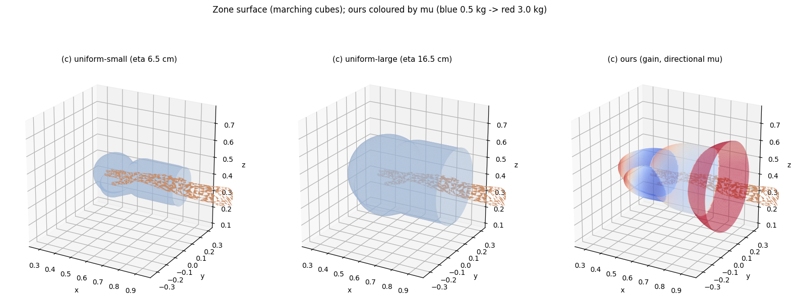

*왼쪽부터 균일 η 6.5 cm, 균일 η 16.5 cm, 제안(색 = μ, 파랑 0.5 kg → 빨강 3.0 kg).*

**결론.** 제안의 두께는 손끝 앞 20.0 cm, 정면-위 45도 11.7 cm, 손등 위 8.7 cm 로 방향에 따라 달라지고, 손 바깥 옆에서는 균일과 같은 6.6 cm 다.

**조건.** 앞으로 뻗은 오른팔 정지 자세, 로봇은 질량 4.6 kg 의 점으로 계산, 팔 표면 법선 방향 두께. 구역 계산이며 MPC 실행이 아니다.

**근거.** `goal1/logs/meff_isaac/v2_thickness.json`, `goal1/logs/meff_isaac/v1_zone.json`(균일 16.5 cm 의 η)

### 2-2 자세 7개, 방향 9개

**질문.** 팔 자세가 바뀌면 방향별 구역 두께가 어떻게 바뀌나?

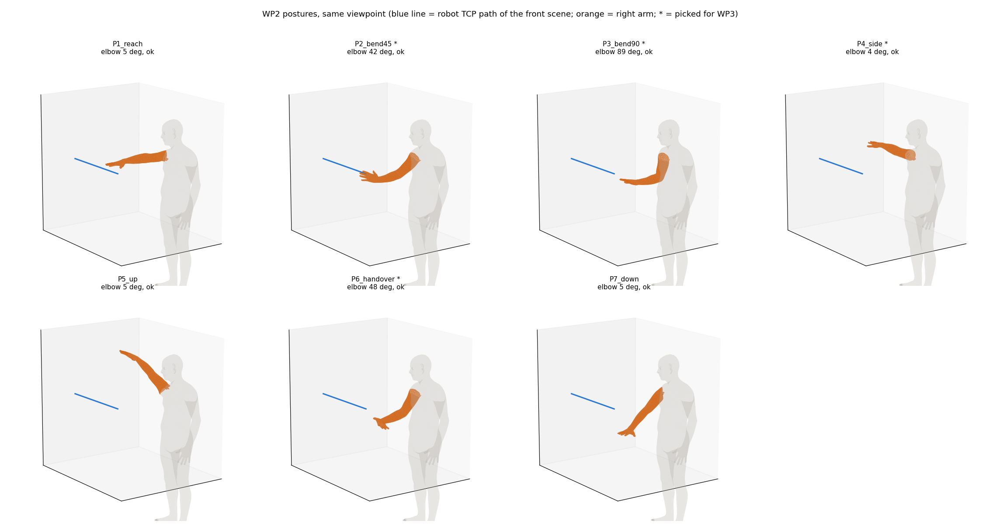

*자세 7개를 같은 시점에서 본 모습. 주황 = 오른팔, 파란 선 = 로봇 경로. 별표는 3절 장면에 쓴 자세.*

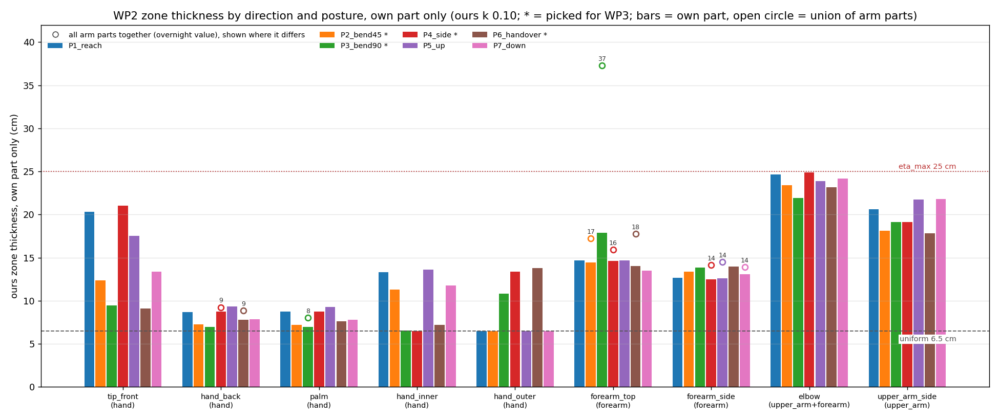

*막대 = 그 방향이 속한 부위만으로 잰 두께. 빈 원은 팔 전체 구역을 합쳐 잰 값이며, 이웃 부위의 구역이 섞여 다를 때만 표시했다.*

**결론.** 손끝 앞 두께는 팔을 펴면 두껍고(앞·옆·위로 편 팔 17.5~21.1 cm, 아래로 편 팔 13.4 cm), 팔꿈치를 굽히면 얇아진다(9.1~12.4 cm). 손등·손바닥은 모든 자세에서 7.0~9.4 cm, 팔꿈치는 21.9~24.9 cm 이고, 손의 한쪽 옆은 6.5~7.2 cm 로 균일과 비슷하다.

**조건.** 자세 7개(팔꿈치 4~89도), 점 로봇 4.6 kg, k_gain 0.10. 각 방향은 그 부위 형상만으로 잰다(손 방향 = 손, 아래팔 위·옆 = 아래팔, 위팔 옆 = 위팔, 팔꿈치 = 아래팔 + 위팔). 방향마다 광선 하나로 잰 값이다.

**근거.** `goal1/logs/meff_isaac/on_wp2_zone.json`(`ours_own` 항목), `goal1/logs/meff_isaac/on_wp2_postures.json`

### 2-3 팔꿈치 각도만 바꿨을 때

**질문.** 팔꿈치만 굽히면 로봇 쪽으로 나온 구역이 어떻게 줄어드나?

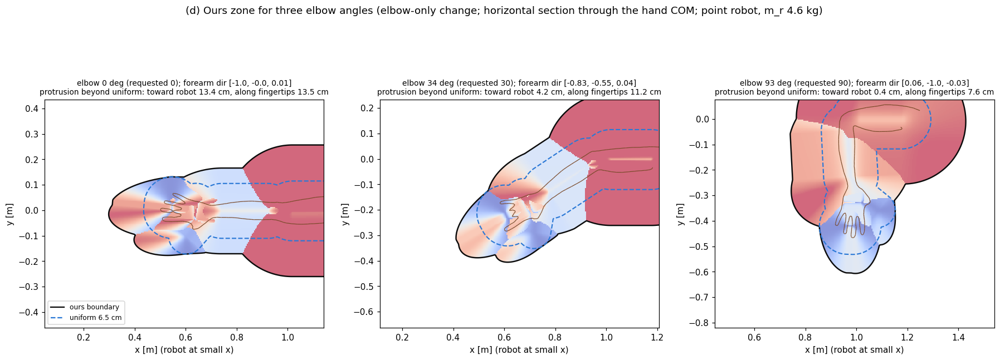

**결론.** 균일보다 로봇 쪽으로 더 나온 길이는 팔꿈치 0도 / 34도 / 93도에서 13.4 / 4.2 / 0.4 cm 이고, 손끝 방향으로는 13.5 / 11.2 / 7.6 cm 다.

**조건.** 앞으로 뻗은 자세에서 팔꿈치만 바꾼 3개 자세, 수평 단면, 점 로봇 4.6 kg. 구역 계산이며 MPC 실행이 아니다.

**근거.** `goal1/logs/meff_isaac/v2_posture.json`

---

## 3. 가만히 있는 팔 옆을 지나갈 때

### 3-1 대표 영상: 손끝 앞과 손 위

**질문.** 앞으로 뻗은 팔 옆을 로봇이 한 번 지나갈 때, 제안이 실제로 더 멀리 지나가나?

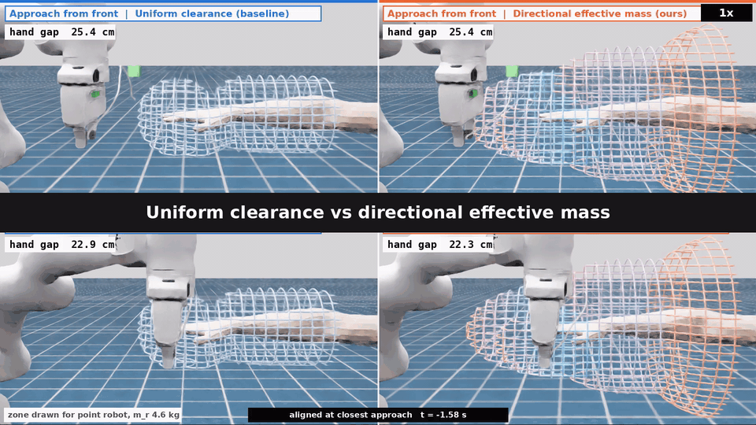

*왼쪽 균일, 오른쪽 제안. 위 줄 = 손끝 앞을 가로지르는 경로, 아래 줄 = 손 위를 가로지르는 경로, seed 0. 원본: [mp4](media/static_two_directions.mp4)*

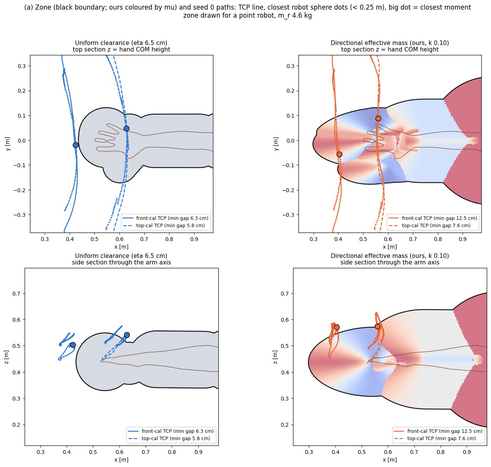

*검은 경계 = 구역(제안은 μ 로 색칠), 선 = seed 0 의 로봇 끝(TCP) 경로, 큰 점 = 최소 간격 순간.*

**결론.** 손끝 앞에서 균일 6.0 cm 대 제안 12.0 cm, 손 위에서 5.4 cm 대 8.2 cm 다(seed 3개 평균). 메시 기준으로는 손끝 앞 6.0 대 12.7 cm, 손 위 4.8 대 10.5 cm 다.

**조건.** 앞으로 뻗은 오른팔 정지, 로봇은 A 에서 B 로 한 번 지나감, seed 0~2. 모든 실행이 목표에 도달했다.

**근거.** `goal1/logs/meff_isaac/v2_summary.json`(`by_scene_cond`), `goal1/logs/meff_isaac/v2_runs.json`

### 3-2 자세 4개 × 방향 3개: 장면별 간격

**질문.** 다른 자세와 다른 접근 방향에서도 제안이 더 멀리 지나가나? 어디서는 차이가 없나?

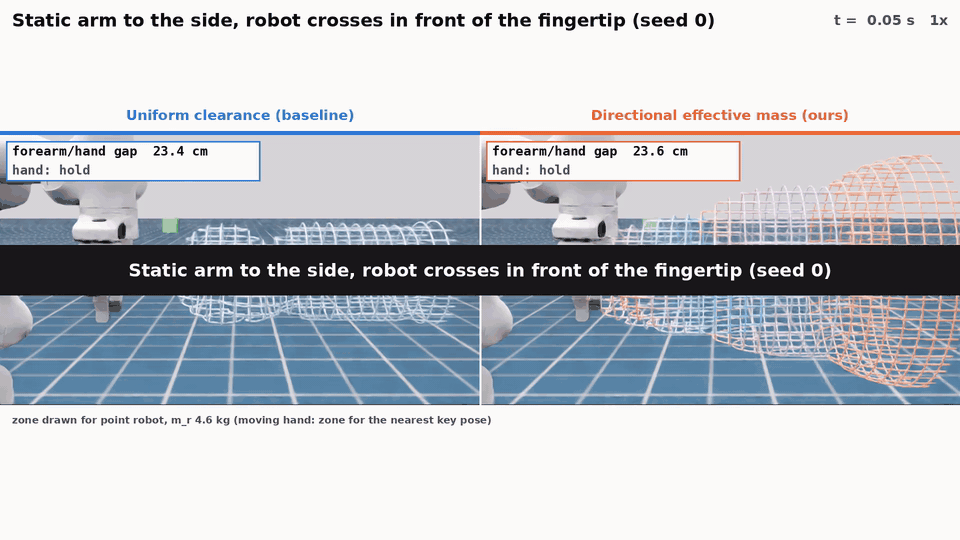

*옆으로 뻗은 팔, 로봇이 손끝 앞을 지나감, seed 0(이 실행의 최소 간격 균일 6.1 cm, 제안 11.0 cm). 원본: [mp4](media/static_fingertip_front.mp4)*

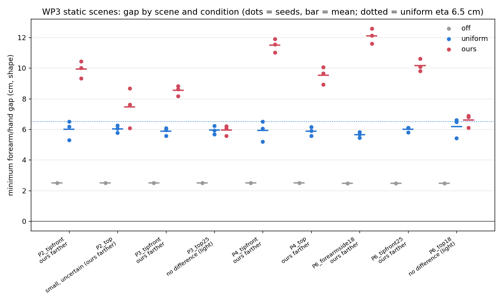

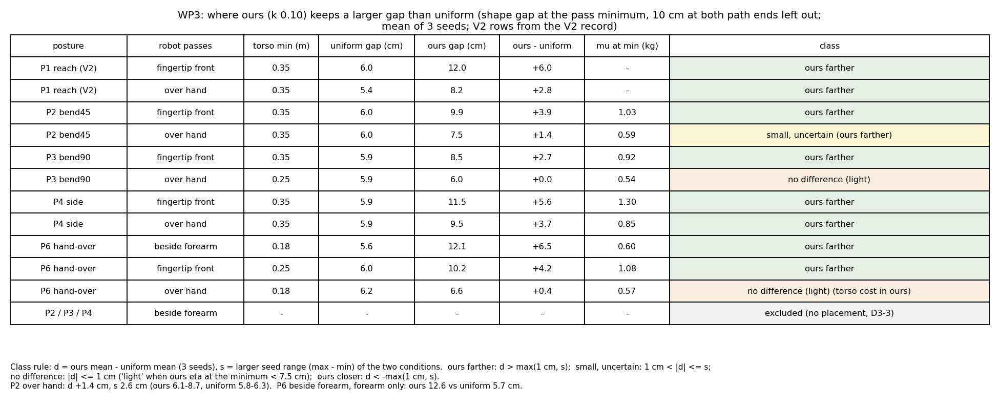

**결론.** 손끝 앞에서는 4개 자세 모두 제안이 2.7~5.6 cm 더 멀었고, 옆으로 뻗은 팔의 손 위는 +3.7 cm, 아래팔 옆은 +6.5 cm 였다. 굽힌 팔의 손 위는 두 자세에서 차이가 없었고(+0.0, +0.4 cm), 한 자세는 +1.4 cm 로 작고 불확실하다(seed 범위 2.6 cm 안). 이 방향의 μ 가 0.54~0.59 kg 로 기준값 0.53 kg 에 가까워 제안의 두께가 6.6~7.0 cm 에 머물렀다.

**조건.** 
- 자세 4개(45도·90도로 굽힌 팔, 옆으로 뻗은 팔, 건네는 자세) × 방향(손끝 앞, 손 위, 아래팔 옆)에서 만들 수 있었던 9개 장면이다. 한 번 지나가며, seed 0~2 이다.
- 간격은 통과 구간의 최소다. 경로 양 끝 10 cm(출발·도착 자세 근처)는 뺐다.
- 몸통과 로봇 경로 사이 거리는 0.35 m 를 기본으로 했다. 장면을 만들 수 없을 때 0.25 m, 0.18 m 로 줄였다(표의 torso min 칸).
- 분류 기준: d = 제안 평균 − 균일 평균, s = 두 조건 중 큰 seed 범위(최대 − 최소)다.
  - ours farther(제안이 더 멂): d > max(1 cm, s)
  - small, uncertain(작고 불확실): 1 cm < |d| ≤ s
  - no difference(차이 없음): |d| ≤ 1 cm
- 아래팔 옆을 아래팔만으로 재면 제안 12.6 cm 대 균일 5.7 cm 다.
- 굽힌 두 자세와 옆으로 뻗은 자세의 아래팔 옆 장면 3개는 몸통이 경로에 너무 가까워 만들지 못했다.

**근거.** `goal1/logs/meff_isaac/on_wp3_summary.json`, `goal1/logs/meff_isaac/on_wp3e_passes.json`, `goal1/logs/meff_isaac/on_wp3_runs.json`, `goal1/logs/meff_isaac/on_wp3e_P6_forearmside18_by_part.json`, `goal1/logs/meff_isaac/on_wp3_scenes.json`

### 3-3 이득 손잡이 k_gain

**질문.** k_gain 을 키우면 간격이 계속 늘어나나?

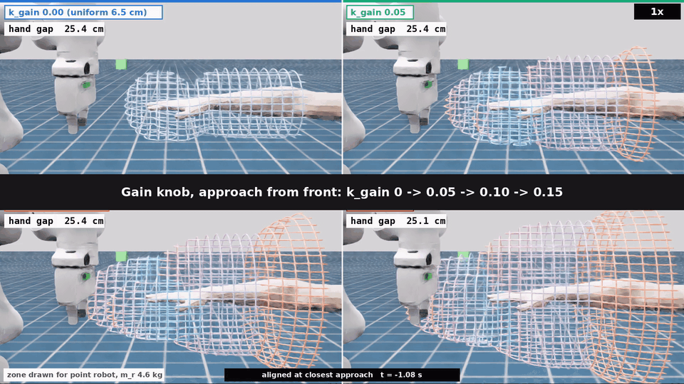

*손끝 앞 장면, k_gain 0 / 0.05 / 0.10 / 0.15, seed 0. 원본: [mp4](media/gain_knob.mp4)*

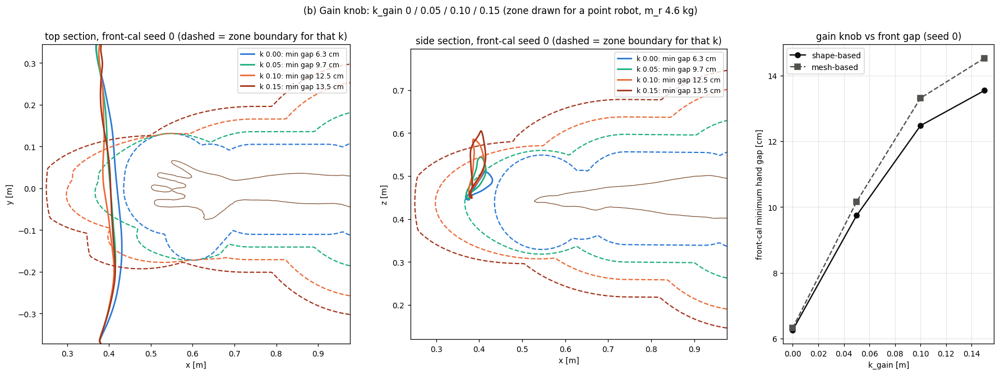

**결론.** 앞으로 뻗은 팔의 손끝 앞에서 간격은 6.3 → 9.7 → 12.5 → 13.5 cm 로 늘지만, 0.15 에서는 로봇이 손 위로 넘어가는 길로 바뀌어 증가가 둔해진다. 옆으로 뻗은 팔에서도 5.9 → 9.8 → 11.5 → 13.4 cm(seed 3개 평균)였고, 0.15 에서 seed 3개 중 1개가 손 위로 넘어갔다. 가벼운 방향(굽힌 팔의 손 위)에서는 0.15 에서도 두께가 7.0~7.3 cm 라 간격이 6.0 → 8.1 cm 에 그쳤다.

**조건.** k_gain 0 / 0.05 / 0.10 / 0.15, 나머지 설정 같음. 앞으로 뻗은 팔은 seed 0 하나, 옆으로 뻗은 팔과 굽힌 팔은 seed 0~2.

**근거.** `goal1/logs/meff_isaac/v2_summary.json`(`gain_knob`), `goal1/logs/meff_isaac/on_r2_gainknob.json`

---

## 4. 손이 움직일 때

**질문.** 손이 뻗기 → 멈춤 → 빼기 → 쉼을 반복할 때도 제안이 더 멀리 지나가나?

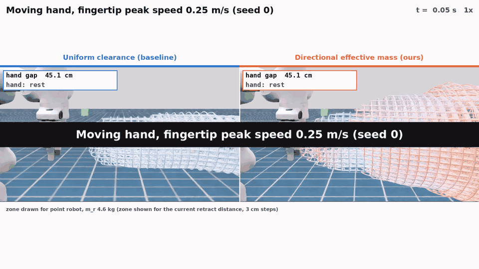

*손끝 최고 속도 0.25 m/s, seed 0(이 실행의 최소 간격 균일 4.8 cm, 제안 8.9 cm). 원본: [mp4](media/moving_hand.mp4)*

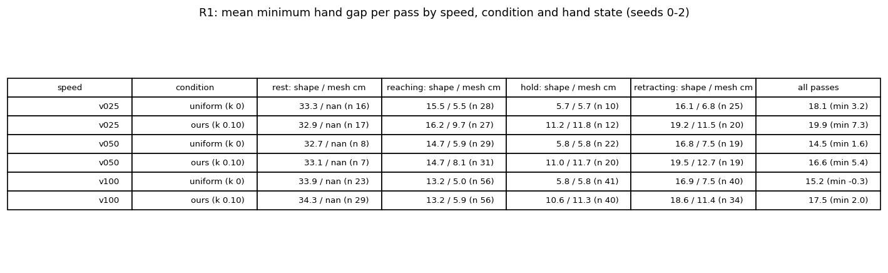

*줄은 위에서부터 손끝 최고 속도 0.25 / 0.5 / 1.0 m/s 의 균일·제안. 칸은 rest = 쉼, reaching = 뻗는 중, hold = 멈춤, retracting = 빼는 중일 때 지나간 통과의 평균 최소 간격.*

**결론.** 최소 간격은 세 속도 모두 제안이 컸다. 0.25 m/s 에서 3.2 대 7.3 cm, 0.5 m/s 에서 1.6 대 5.4 cm, 1.0 m/s 에서 −0.3 대 2.0 cm 였다. 손이 멈춰 있을 때 지나간 경우의 평균 간격은 5.8 대 10.8 cm 다. 1.0 m/s 에서 간격이 크게 줄어드는 이유는 6절에서 다룬다.

**조건.** 
- 손 동작: 손끝 최고 속도 0.25 / 0.5 / 1.0 m/s, 최소 저크(가가속도를 최소로 하는 매끄러운 궤적), 멈춤 1.5 s.
- 로봇: 손끝 앞 경로를 60 s 동안 왕복했다. seed 0~2 이다.
- 사람 움직임 예측은 쓰지 않았다. 매 순간의 자세가 그대로 있다고 가정했다.
- 침투는 1.0 m/s 균일 한 실행의 형상 기준 3 스텝뿐이었고, 메시 기준으로는 0 이었다.

**근거.** `goal1/logs/meff_isaac/r1_summary.json`, `goal1/logs/meff_isaac/r1_runs.json`, `goal1/logs/meff_isaac/r1_passes.json`, `goal1/logs/meff_isaac/r1_video_info.json`

---

## 5. 협업 동작: 건네기, 가로지르기

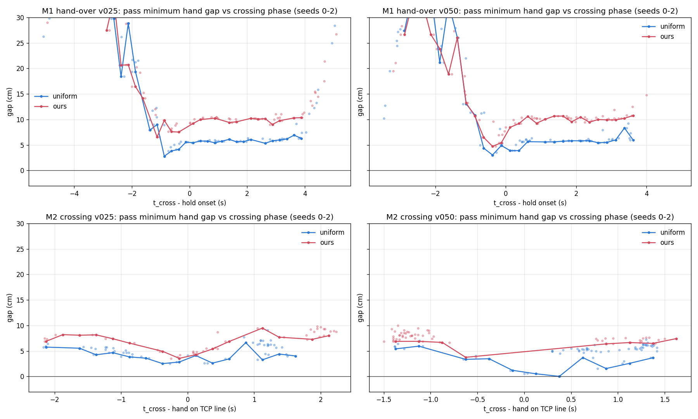

*위 = 건네기, 아래 = 가로지르기. 가로축 = 로봇이 손 앞을 지난 시각에서 손이 멈춘 시각(건네기) 또는 손이 로봇 경로에 닿은 시각(가로지르기)을 뺀 값. 점 = 통과 하나, 선 = 0.25 s 구간 최소.*

### 5-1 건네기

**질문.** 사람이 물건을 건네듯 손을 내밀고 3초 멈췄다가 빼는 동안, 제안이 더 멀리 지나가나? 그 대가로 덜 지나가나?

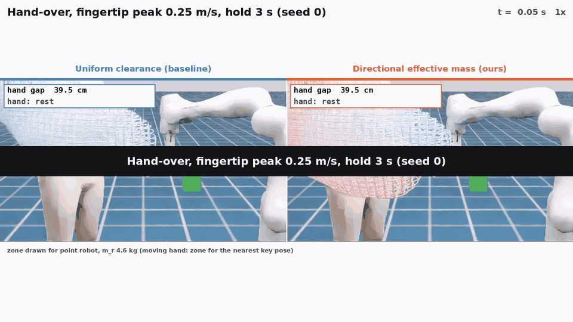

*손끝 최고 속도 0.25 m/s, seed 0(이 실행의 최소 간격 균일 5.3 cm, 제안 7.9 cm). 원본: [mp4](media/handover.mp4)*

**결론.** 손이 멈춘 3초 동안의 평균 간격은 제안 10.1 cm 대 균일 5.8~5.9 cm 였다. 최소 간격은 모든 seed 에서 제안이 컸다(0.25 m/s 6.6~7.6 대 2.8~5.3 cm, 0.5 m/s 4.7~7.7 대 3.0~3.9 cm). 60 s 동안 지나간 횟수는 25~27 대 26~28 로 거의 같았다.

**조건.** 
- 손 동작: 굽힌 팔(팔꿈치 48도)의 손을 0.38 m 내밀고 3 s 멈췄다가 뺀다. 손끝 최고 속도는 0.25 / 0.5 m/s 다.
- 로봇: 60 s 동안 왕복했다. seed 0~2 이다.
- 몸통과 경로 사이 거리 기준은 0.25 m 다. 침투는 0 이었다.

**근거.** `goal1/logs/meff_isaac/on_wp4_summary.json`, `goal1/logs/meff_isaac/on_wp4_runs.json`, `goal1/logs/meff_isaac/on_wp4_motion_check.json`

### 5-2 가로지르기

**질문.** 손이 로봇 경로를 옆으로 가로질러 쓸고 지나갈 때는?

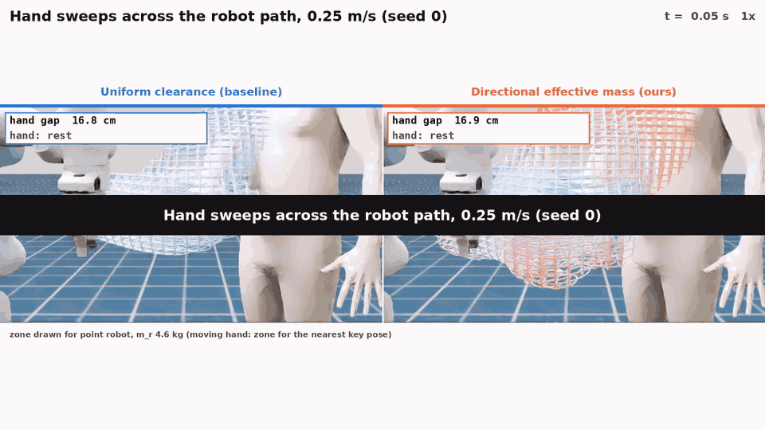

*손끝 최고 속도 0.25 m/s, seed 0(이 실행의 최소 간격 균일 2.6 cm, 제안 4.3 cm). 원본: [mp4](media/crossing.mp4)*

**결론.** 최소 간격은 0.5 m/s 에서 제안 3.8~6.7 cm 대 균일 0.0~1.2 cm, 0.25 m/s 에서 3.6~4.3 대 2.5~3.3 cm 로 제안이 컸다. 대신 60 s 동안 지나간 횟수는 0.25 m/s 에서 12~14 대 16~18, 0.5 m/s 에서 18~19 대 21 로 줄었다. 제안은 비켜 돌아가는 것이 아니라 기다려서 간격을 지켰다(8번 2항).

**조건.** 
- 손 동작: 아래로 뻗은 팔의 손끝이 로봇 경로를 40도로 0.40 m 가로지르고, 양쪽 끝에서 1.5 s 쉰다. 먼 쪽에서는 손이 로봇 경로 안에서 쉰다.
- 손끝 최고 속도는 0.25 / 0.5 m/s, 60 s 왕복, seed 0~2 이다. 침투는 0 이었다.

**근거.** `goal1/logs/meff_isaac/on_wp4_summary.json`, `goal1/logs/meff_isaac/on_wp4_runs.json`, `goal1/logs/meff_isaac/on_wp4_passes.json`

---

## 6. 손이 빠를 때와 움직임 예측

**질문.** 손이 1.0 m/s 로 빠를 때 제안의 간격이 왜 구역 두께보다 크게 모자라나? 사람 움직임을 예측하면 나아지나?

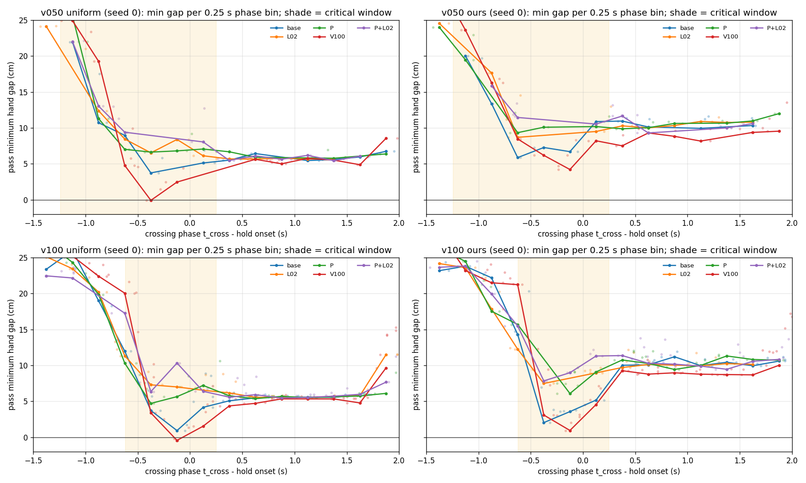

*위 = 0.5 m/s, 아래 = 1.0 m/s, 왼쪽 = 균일, 오른쪽 = 제안, seed 0. 노란 띠 = 손이 뻗는 중이거나 막 멈춘 때 지나간 통과(이하 "뻗는 중 통과"). 선 5개는 예측 없음, 등속 예측, 사람 위치 0.2 s 앞당김, 속도 상한 1.0 m/s, 등속 예측 + 앞당김이다(범례 기호는 9번 표).*

**결론.** 
- 간격 부족은 "뻗는 중 통과"에 몰렸다. 1.0 m/s 에서 제안의 최대 간격 부족(η − 간격)은 11.7~13.8 cm 였다.
- 등속 예측(사람 몸이 지금 속도로 계속 움직인다고 보고 앞날을 계산)을 켜면 4.3~5.0 cm 로 줄었다(seed 3개). 균일은 4.9~6.8 cm 에서 0.9~1.8 cm 가 됐다.
- 속도 상한을 0.75 / 1.0 m/s 로 올려도 제안의 최대 부족은 12.3 cm 로 줄지 않았다(seed 1개). 사람 위치를 0.2 s 앞당기는 방법은 부족을 줄였지만, 사람 근처 속도 p99 가 0.66~0.76 m/s 로 상한을 넘었다(seed 1개).

**조건.** 
- 4절과 같은 움직이는 손 장면이다. 손끝 최고 속도 0.5 / 1.0 m/s, 60 s 왕복이다.
- 예측 없음은 seed 0~2, 1.0 m/s 등속 예측은 seed 0~2, 나머지 변형은 seed 0 이다. 0.5 m/s 등속 예측은 seed 0~1 이다.
- "뻗는 중 통과"는 손이 멈추기 직전 뻗는 시간부터 멈춘 뒤 0.25 s 까지 로봇이 손끝 앞을 지난 통과다.
- 1.0 m/s 의 한계는 4절의 영상과 같은 장면에서 손 속도만 바꾼 것으로, 영상은 넣지 않았다.

**근거.** `goal1/logs/meff_isaac/on_wp1_summary.json`, `goal1/logs/meff_isaac/on_wp1_r1_passes.json`, `goal1/logs/meff_isaac/on_wp1_var_passes.json`, `goal1/logs/meff_isaac/on_wp1_var_runs.json`

---

## 7. 카메라가 불완전할 때: 지연, 떨림, 누락

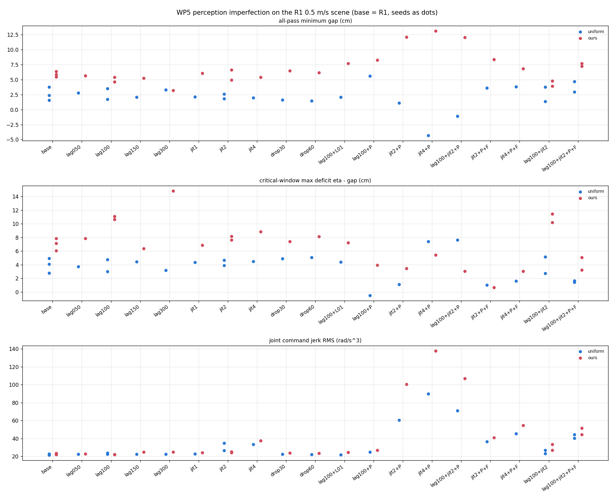

*0.5 m/s 움직이는 손 장면. 위 = 최소 간격, 가운데 = 뻗는 중 통과의 최대 간격 부족, 아래 = 관절 명령 저크. 점 = seed. 가로축은 지연(ms)·떨림(cm)·누락(%)의 크기와 등속 예측·속도 필터·앞당김 조합이다(기호는 9번 표).*

카메라 결함은 모두 재생 데이터에 넣은 **합성 잡음**이다. 간격은 결함이 없는 실제 사람 위치로 잰다.
- 지연: 일정 시간 전의 자세를 준다.
- 떨림: 프레임·부위마다 가우스 위치 잡음을 준다.
- 누락: 빠진 프레임 자리에 마지막 프레임을 그대로 둔다.

### 7-1 예측 없이 결함만 넣었을 때

**질문.** 사람 움직임을 예측하지 않을 때, 지연·떨림·누락을 어디까지 견디나?

**결론.** 지연 300 ms, 떨림 4 cm, 누락 60% 까지 두 방식 모두 침투가 없었다. 지연 100 ms 부터 제안의 최대 간격 부족이 커졌다(10.6~11.1 cm, 결함 없을 때 6.1~7.8 cm, seed 2개). 떨림은 간격보다 관절 명령의 저크(흔들림 정도, rad/s³)를 키웠다(22 안팎 → 떨림 2 cm 25~35, 4 cm 33~38).

**조건.** 0.5 m/s 움직이는 손 장면, 60 s 왕복. 지연 50/100/150/300 ms, 떨림 1/2/4 cm, 누락 30/60%. 지연 100 ms 와 떨림 2 cm 는 seed 0~1, 나머지는 **seed 1개**(seed 0) 다.

**근거.** `goal1/logs/meff_isaac/on_wp5_summary.json`, `goal1/logs/meff_isaac/on_wp5_runs.json`, `goal1/logs/meff_isaac/on_wp5_passes.json`

### 7-2 떨리는 데이터에 예측을 쓰면

**질문.** 6절의 등속 예측을 떨리는 골격 데이터에 그대로 써도 되나?

**결론.** 아니다. 떨림 4 cm 에서 예측을 켜자 균일이 손을 형상 기준 62 스텝, 메시 기준 34 스텝 침투했고(최소 −4.3 cm), 제안은 관절 저크가 138 로 뛰고 60 s 에 9 번만 지나갔다. 속도를 지수이동평균(EMA, 계수 0.2)으로 걸러 예측에 넣으면 떨림 2 / 4 cm 모두 침투가 0 이 되고, 떨림 4 cm 에서 저크는 45~55, 지나간 횟수는 24~26 번으로 돌아왔다.

**조건.** 0.5 m/s 장면, 떨림 2 / 4 cm, 예측 없음 / 예측 / 예측 + 필터, **seed 1개**(seed 0).

**근거.** `goal1/logs/meff_isaac/on_wp5_summary.json`, `goal1/logs/meff_isaac/on_wp5_runs.json`

### 7-3 실제 카메라에 가까운 조합: 지연 100 ms + 떨림 2 cm

**질문.** 지연과 떨림이 함께 있을 때, 예측 + 필터가 예측 없음보다 나은가? 속도 상한은 지켜지나?

**결론.** 0.5 m/s 에서 예측 + 필터가 최소 간격을 키웠다. 제안은 3.9~4.8 cm 에서 7.2~7.7 cm 로, 균일은 1.3~3.7 cm 에서 2.9~4.7 cm 로 늘었다(seed 2개). 1.0 m/s 에서는 사람 근처 속도 p99 가 0.54~0.63 m/s 로 0.5 m/s 상한을 넘었다. 속도 상한을 거는 거리를 0.5 m 로 넓히면 0.467~0.478 m/s 로 돌아왔다(6개 실행).

**조건.** 0.5 m/s 는 seed 0~1, 1.0 m/s 는 seed 0~1, 속도 상한 거리는 0.4 m(기본)와 0.5 m 를 비교했다. 필터 계수 0.2 는 합성 잡음에서 정한 값이다.

**근거.** `goal1/logs/meff_isaac/on_wp5_summary.json`, `goal1/logs/meff_isaac/on_wp1_var_runs.json`, `goal1/logs/meff_isaac/on_wp1_summary.json`

### 7-4 이 조합이 결함 없는 데이터와 협업 동작에서 손해를 보나

**질문.** 예측 + 필터 + 속도 상한 거리 0.5 m 조합을 결함 없는 데이터에 써도 손해가 없나?

**결론.** 손해는 보이지 않았다. 움직이는 손에서 최소 간격은 같거나 커졌고(제안 0.5 m/s 5.4~5.9 → 8.4~8.9 cm, 균일 1.6~3.7 → 5.5 cm), 저크는 20~23 으로 그대로였다. 건네기 0.5 m/s 에서 제안 9.0~9.9 cm, 가로지르기 0.5 m/s 에서 6.4~6.5 cm 였고, 모든 실행에서 침투 0, 사람 근처 속도 p99 0.465~0.478 m/s 였다.

**조건.** 손끝 최고 속도 0.25 / 0.5 m/s 움직이는 손, 0.5 m/s 건네기·가로지르기, **seed 2개**(seed 0~1).

**근거.** `goal1/logs/meff_isaac/on_wp1_var_runs.json`, `goal1/logs/meff_isaac/on_wp4_runs.json`, `goal1/logs/meff_isaac/on_wp4_summary.json`

---

## 8. 한계와 주의

1. **빠른 손 + 지연은 미해결.** 손이 1.0 m/s 로 움직이고 지연 100 ms 가 겹치면, 제안이 균일보다 낫다는 것이 확인되지 않았다(최소 간격 제안 1.9~5.0 cm 대 균일 0.6~6.2 cm, 각 4개 실행). 이 조건에서 간격과 속도 상한을 함께 지키는 설정도 찾지 못했다.
2. **가로지르기의 이점은 우회가 아니라 대기다.** 제안은 손을 비켜 돌아가지 않고 손이 경로를 비울 때까지 기다리거나 늦게 지나가서 간격을 지켰다. 그래서 60 s 동안 지나간 횟수가 0.25 m/s 에서 12~14 대 16~18 로 줄었다. 경로 모양을 프레임 단위로 비교하지는 않았다.
3. **카메라 관련 결과는 대부분 seed 1개이고 합성 잡음 기준이다.** 지연·떨림·누락은 재생 데이터에 넣은 단순한 모형(고정 지연, 가우스 떨림, 마지막 프레임 유지)이고, 실제 Kinect 데이터가 아니다. 속도 필터 계수 0.2 는 실제 데이터에서 다시 정해야 한다.
4. **균일을 크게 잡으면 가벼운 방향까지 막는다.** 균일 두께를 16.5 cm 로 키우면(2-1 그림 가운데), 제안이 6.6 cm 만 두는 손 바깥 옆 같은 가벼운 방향까지 16.5 cm 를 둔다. 균일을 키우는 것만으로는 방향에 따른 차이를 만들 수 없다.
5. **속도 상한 0.5 m/s 는 설계값이며 규격 적합 주장이 아니다.** 충돌력 측정과 규격 검증은 범위 밖이다. 한 번 지나가는 정지 장면 54개 실행 중 2개(균일)에서 사람 근처 속도 p99 가 0.546 / 0.518 m/s 로 0.5 m/s 를 넘었다.
6. **모두 시뮬레이션이다.** 한 사람의 체형으로 미리 계산한 자세를 재생했고, 실제 사람·실시간 Kinect·실물 FR3 결과는 아직 없다.
7. **구역이 두꺼워도 실제 간격은 그보다 작을 수 있다.** 앞으로 뻗은 팔의 손끝 앞 구역은 20 cm 인데 실제 간격은 12 cm 다. 로봇이 구역이 얇은 비스듬한 쪽(약 43도)으로 비켜 지나가기 때문이다. k_gain 0.15 에서는 로봇이 손 위로 넘어가는 길로 바꿔 간격 증가가 포화된다.
8. **메시 기준과 형상 기준이 다를 수 있다.** MPC 는 캡슐 몸 모델로 계산하므로 실제 몸 표면까지의 간격은 장면에 따라 다르다. 앞으로 뻗은 팔에서 손끝 앞과 손 위의 차이는 메시 기준이 형상 기준보다 작았다(제안 +2.2 대 +3.8 cm).
9. **장면 범위가 좁다.**
   - 아래팔 옆 장면은 건네는 자세 하나뿐이다.
   - 몸통과 경로 사이 거리를 0.35 m 에서 0.25 m, 0.18 m 로 줄인 장면이 있다.
   - 굽힌 팔의 손 위처럼 μ 가 기준값 근처인 방향에서는 제안과 균일의 차이가 없다.
   - 건네는 자세의 손 위 장면(몸통 0.18 m)은 제안에 몸통 비용이 걸려, 팔에 대한 효과를 말하지 못한다.
   - 구역 그림과 두께는 로봇을 4.6 kg 의 점으로 놓고 계산했다.

---

## 9. 설정과 근거 파일, 내부 이름 대응표

### 공통 설정

| 항목 | 값 |
|---|---|
| 시뮬레이터, 로봇 | Isaac Sim 4.5, Franka FR3, GPU RTX 2080 Ti |
| MPC | cuRobo MPPI, 비용 채널은 warp 커널(CUDA graph 안), (로봇 구, 사람 형상) 쌍의 최댓값을 시점마다 더함 |
| 구역 식 | d_base 0.065 m, k_gain 0.10 m(제안) / 0(균일), μ_ref 0.53 kg, η_max 0.25 m |
| 속도 상한 | 사람 형상 0.4 m 안에서 로봇 구 속도 0.5 m/s 비용, 가중치 3e5, 설정 파일 `goal1/config/tuned_t1.yml` |
| 속도 상한 거리 0.5 m 변형 | `goal1/config/tuned_t2a_c2.yml` (7-3, 7-4) |
| 사람 입력 | 미리 계산한 사람 형상·관성 재생, 움직임 모델은 정지(6·7절의 예측 변형만 등속) |
| 실시간 배율 | 움직이는 손 실행과 밤사이 분석 실행 모두 1.0 이상(가장 낮은 것 1.02, 한 번 지나가는 실행 하나) |
| 분석 | 실행된 관절값과 같은 시각의 실제 사람으로 오프라인에서 간격·μ·η 계산 (`goal1/scripts/on_analyze.py`, `goal1/scripts/r1_analyze.py`) |

### 상세 기록

- 밤사이 작업 기록(영문 상세 표, 판단 기록): `goal1/overnight/REPORT.md`, `goal1/overnight/DECISIONS.md`
- 단계별 요약: [`docs/progress.md`](../docs/progress.md)

### 내부 이름 대응표

| 내부 이름 | 뜻 | 이 문서 |
|---|---|---|
| V1 | 기본 간격 + 질량 이득 식을 정한 단계 | 2-1 (16.5 cm 균일) |
| V2 | 앞으로 뻗은 팔 정적 시연, 이득 손잡이 seed 0 | 2-1, 2-3, 3-1, 3-3 |
| R1 | 움직이는 손 재생(뻗기·멈춤·빼기·쉼) | 4, 6 |
| WP1 | 빠른 손에서 구역이 무너지는 원인 분석 | 6 |
| WP2 | 자세 7개의 방향별 구역 두께 | 2-2 |
| WP3 | 정지 장면 9개(자세 × 방향) | 3-2 |
| WP4 | 협업 동작. M1 = 건네기, M2 = 가로지르기, M3 = 아래팔 따라 움직이는 굽힌 팔(이 문서에 없음) | 5 |
| WP5 | 카메라 불완전성(지연·떨림·누락) | 7 |
| WP6 | 공통 설정 튜닝. 규칙상 채택 후보 없음(이 문서에 없음, `goal1/overnight/REPORT.md`) | - |
| 예비 2 (`on_r2_*`) | 이득 손잡이를 장면 2개, seed 3개로 반복 | 3-3 |
| F1~F8 | 밤사이 후속 확인(예측·필터·속도 상한 거리 조합) | 7-2 ~ 7-4 |
| t1 | 속도 상한 0.5 m/s 프로파일 (`tuned_t1.yml`) | 공통 |
| t2a_c1 / t2a_c2 | 속도 상한 가중치 1e6 / 속도 상한 거리 0.5 m 프로파일 | 7-3 |
| uniform, gk000, u065, k 0 | 균일(η 6.5 cm) | 전체 |
| ours, gain, k 0.10 | 제안 | 전체 |
| v025 / v050 / v100 | 손끝 최고 속도 0.25 / 0.5 / 1.0 m/s | 4 ~ 7 |
| P | 등속 예측 (`--meff-motion cv`) | 6, 7 |
| F | 사람 속도 EMA 필터 0.2 (`--human-vel-alpha 0.2`) | 7 |
| C1 / C2 | t2a_c1 / t2a_c2 프로파일 | 7-3 |
| L01 / L02 | 재생 사람 위치를 0.1 / 0.2 s 앞당김 | 6, 7 |
| V075 / V100 | 진단용 속도 상한 0.75 / 1.0 m/s (`tuned_d1v075.yml`, `tuned_d1v100.yml`) | 6 |
| lag050~300, jit1~4, drop30/60 | 지연(ms), 떨림(cm), 누락(%) | 7 |
| crit, critical window | 뻗는 중 통과(6절 조건) | 6, 7 |
| P1_reach ~ P7_down | 자세 7개: 앞으로 뻗음, 45도 굽힘, 90도 굽힘, 옆으로 뻗음, 위로 뻗음, 건네는 자세(48도), 아래로 뻗음 | 2-2, 3-2 |
| tipfront / top / forearmside | 손끝 앞 / 손 위 / 아래팔 옆을 지나는 장면 | 3-2 |
| 장면 이름 끝 25 / 18 | 몸통과 경로 사이 최소 거리 0.25 / 0.18 m 로 줄인 장면 | 3-2 |

### 그림·영상 사본과 원본

이 폴더의 파일은 사본이다. 원본은 옮기지 않았다.

| 이 폴더 | 원본 | 근거 로그 |
|---|---|---|
| `figures/zone_3d.png` | `goal1/zone/zone_3d.png` | `v1_zone.json`, `v2_thickness.json` |
| `figures/postures.png` | `goal1/overnight/postures_preview.png` | `on_wp2_postures.json` |
| `figures/zone_thickness_by_posture.png` | `goal1/overnight/wp2_zone_thickness.png` | `on_wp2_zone.json` |
| `figures/elbow_angle_zone.png` | `goal1/zone/v2_d_posture.png` | `v2_posture.json` |
| `figures/static_paths_zone.png` | `goal1/zone/v2_a_paths_zone.png` | `v2_summary.json` |
| `figures/static_scene_gap.png` | `goal1/overnight/wp3_scene_gap.png` | `on_wp3_summary.json` |
| `figures/static_scene_table.png` | `goal1/overnight/wp3_effect_table.png` | `on_wp3_summary.json` |
| `figures/gain_knob.png` | `goal1/zone/v2_b_gain_knob.png` | `v2_summary.json` |
| `figures/moving_hand_table.png` | `goal1/r1/r1_c_table.png` | `r1_summary.json` |
| `figures/collaboration_phase_gap.png` | `goal1/overnight/wp4_phase_gap.png` | `on_wp4_passes.json` |
| `figures/fast_hand_phase_gap.png` | `goal1/overnight/wp1_phase_gap.png` | `on_wp1_summary.json` |
| `figures/camera_imperfection.png` | `goal1/overnight/wp5_perception.png` | `on_wp5_summary.json` |
| `media/static_two_directions.gif`, `.mp4` | `media/v2_main.gif`, `media/v2_main.mp4` | `v2_summary.json` |
| `media/gain_knob.gif`, `.mp4` | `media/v2_gain_knob.gif`, `media/v2_gain_knob.mp4` | `v2_summary.json` |
| `media/static_fingertip_front.gif`, `.mp4` | 원본 mp4 `on_static_P4_tipfront.mp4` (녹화 폴더, 저장소 밖) | `on_wp7_video_info.json` |
| `media/moving_hand.gif`, `.mp4` | 원본 mp4 `r1_main.mp4` (저장소 밖) | `r1_video_info.json` |
| `media/handover.gif`, `.mp4` | 원본 mp4 `on_M1_handover.mp4` (저장소 밖) | `on_wp7_video_info.json` |
| `media/crossing.gif`, `.mp4` | 원본 mp4 `on_M2_crossing.mp4` (저장소 밖) | `on_wp7_video_info.json` |

- 로그 파일은 모두 `goal1/logs/meff_isaac/` 에 있다.
- GIF 는 가로 960 px, 12 fps 이고 `goal1/scripts/an_gif.sh` 로 만들었다. 새로 만든 GIF 4개는 10 MB 이하로 맞추려고 색을 줄였다. 3개는 64색, 정지 장면 하나는 128색이다.
