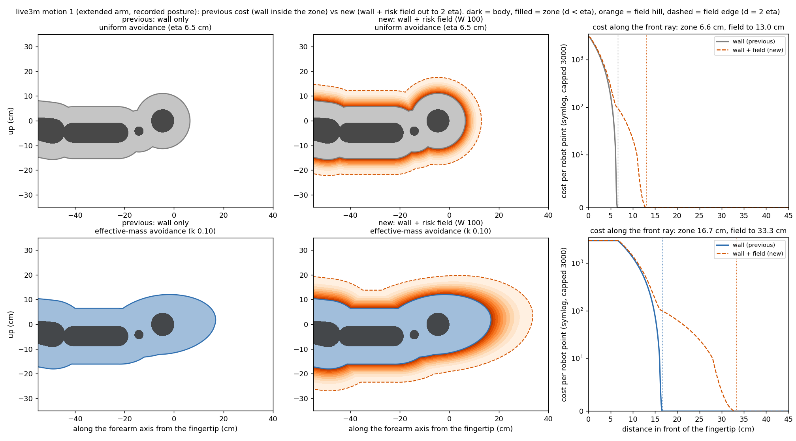
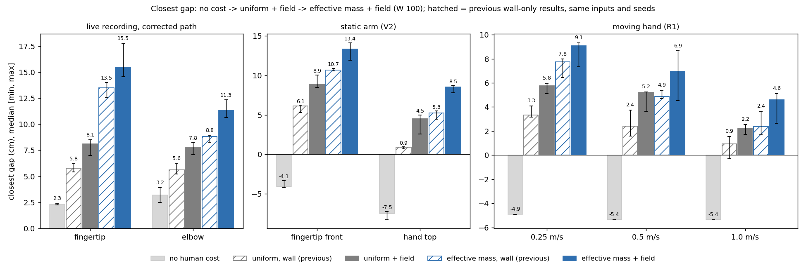
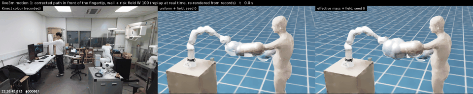
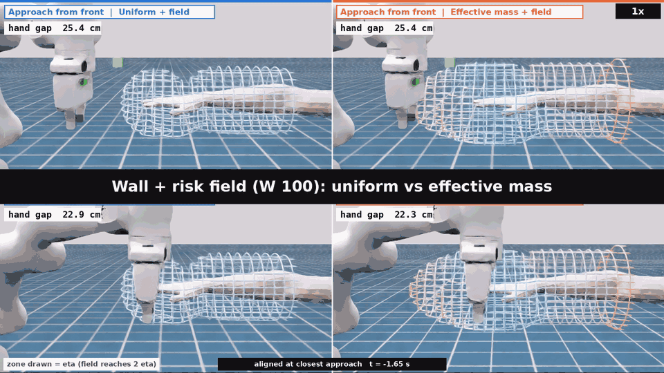

# 유효질량 위험 필드: 구역 바깥에 비용 언덕을 더한 판 (2026-11-20)

이전 판은 회피 구역 안(간격 d < 구역 두께 η)에서만 비용(벽)을 주었다. ("이전 판" = 필드 없는 벽만의 판. [../README.md](../README.md) 의 "이전 식"(모든 부위에 같은 기준 질량 0.53 kg)과 다르다.) 지금 판은 같은 η 를 안쪽 벽으로 두고, 바깥 η ~ 2η 에 비용 언덕(**위험 필드**)을 더한다. 구역이 두꺼운 방향(무거운 방향)일수록 필드도 넓어서, 로봇이 더 멀리서부터 비켜 가기 시작한다. 균일 회피에서는 모든 방향의 η 가 d_base 이므로 필드도 모든 방향에서 같은 폭(d_base ~ 2 d_base)이다.

```
η = clamp( d_base + k_gain · max( sqrt(μ / μ_iso) − 1, 0 ),  d_base,  η_max )        (이전 판과 같음)

(로봇 구, 사람 형상) 쌍마다, d = 간격:
  벽    c_wall  = w · (η − d)² / (2η)          (0 ≤ d < η),   w · (η/2 − d)  (d < 0),   0  (d ≥ η)    (이전 판과 같음)
  필드  c_field = W · (1 − (d − η) / η)²       (η ≤ d < 2η),  W  (d < η),                  0  (d ≥ 2η)
  쌍의 비용 = c_wall + c_field,  rollout 의 각 시점에서 쌍들의 최댓값을 더한다
```

| 매개변수 | 값 | 뜻 |
|---|---|---|
| W | 100 | 필드 높이. 벽의 가중치 w = 1e5 와 같은 비용 단위. **W = 0 이면 이전 판과 같다** |
| 필드 폭 | η | 구역 바깥 η 만큼(경계 2η) |
| d_base, k_gain, μ_iso, η_max | 0.065 m, 0.10 m, 부위별, 0.25 m | 이전 판 그대로 (시뮬 예시) |



*녹화된 편 팔 자세(live3m 동작 1)의 아래팔 축 단면. 위 줄 균일 회피, 아래 줄 유효질량 회피. 왼쪽 이전 판(벽만), 가운데 지금 판(벽 + 필드), 오른쪽 손끝 앞 방향의 비용. 손끝 앞에서 구역은 균일 6.6 cm / 유효질량 16.7 cm 이고, 필드는 각각 13.0 cm / 33.3 cm 까지 닿는다. 로봇을 4.6 kg 의 점으로 놓고 계산했다.*

## 확인한 것

- **필드를 끄면 이전 판과 같다.** 필드 코드가 들어간 뒤의 실행 노드로 V2 정면(seed 0)을 다시 돌려, 필드 코드 이전의 실행과 관절 명령 304개가 비트 단위로 같았다.
- **균일 회피에서 필드는 둥글다.** 구 형상 하나 둘레 400개 방향에서 GPU 커널의 필드 값이 간격마다 같았다(차이 ≤ 4e-4, W 100 기준, float32 반올림). 값은 식과 1.2e-4 안에서 맞았다. 유효질량 회피에서는 같은 형상에서 방향에 따라 η 가 6.5–10.9 cm 로 달라졌다.

## 결과: 같은 입력, 같은 seed 로 다시 만든 예시

간격은 이전과 같은 규칙으로 쟀다(로봇 구 전체(MPC 반지름 + 0.02 m)와 사람 형상 전체, 경로 양 끝 10 cm 제외). 값은 가장 가까웠을 때의 간격의 중앙값 [최소, 최대] 이고, 괄호 밖 "이전" 은 같은 실행 조건의 벽만 결과다.



### 실제 Kinect 녹화, 보정한 길 (seed 0·1·2 × 출발 A·B, 방식마다 6회)

| 동작 | 사람 비용 없음 | 균일 + 필드 (이전) | 유효질량 + 필드 (이전) | 한 번 지나가는 시간 s: 균일 + 필드 / 유효질량 + 필드 (이전) |
|---|---|---|---|---|
| 편 팔 손끝 | 2.3 [2.3, 2.4] | 8.1 [7.0, 8.5] (5.8) | 15.5 [14.6, 17.8] (13.5) | 2.08 / 2.51 (2.05 / 2.55) |
| 팔꿈치 | 3.2 [2.5, 3.9] | 7.8 [7.1, 8.2] (5.6) | 11.3 [10.6, 12.3] (8.8) | 1.92 / 2.93 (1.88 / 1.99) |
| 실물 설정 (유효질량, d_base 0.10, W 100) | | | 손끝 21.1 [18.7, 23.0], 팔꿈치 14.7 [13.7, 15.5] | 3.07 / 4.13 |

사람 비용 없음은 출발 A·B 각 1회(seed 0). 겹침은 모든 실행에서 0 스텝이다.



*같은 녹화(편 팔 손끝)를 지금 판에 다시 튼 장면(seed 0, 출발 A). 화면 속 원 껍질은 구역 두께 η 이고, 필드는 그 두 배까지 닿는다. 원본: [field_motion1.mp4](media/field_motion1.mp4), 팔꿈치: [field_motion3.mp4](media/field_motion3.mp4)*

### 정지한 팔 (V2, seed 0·1·2)

| 장면 | 사람 비용 없음 | 균일 + 필드 (이전) | 유효질량 + 필드 (이전) |
|---|---|---|---|
| 손끝 앞을 가로지름 | −4.1 (겹침) | 8.9 [8.5, 10.1] (6.1) | 13.4 [12.0, 14.1] (10.7) |
| 손 위를 가로지름 | −7.5 (겹침) | 4.5 [2.6, 5.0] (0.9) | 8.5 [7.8, 8.7] (5.3) |



*seed 0. 화면 속 고리 선은 구역 두께 η 다. 화면 속 hand gap 은 손 형상까지의 간격(실행 기록)이라 위 표의 값(사람 형상 전체, seed 3개 중앙값)과 다를 수 있다. 원본: [field_static_2x2.mp4](media/field_static_2x2.mp4)*

### 정지 장면 9개 (자세 4개 × 방향, seed 0·1·2)

| 장면 | 균일 (이전) | 균일 + 필드 | 유효질량 (이전) | 유효질량 + 필드 |
|---|---|---|---|---|
| P2 손끝 앞 | 6.2 | 9.1 | 10.7 | 14.3 |
| P3 손끝 앞 | 5.9 | 10.3 | 8.6 | 11.9 |
| P4 손끝 앞 | 6.0 | 9.4 | 11.9 | 14.6 |
| P6 손끝 앞 | 6.1 | 10.5 | 10.0 | 14.6 |
| P2 손 위 | 6.0 | 8.6 | 7.3 | 9.9 |
| P3 손 위 | 5.9 | 8.9 | 6.3 | 8.6 |
| P4 손 위 | 5.9 | 8.8 | 7.9 | 11.4 |
| P6 손 위 | 6.5 | 8.9 | 6.3 | 9.1 |
| P6 아래팔 옆 | 5.7 | 10.3 | 6.4 | 11.0 |

손끝 앞(무거운 방향)에서는 유효질량 + 필드가 균일 + 필드보다 1.6–5.2 cm 더 멀다. 손 위·아래팔 옆(가벼운 방향)에서는 두 방식이 −0.3 ~ +2.6 cm 로 가깝다. 필드는 두 방식 모두에 2.3–4.6 cm 를 더했다.

### 움직이는 손 (R1, 60초 왕복, 1.0 m/s 는 120초, seed 0·1·2)

| 손끝 최고 속도 | 사람 비용 없음 (seed 0) | 균일 + 필드 (이전) | 유효질량 + 필드 (이전) | 통과 횟수 균일 + 필드 / 유효질량 + 필드 |
|---|---|---|---|---|
| 0.25 m/s | −4.9 | 5.8 [5.1, 6.0] (3.3) | 9.1 [7.3, 9.3] (7.8) | 25–27 / 25–26 |
| 0.5 m/s | −5.4 | 5.2 [3.6, 5.2] (2.4) | 6.9 [4.5, 8.7] (4.9) | 25–27 / 25–26 |
| 1.0 m/s | −5.4 | 2.2 [1.7, 2.6] (0.9) | 4.6 [2.6, 5.1] (2.4) | 52–55 / 50–55 |

필드를 켠 실행은 모두 겹침 0 스텝이다(이전 판 균일 회피는 1.0 m/s seed 1 에서 3 스텝). 통과 횟수는 이전 판과 같은 범위다.

### 계산 시간

MPC 풀이 평균은 필드를 켜면 최대 약 1.0 ms 늘었다(정지 장면 9개 평균: 이전 균일 9.6 / 유효질량 10.0 ms, 필드를 켜면 10.6 / 10.6 ms). 모두 16.7 ms(60 Hz) 안이다.

## 실물 FR3 (한 단락)

실물 설정은 유효질량 회피, d_base 0.10 m, W 100 이다. 실물 기록을 PC 안에서 다시 튼 비교에서 회피를 시작한 거리(팔과의 실제 간격)가 12.9 → 18.7 cm, 실제 최소 거리가 −0.7 / −1.1 → +4.7 / +5.0 cm(기록 두 개) 였고, 경로 길이는 1.22배였다. 같은 장면의 실물 실행에서는 최소 7.5 cm, 10 cm 미만 스텝 74 → 34, 도착 3 → 4 였다(벽만 real_ym_1120_181842 → 필드 real_ym_1120_202059). 사람 한 명, 실행 몇 번의 결과다. 실물 영상은 넣지 않았다.

## 한계

1. **끝점이 필드 안에 있으면 끝점 앞에서 멈출 수 있다.** V2 손 위 장면의 유효질량 + 필드는 seed 3개 중 2개가 끝점 1.5–2.7 cm 앞에서 섰다(길의 99 % 진행, 속도 1.2 cm/s 미만). 이전 판은 1.4 cm 앞에서 끝나 도착으로 셌다. 필드 비용과 끝점 자세 비용이 균형을 이룬 것이다.
2. **지나가는 시간이 늘 수 있다.** 팔꿈치 보정한 길에서 유효질량 + 필드는 1.99 → 2.93 s 였다. 실물 설정(d_base 0.10)은 손끝 3.07 s, 팔꿈치 4.13 s 다.
3. **W 100 은 실물 재생 비교에서 정한 값이다.** 시뮬에서는 회피가 지나치다는 근거(겹침·실행 불가능·통과 횟수 감소)가 없어 그대로 썼다.
4. Isaac 예시는 실행 노드(`step2b_mpc_isaac.py`)를 바꾸지 않고, 시작할 때 `MeffChannel.set_field(1, 100)` 을 켜는 작은 실행기로 돌렸다. 실행 노드의 옵션으로 넣는 것은 다음 갱신이다.
5. 길은 이전 판과 같다(녹화 뒤 정한 길). 사람은 로봇에 반응하지 않는다.

## 이전 판 결과

벽만 쓴 이전 판의 결과와 분석은 [../README.md](../README.md), [../live/README.md](../live/README.md) 에 그대로 있다.
