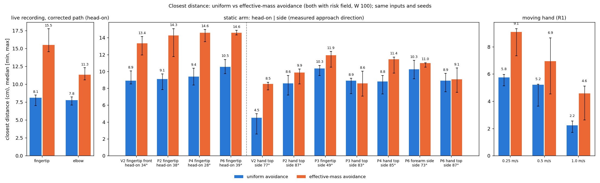

# 균일 회피 대 유효질량 회피: 두 방식 모두 위험 필드를 쓴 비교 (2026-11-21)

두 방식은 같은 MPC 와 같은 비용 구조를 쓴다. 사람 형상 둘레의 **이격 구역**(간격 d < 구역 두께 η)에 가파른 비용을 두고, 그 바깥 η ~ 2η 에 **위험 필드**(비용 언덕)를 둔다. 위험 필드는 로봇이 구역 경계에 닿기 전부터 미리 돌아가게 하는 비용이고, 높이 W 는 두 방식에 같다. **다른 것은 η 를 정하는 질량뿐이다.** 균일 회피는 모든 방향에서 η = 6.5 cm, 유효질량 회피는 방향별 유효질량으로 η 를 정한다. 필드 폭은 각 방식의 η 로 정해지므로, 유효질량 회피에서는 무거운 방향일수록 필드도 넓다.

```
η = clamp( d_base + k_gain · max( sqrt(μ / μ_iso) − 1, 0 ),  d_base,  η_max )      균일 회피: k_gain = 0 (η = d_base)

(로봇 구, 사람 형상) 쌍마다, d = 간격:
  이격 구역  c_zone  = w · (η − d)² / (2η)          (0 ≤ d < η),   w · (η/2 − d)  (d < 0),   0  (d ≥ η)
  위험 필드  c_field = W · (1 − (d − η) / η)²       (η ≤ d < 2η),  W  (d < η),                  0  (d ≥ 2η)
  쌍의 비용 = c_zone + c_field,  rollout 의 각 시점에서 쌍들의 최댓값을 더한다
```

| 매개변수 | 값 | 뜻 |
|---|---|---|
| w | 1e5 | 이격 구역 비용의 가중치 |
| W | 100 | 위험 필드 높이(w 와 같은 비용 단위). 두 방식에 같다 |
| 필드 폭 | η | 구역 바깥 η 만큼(경계 2η) |
| d_base, k_gain, μ_iso, η_max | 0.065 m, 0.10 m(균일 회피 0), 부위별, 0.25 m | 시뮬 예시의 값 |

균일 회피의 η 6.5 cm 는 유효질량 회피의 기본 두께 d_base 와 같다(V1 단계에서 정한 기본값). 가벼운 방향에서는 두 방식의 구역이 같고, 무거운 방향에서만 유효질량 회피의 구역이 두껍다.


*녹화된 편 팔 자세(live3m 동작 1)의 아래팔 축 단면. 왼쪽 균일 회피, 가운데 유효질량 회피. 채운 영역 = 이격 구역, 보라색 = 위험 필드(점선 = 2η). 오른쪽은 손끝 정면 방향의 비용이다. 손끝 정면에서 구역은 6.6 / 16.7 cm, 필드는 13.0 / 33.3 cm 까지 닿는다. 로봇을 4.6 kg 의 점으로 놓고 계산했다.*

## 방향별 구역 두께 (README 에서 옮김)

충돌 방향 u 는 로봇 구 중심에서 사람 형상의 가장 가까운 점을 향하는 방향이다. 이 방향으로 사람 분절의 유효질량 m_h, 로봇 구 위치의 유효질량 m_r 을 구하고, 둘을 묶은 환산질량 μ 로 그 쌍의 구역 두께 η 를 정한다.

```
m_h = 1 / (uᵀ Λ_h⁻¹ u)        Λ_h⁻¹ : 사람 분절의 3x3 작업공간 역관성 (체형·자세에서 계산)
m_r = 1 / (uᵀ Λ_r⁻¹ u)        Λ_r⁻¹ : 로봇 구 중심의 3x3 작업공간 역관성 (FR3 모델)
μ   = 1 / (uᵀ Λ_h⁻¹ u + uᵀ Λ_r⁻¹ u)
μ_iso = 1 / (1 / m_iso(부위) + 1 / m_r)      m_iso : ISO/TS 15066 의 부위별 기준 질량
```

이격 구역의 두께(cm): 몸 표면에서 구역 경계까지, 녹화된 세 자세

| 방식, 자세 | 손끝(팔꿈치) 앞 | 위쪽 |
|---|---|---|
| 균일 회피 (세 자세 모두) | 6.6 | 6.6 |
| 유효질량 회피, 편 팔 | 16.7 | 7.4 |
| 유효질량 회피, 굽힌 손 | 11.2 | 7.5 |
| 유효질량 회피, 팔꿈치 내밀기 | 10.0 | 7.8 |

- 같은 부위라도 앞쪽은 두껍고 위쪽은 균일 회피와 거의 같다.
- 균일 회피의 구역 두께는 6.5 cm 다. 표의 6.6 은 두께를 1 mm 간격으로 재면서 구역 경계를 처음 넘은 점을 적은 값이다.
- 두께는 로봇을 4.6 kg 의 점으로 놓고 계산했다.
- 자세가 달라 값이 다르다: 여기 16.7 cm 는 녹화된 편 팔이고, [../README.md 2-1](../README.md#2-1-같은-손에서-방향별-두께) 의 20.0 cm 는 앞으로 뻗은 정지 자세다.
- 사람 근처(형상 기준 0.4 m 안)에서는 로봇 구 속도 상한 0.5 m/s 비용을 함께 쓴다.


*앞으로 뻗은 정지 자세의 구역 표면. 그림 제목의 옛 표기 proposed (per-part reference) 는 유효질량 회피다.*

## 확인한 것

- **위험 필드를 끄면 이전 판과 같다.** 필드 코드가 들어간 뒤의 실행 노드로 V2 정면(seed 0)을 다시 돌려, 필드 코드 이전의 실행과 관절 명령 304개가 비트 단위로 같았다.
- **균일 회피에서 필드는 둥글다.** 구 형상 하나 둘레 400개 방향에서 GPU 커널의 필드 값이 간격마다 같았다(차이 ≤ 4e-4, W 100 기준, float32 반올림). 값은 식과 1.2e-4 안에서 맞았다. 유효질량 회피에서는 같은 형상에서 방향에 따라 η 가 6.5–10.9 cm 로 달라졌다.

## 결과: 같은 입력, 같은 seed 로 비교

간격은 로봇 구 전체(MPC 반지름 + 0.02 m)와 사람 형상 전체 사이에서 쟀고, 경로 양 끝 10 cm 는 뺐다. 값은 가장 가까운 간격의 중앙값 [최소, 최대] (cm)이다. 두 방식 모두 위험 필드 W 100 을 썼다.

**접근 방향.** 가장 가까울 때 로봇이 있는 방향(사람 표면의 가장 가까운 점 → 로봇 구 중심)과 아래팔 축이 이루는 각을 쟀다(0~90°로 접음). 45° 미만이면 **정면(head-on)**, 이상이면 **옆(side)** 이다. 정지한 팔은 사람 비용 없는 실행(V2) 또는 균일 회피 실행(on3)의 seed 3개 중앙값, 보정한 길은 사람 비용 없는 실행의 값이다.



*막대 = 중앙값, 선 = 최소·최대. 가운데 칸은 정지한 팔의 장면을 잰 접근 방향으로 나눴다(점선 왼쪽 정면, 오른쪽 옆).*

### 실제 Kinect 녹화, 보정한 길 (seed 0·1·2 × 출발 A·B, 방식마다 6회)

| 동작 (접근 방향) | 균일 회피 | 유효질량 회피 | 회피 시작 거리: 균일 / 유효질량 | 한 번 지나가는 시간 s: 균일 / 유효질량 |
|---|---|---|---|---|
| 편 팔 손끝 (정면, 15–23°) | 8.1 [7.0, 8.5] | 15.5 [14.6, 17.8] | 13.5 / 19.1 | 2.08 / 2.51 |
| 팔꿈치 (정면, 위팔 축 기준 1–15°) | 7.8 [7.1, 8.2] | 11.3 [10.6, 12.3] | 10.4 / 13.6 | 1.92 / 2.93 |
| 편 팔 손끝, 실물 설정 d_base 0.10 m | 10.7 [10.0, 13.7] | 21.1 [18.7, 23.0] | | 2.37 / 3.07 |
| 팔꿈치, 실물 설정 d_base 0.10 m | 10.6 [9.9, 11.5] | 14.7 [13.7, 15.5] | | 2.72 / 4.13 |

회피 시작 거리는 로봇 끝(TCP)이 사람 비용 없이 같은 길·출발로 간 실행의 경로에서 3 cm 넘게 벗어나 0.2 s 이어진 첫 순간의 간격이다(첫 통과만, 중앙값). 겹침은 모든 실행에서 0 스텝이다.


*같은 녹화(편 팔 손끝)를 두 방식에 다시 튼 장면(seed 0, 출발 A, 같은 시각). 화면 속 둥근 껍질은 구역 두께 η 이고, 위험 필드는 그 두 배까지 닿는다. 화면의 min distance 는 측정 구간의 최소 간격으로, 이 실행(seed 0)에서 8.2 / 15.2 cm 다. 원본: [field_motion1.mp4](media/field_motion1.mp4). 팔꿈치(정면): [field_motion3.gif](media/field_motion3.gif), [field_motion3.mp4](media/field_motion3.mp4)*

### 정지한 팔: 정면과 옆 (seed 0·1·2)

| 장면 | 접근 방향 (각) | 균일 회피 | 유효질량 회피 | 차이 |
|---|---|---|---|---|
| V2 손끝 앞을 가로지름 | 정면 (34°) | 8.9 [8.5, 10.1] | 13.4 [12.0, 14.1] | +4.5 |
| P2 손끝 앞 | 정면 (38°) | 9.1 [7.9, 9.7] | 14.3 [11.8, 15.1] | +5.2 |
| P4 손끝 앞 | 정면 (28°) | 9.4 [8.4, 10.4] | 14.6 [13.5, 15.0] | +5.2 |
| P6 손끝 앞 | 정면 (39°) | 10.5 [9.8, 11.4] | 14.6 [14.3, 14.9] | +4.1 |
| V2 손 위를 가로지름 | 옆 (77°) | 4.5 [2.6, 5.0] | 8.5 [7.8, 8.7] | +4.0 |
| P2 손 위 | 옆 (87°) | 8.6 [7.2, 9.5] | 9.9 [8.5, 10.3] | +1.3 |
| P3 손끝 앞 | 옆 (49°) | 10.3 [9.5, 10.7] | 11.9 [10.5, 12.4] | +1.6 |
| P3 손 위 | 옆 (83°) | 8.9 [7.4, 9.2] | 8.6 [7.1, 10.0] | −0.3 |
| P4 손 위 | 옆 (85°) | 8.8 [7.3, 9.5] | 11.4 [9.8, 11.7] | +2.6 |
| P6 아래팔 옆 | 옆 (73°) | 10.3 [9.1, 11.3] | 11.0 [10.5, 11.0] | +0.7 |
| P6 손 위 | 옆 (87°) | 8.9 [7.6, 9.8] | 9.1 [7.5, 10.4] | +0.2 |

**질량 효과는 정면에서 크고 옆에서 작다.** 정면 4개 장면에서 유효질량 회피가 4.1–5.2 cm 더 멀고, 옆 7개 중 6개 장면에서는 −0.3 ~ +2.6 cm 다. 예외인 V2 손 위(+4.0 cm)는 끝점이 손 바로 위에 있어 유효질량 회피가 seed 3개 중 2개에서 끝점 앞에 멈춘 장면이다(한계 1). 장면 이름이 "손끝 앞"인 P3 는 잰 각이 49° 라 옆으로 셌다. 모든 실행에서 겹침 0 스텝이다.


*같은 팔 자세, 같은 seed(0), 같은 시각. 위 줄은 로봇이 손끝 정면을 지나가고, 아래 줄은 손 위를 지나간다. 이 실행의 가장 가까운 간격은 정면 9.1 / 15.1 cm, 옆 8.6 / 10.3 cm 다. 화면 속 둥근 껍질은 구역 두께 η 다. 원본: [field_headon_side.mp4](media/field_headon_side.mp4)*

### 움직이는 손 (R1, 60초 왕복, 1.0 m/s 는 120초, seed 0·1·2)

| 손끝 최고 속도 | 균일 회피 | 유효질량 회피 | 통과 횟수 균일 / 유효질량 |
|---|---|---|---|
| 0.25 m/s | 5.8 [5.1, 6.0] | 9.1 [7.3, 9.3] | 25–27 / 25–26 |
| 0.5 m/s | 5.2 [3.6, 5.2] | 6.9 [4.5, 8.7] | 25–27 / 25–26 |
| 1.0 m/s | 2.2 [1.7, 2.6] | 4.6 [2.6, 5.1] | 52–55 / 50–55 |

모든 실행에서 겹침 0 스텝이다.

### 계산 시간

MPC 풀이 평균은 정지 장면 9개(on3)에서 균일 회피 10.6 ms, 유효질량 회피 10.6 ms 였다. 모두 16.7 ms(60 Hz) 안이다.

## 실물 FR3 에서 제안 방법의 동작 (한 단락)

실물에서는 유효질량 회피만 돌렸다(d_base 0.10 m, W 100). 실물에서 균일 회피와 비교하지는 않았다. 실물 실행 real_ym_1120_202059 에서 사람 팔과의 가장 가까운 간격은 7.5 cm 였고, 간격이 10 cm 미만인 스텝은 34개, 끝점 도착은 4번이었다. 사람 한 명, 실행 몇 번의 결과다. 실물 영상은 넣지 않았다.

## 한계

1. **끝점이 위험 필드 안에 있으면 끝점 앞에서 멈출 수 있다.** V2 손 위 장면의 유효질량 회피는 seed 3개 중 2개가 끝점 1.5–2.7 cm 앞에서 섰다(길의 99 % 진행, 속도 1.2 cm/s 미만). 필드 비용과 끝점 자세 비용이 균형을 이룬 것이다.
2. **지나가는 시간이 늘 수 있다.** 팔꿈치 보정한 길에서 한 번 지나가는 시간은 균일 회피 1.92 s, 유효질량 회피 2.93 s 였다. 실물 설정(d_base 0.10)의 유효질량 회피는 손끝 3.07 s, 팔꿈치 4.13 s 다.
3. **W 100 은 실물 기록 재생에서 정한 값이고, 두 방식에 같다.** 시뮬에서는 겹침·실행 불가능·통과 횟수 감소가 없어 그대로 썼다.
4. Isaac 예시는 실행 노드(`step2b_mpc_isaac.py`)를 바꾸지 않고, 시작할 때 `MeffChannel.set_field(1, 100)` 을 켜는 실행기 [tools/step2b_mpc_isaac_field.py](tools/step2b_mpc_isaac_field.py) 로 돌렸다. 공개 예시는 이 실행기로 재현한다(파일 머리에 실행 예). 위험 필드 코드는 `goal1/scripts/g1_meff_gpu.py`(`MeffChannel.set_field`)에 있다.
5. **실제 녹화 비교의 길은 녹화 뒤에 정했다.** 가상 로봇 베이스의 위치를 동작마다 옮겼다. 길 보정 비교는 자세가 유지되는 3~4초 구간에서만 쟀고, 굽힌 손 동작은 조건을 만들지 못했다. 녹화된 사람은 로봇에 반응하지 않는다. 영상의 Isaac 화면은 실행 기록으로 다시 그린 것이다(정지 장면은 같은 설정으로 다시 돌려 관절 명령이 원래 실행과 비트 단위로 같음을 확인했다). 실시간 실행 당시에는 화면이 실제의 약 0.6배로 흘렀다.
6. **구역이 두꺼워도 실제 간격은 그보다 작을 수 있다.** 로봇은 구역이 얇은 쪽(비스듬한 쪽, 위쪽)으로 비켜 지나간다. 실제 녹화의 손끝 동작에서도 처음 정한 길에서는 가장 가까운 방향이 대부분 손 위쪽이어서 차이가 정지 장면보다 작았다(이전 판).
7. **구역 그림과 두께는 로봇을 4.6 kg 의 점으로 놓고 계산했다.**
8. **실물에서는 유효질량 회피만 돌렸다(사람 한 명, 실행 몇 번).** 두 방식의 실물 비교는 effmass-mpc-franka 에서 다룬다. 실제 녹화 비교는 사람 한 명의 녹화 한 번이다.

## 이전 판 결과 (README 에서 옮김)

이 절의 결과는 지금 판과 섞지 않는다. **이전 판**은 위험 필드 없이 이격 구역 안(d < η)에서만 비용을 준 판이다(2026-11-19 까지, W = 0 과 같다). **이전 식**은 그보다 앞의 구역 식으로, 모든 부위에 같은 기준 질량 0.53 kg 을 썼다.

- 이전 판, 같은 녹화의 보정한 길: 편 팔 손끝 균일 회피 5.8 / 유효질량 회피 13.5 cm, 팔꿈치 5.6 / 8.8 cm.
- 이전 판, 빠른 손 + 지연: 손이 1.0 m/s 로 움직이고 지연 100 ms 가 겹치면, 유효질량 회피가 균일 회피보다 낫다는 것이 확인되지 않았다(이전 식 결과).
- 이전 판, 가로지르기 0.5 m/s: 아래팔 쪽에서 다가오는 장면이라 구역이 균일 회피와 비슷해 유효질량 회피의 이점이 없었다(최소 간격 0.2~1.2 대 0.0~1.2 cm).
- 이전 판, 카메라 결함(지연·떨림·누락): 이전 식, 대부분 seed 1개, 합성 잡음 기준이다.

이전 판의 분석과 영상:

- [실제 Kinect 녹화로 본 손·팔꿈치 회피 → ../live/README.md](../live/README.md): 길 보정, 처음 정한 길에서 차이가 작았던 이유, 구역 모양 그림, 세 화면 영상.
- [시뮬레이션 결과 분석 전체 → ../README.md](../README.md): 자세·방향별 구역, 정지한 팔 9개 장면, 움직이는 손, 건네기·가로지르기, 빠른 손과 움직임 예측, 카메라 지연·떨림·누락. 일부는 이전 식 결과이며 각 항목에 표시했다.

## 미포함 항목과 이유 (README 에서 옮김)

| 항목 | 이유 |
|---|---|
| SMPL / SMPL-H 모델 파일 | 모델 라이선스상 재배포 불가 |
| 사람 데이터 (Kinect 원본 컬러 프레임, Kinect 녹화에서 나온 자세·위치, 메시 정점, SMPL 매개변수가 든 npz, 구역 메시 npz) | 개인 데이터와 SMPL 파생 데이터 |
| NVIDIA GPU MPC 라이브러리, Isaac Sim, CUDA, Franka 설명 파일·USD 등 타사 코드와 로봇 에셋 | 각 원저작자 배포본을 써야 함 |
| 사람 동역학 ROS 2 패키지 (`ws/`) | 기존 연구실 코드에 기반한 파일이 포함되어 공개 범위 검토 중 |
| ISO/TS 15066 수치 파일 | 규격 문서의 수치를 담고 있어 공개 범위 검토 중 |
| 가상환경, 캐시, 프레임·녹화 폴더, 25 MB 넘는 영상 | 다시 만들 수 있거나 용량이 큼 |

`env_check/scripts/`, `goal1/scripts/` 의 스크립트는 개발 환경의 폴더 배치(절대 경로 포함)를 가정한다. 로그 파일에도 개발 환경의 경로가 남아 있다.

## 저장소 경로 전체 (README 에서 옮김)

| 경로 | 설명 |
|---|---|
| `env_check/scripts/` | MPC 실행 노드(`step2b_mpc_isaac.py`, Isaac Sim 안에서 MPPI 실행), 장면·실행 스크립트, 환경 점검 단계 스크립트 |
| `goal1/scripts/` | 실험 실행 래퍼, 유효질량 비용 채널(`g1_meff_gpu.py`, 위험 필드 포함), 분석·그림·영상 합성 스크립트 |
| `goal1/config/` | 조정 결과 프로파일 (`tuned_t1.yml`), 시험용 변형 프로파일 |
| `goal1/scene_g1.json`, `goal1/b2a/g2/scene_*.json` | 장면 정의 (목표 자세, 경로 끝점, 시작 관절값) |
| `goal1/logs/*.json` | 사람·로봇 유효질량 검증 로그, FR3 모델 점검 |
| `goal1/logs/meff_isaac/` | 요약 로그 json |
| `goal1/b2a/b2a5_fig*.png`, `goal1/zone/*.png`, `goal1/r1/*.png` | 단계별 그림 (구역, 움직이는 손 등) |
| `goal1/overnight/`, `goal1/overnight2/` | 이후 시험의 그림과 작업 기록, 실물 연결 준비 기록 |
| `analysis/` | 결과 분석 문서, 그림·영상 사본 (`analysis/field/` 지금 판, `analysis/live/` 와 `analysis/README.md` 이전 판) |
| `goal1/live/live3m/` | 녹화 비교 결과(표 json, 그림, 영상). 원본 컬러 프레임과 사람 자세 자료는 미포함 |
| `goal1/part_regen/` | 기준 질량을 부위별로 바꾼 식의 재실행 요약과 그림 |
| `goal1/public_draft/` | 이전 공개 갱신의 처리표, 바뀐 숫자 목록, 점검 기록 |
| `goal1/step1_2_report.md`, `goal1/step1_3_report.md` | 단계별 작업 기록 (작성 당시 원문 유지) |
| `media/` | 이전 대표 GIF 와 원본 mp4 (이전 식) |
| `docs/` | 단계별 진행 기록, 커밋 규칙 |
