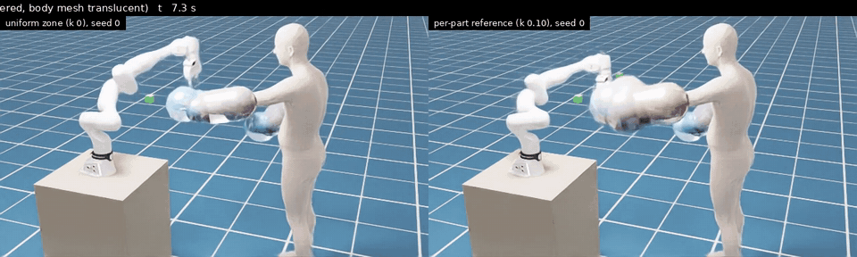
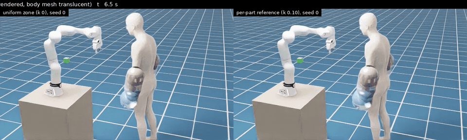
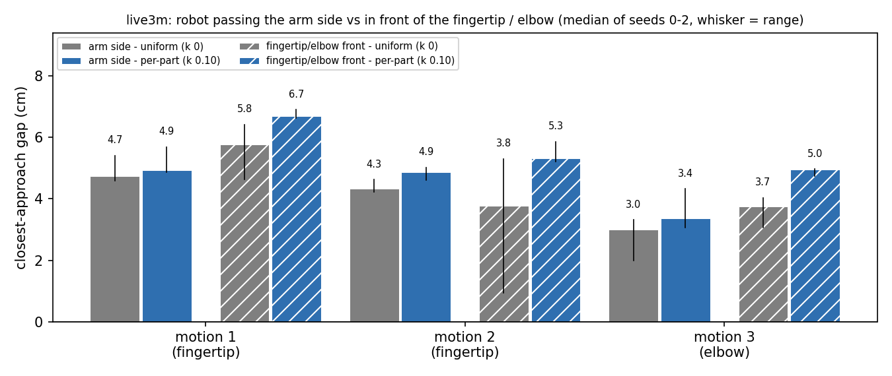
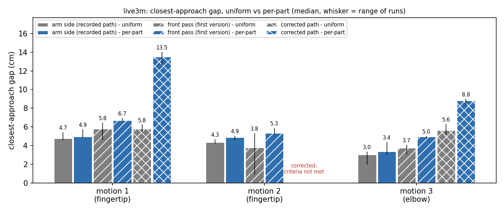
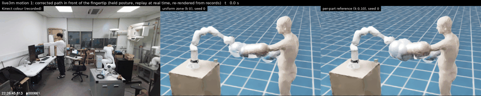
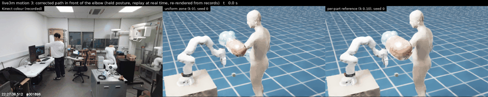
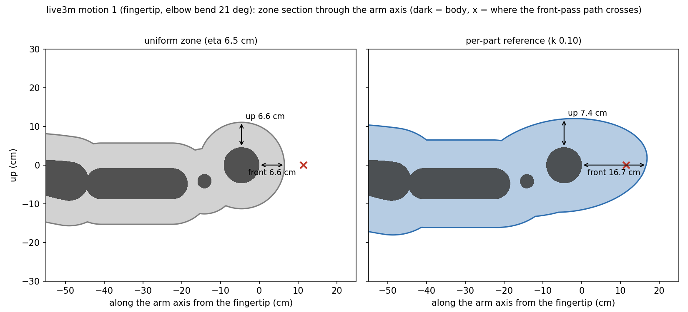
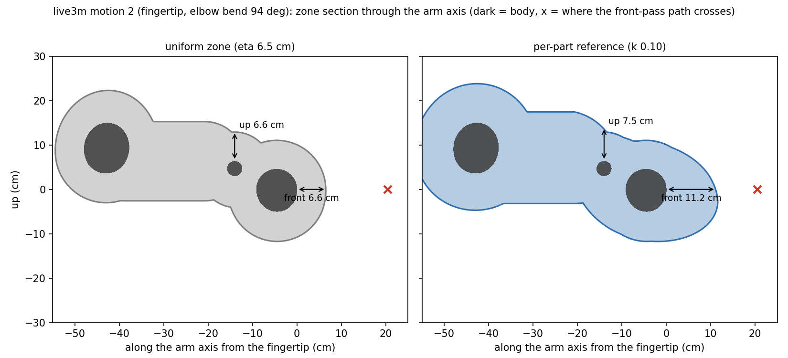
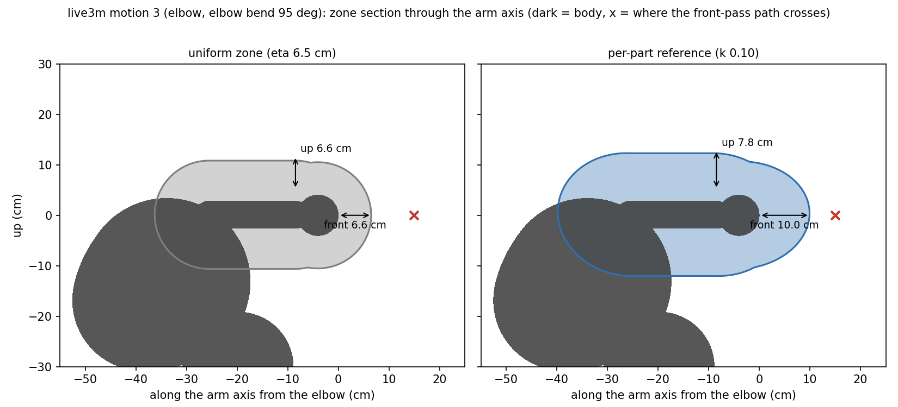
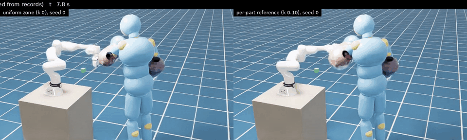

# 실제 Kinect 녹화로 본 손·팔꿈치 회피: 팔 옆 접근과 손끝 앞 통과

이 글은 사람이 실제 Kinect 카메라 앞에서 한 세 동작을 녹화해, 균일 회피와 부위별 기준(제안 방식)을 같은 조건에서 비교한 결과다.
녹화된 사람 움직임을 제 속도로 다시 틀었다. 로봇은 Isaac Sim 의 가상 Franka FR3 다.
같은 녹화에서 로봇의 길을 보정해 다시 비교한 결과는 2절의 "길을 보정한 비교"에 있다.

*손끝 앞 통과(동작 1, 편 팔). 왼쪽 균일, 오른쪽 부위별 기준, seed 0, 반투명 사람 메시와 회피 구역(손·아래팔·팔꿈치). 부위별 기준의 구역이 손끝 앞으로 더 두껍게 나와 있다. 다만 이 실행의 손끝 최소 간격은 균일 6.4 cm, 부위별 기준 6.9 cm 로 차이는 0.5 cm 다(부위별 기준 실행에서 가장 가까운 순간 로봇은 손 위쪽에 있었다).*

*팔 옆 접근(동작 1, 녹화 당시 로봇 길). 팔이 길을 가로막아 로봇이 아래팔 옆에서 기다린다. 두 방식의 간격 차이는 0.2 cm 다.*

## 1. 무엇을 했나

- **녹화(live3m)**: 한 사람이 카메라 앞에서 팔을 내리고 서 있다가 세 동작을 차례로 했다. 동작 1 = 팔을 편 채 손끝 내밀기, 동작 2 = 팔꿈치를 굽힌 손, 동작 3 = 팔꿈치 내밀기. 각 동작은 15~20초 유지했다.
- **다시 틀기**: 녹화된 사람 자세를 사람 시간 = 시뮬레이션 시간이 되도록 틀었다. 실시간 실행 당시에는 화면이 실제의 약 0.6배로 흘러 로봇이 늦게 피했기 때문이다. 설정은 실시간 실행과 같다(움직임 예측, 사람 근처 속도 상한 0.5 m/s 등).
- **두 방식**: 균일 = 모든 부위·방향에 6.5 cm, 부위별 기준 = 방향별 환산질량을 그 부위의 ISO/TS 15066 기준 질량과 비교해 두께를 정함(k_gain 0.10 m). seed 0·1·2.
- **세 가지 로봇 길**
  - 팔 옆 접근: 녹화 당시의 로봇 길(로봇 앞을 좌우로 왕복). 뻗은 팔이 길을 가로질러, 로봇은 아래팔 옆면에 다가가 기다렸다.
  - 손끝 앞 통과: 동작마다 새로 정한 길. 그 동작에서 자세를 유지한 프레임들의 중앙값 자세를 쓰고, 손끝(동작 3은 팔꿈치) 바로 앞을 팔 축에 직각인 수평선으로 지나가게 했다. 사람 비용 없이 지나가면 약 3 cm 거리가 되도록 손끝에서 떨어진 거리를 맞췄다. 아래에서 "처음 정한 길"이라고 부른다.
  - 보정한 길: 접근 방향이 손끝이 가리키는 방향(팔꿈치가 내민 방향)과 맞도록 길의 높이·거리와 가상 로봇의 위치를 다시 정한 길. 2절의 "길을 보정한 비교"에 있다.
- **간격**: 로봇 충돌 구 표면(여유 2 cm 포함)에서 사람 몸 형상(캡슐) 표면까지의 거리다. 음수면 겹친 것이다.

## 2. 결과

| 동작 | 로봇 길 | 균일 간격 (cm) | 부위별 간격 (cm) | 차이 | 가장 가까운 부위·방향 | 그 순간 부위별 구역 두께 |
|---|---|---|---|---|---|---|
| 1 편 팔 손끝 | 팔 옆 접근 | 4.7 [4.6, 5.4] | 4.9 [4.9, 5.7] | +0.2 | 아래팔 옆 | 6.9 cm |
| 1 편 팔 손끝 | 손끝 앞 통과 | 5.8 [4.6, 6.4] | 6.7 [6.6, 6.9] | +0.9 | 손끝, 주로 위쪽 | 7.1 cm |
| 2 굽힌 손 | 팔 옆 접근 | 4.3 [4.2, 4.6] | 4.9 [4.6, 5.0] | +0.5 | 아래팔 옆 | 7.0 cm |
| 2 굽힌 손 | 손끝 앞 통과 | 3.8 [0.9, 5.3] | 5.3 [5.2, 5.9] | +1.5 | 손끝, 주로 위쪽 | 6.5 cm |
| 3 팔꿈치 내밀기 | 팔 옆 접근 | 3.0 [2.0, 3.3] | 3.4 [3.1, 4.3] | +0.4 | 위팔·손 | 6.5 cm |
| 3 팔꿈치 내밀기 | 팔꿈치 앞 통과 | 3.7 [3.1, 4.0] | 5.0 [4.8, 5.0] | +1.2 | 팔꿈치, 주로 앞쪽 | 8.0 cm |

위 표는 팔 옆 접근과 처음 정한 길의 결과다. 값은 seed 3개의 중앙값 [최솟값, 최댓값]. 팔 옆 접근은 동작 구간 전체의 팔 최소 간격, 손끝 앞 통과는 자세를 유지한 프레임에서 손끝(팔꿈치)까지의 최소 간격이다. 겹친 스텝은 손끝 앞 통과 동작 2 균일 seed 0 에서만 8스텝이고, 나머지는 모두 0 이다.

### 결과의 해석과 계획

정지한 사람 형상을 쓴 실험에서는 두 방식의 차이가 분명했다. 손끝 정면으로 지나갈 때의 간격이 균일 5.3~6.2 cm, 부위별 기준 10.6~10.9 cm였다.

실시간 RGB-D 카메라를 연결한 가상환경 실험에서는 처음에 차이가 0.9~1.5 cm로 작게 나왔다. 이 실험에서 사용자는 화면 속 가상 로봇을 보면서 자세를 잡아야 했다. 사람의 유효질량이 가장 크게 나타나는 방향(손끝 정면)으로 로봇이 지나가도록 팔의 각도와 위치를 화면만 보고 맞추기는 어려웠다. 녹화된 팔은 아래로 14~15도 기울어 있었고, 손끝 동작에서 로봇은 대부분 구역이 얇은 손 위쪽에서 먼저 가까워졌다.

그래서 같은 녹화에서 로봇의 길만 다시 정해 비교했다. 사람 자세는 그대로 두고, 로봇이 손끝이 가리키는 방향(편 팔)과 팔꿈치가 내민 방향의 3 cm 앞을 지나가도록 길의 높이·거리와 가상 로봇의 위치를 보정했다. 부위별 기준은 균일보다 편 팔에서 7.7 cm(5.8 → 13.5 cm), 팔꿈치에서 3.2 cm(5.6 → 8.8 cm) 더 멀리 지나갔다. 그 방향의 구역 두께 차이(편 팔 약 8~10 cm, 팔꿈치 약 3 cm)와 비슷한 크기다. 굽힌 손 동작은 반대쪽 손이 길을 막아 같은 조건을 만들지 못했다.

이 비교에서 길은 녹화 뒤에 정했고, 녹화된 사람은 로봇에 반응하지 않는다. 사람이 직접 자세와 접근 방향을 맞추는 비교는, 실제 로봇을 눈앞에 두고 진행하는 하드웨어 실험에서 다룰 계획이다.

### 길을 보정한 비교

| 동작 | 팔 옆 접근 | 손끝 앞 통과 (처음 정한 길) | 보정한 길 |
|---|---|---|---|
| 1 편 팔 손끝 | 4.7 → 4.9 (+0.2) | 5.8 → 6.7 (+0.9) | 5.8 → 13.5 (+7.7) |
| 2 굽힌 손 | 4.3 → 4.9 (+0.5) | 3.8 → 5.3 (+1.5) | 기준 미충족 |
| 3 팔꿈치 내밀기 | 3.0 → 3.4 (+0.4) | 3.7 → 5.0 (+1.2) | 5.6 → 8.8 (+3.2) |

값은 균일 → 부위별 기준의 간격(cm)이다. 앞의 두 열은 seed 3개의 중앙값이고 동작 전체를 틀었다. 보정한 길은 자세가 유지되는 구간만 틀었고, 방식마다 6회(seed 0·1·2 × 출발 끝 2가지)의 중앙값이다. 범위는 편 팔이 5.4~6.2 대 12.6~14.0 cm, 팔꿈치가 5.2~6.3 대 8.3~9.0 cm 다. 겹친 스텝은 없다.

*보정한 길, 편 팔 손끝(seed 0). 왼쪽부터 컬러 영상, 균일, 부위별 기준. 원본: [corrected_motion1.mp4](media/corrected_motion1.mp4)*

*보정한 길, 팔꿈치(seed 0). 비용을 끈 간격이 네 번 중 한 번 기준을 벗어났고(5.0 cm), 길 높이가 허용 범위의 끝이다(−19.7 cm). 원본: [corrected_motion3.mp4](media/corrected_motion3.mp4)*

**보정 방법**

- 맞춘 기준은 두 가지다. (a) 사람 회피 비용을 끄고 지나갈 때 최소 간격이 가는 방향과 오는 방향 모두 3 ± 1 cm. (b) 가장 가까운 순간의 접근 방향이 목표 방향과 30도 안. 목표 방향은 편 팔이 아래팔 축, 팔꿈치가 위팔 축이다.
- 간격은 로봇 구 전체 대 사람 형상 전체로 쟀고, 길의 양 끝 10 cm 는 뺐다.
- 비용을 끄면 MPC 는 두 끝 사이를 직선으로 가지 않는다. 처음 정한 길에서는 한 방향만 사람 쪽으로 20 cm 부풀었다. 가상 로봇 받침을 목표 방향의 연장선 위로 옮겨 길이 로봇 정면에서 좌우 대칭이 되게 하자, 부풂이 양 방향에서 4~8 cm 로 비슷해졌다.
- 길을 낮췄다(편 팔 −16.2 cm, 팔꿈치 −19.7 cm). 그리퍼가 아래를 향해 손목 위쪽 링크가 가장 앞으로 나오므로, 이 부분이 손끝(팔꿈치) 아래로 지나가야 접근 방향이 맞는다.
- 자세 보정은 쓰지 않았다.

| 동작 | 비용 끔 간격, 가는 방향 (cm) | 오는 방향 (cm) | 접근 방향 각도 |
|---|---|---|---|
| 1 편 팔 손끝 | 3.6 / 2.8 / 2.9 | 2.4 / 2.3 / 3.9 | 5~23도 |
| 3 팔꿈치 내밀기 | 3.0 / 5.0 | 2.5 / 3.9 | 1~15도 |

값은 유지 구간 안의 통과마다 하나다. 같은 방향에서도 통과마다 약 ±1 cm 달라진다.

**굽힌 손 동작이 안 된 이유**

왼손 손끝이 가리키는 쪽에 오른손이 있다(옆으로 18 cm, 앞으로 22 cm). 수평 길은 가장 유리하게 본 정적 계산에서도, 손끝 간격을 3 cm 로 두면 오른손이나 골반이 1.4~2.5 cm 로 더 가깝다. 팔을 어깨에서 15도까지 들어 올린 경우를 계산해도 맞출 수 없었다. 길을 위아래로 세우면 로봇이 10 cm 넘게 부풀고 방향마다 달라서, 간격이 −5.8 ~ +8.7 cm 로 흩어지고 오른손과 겹쳤다. 그래서 이 동작은 비교와 영상을 만들지 않았다.

**이 비교의 한계**

- 길은 녹화 뒤에 정했다. 녹화된 사람은 로봇에 반응하지 않는다.
- 가상 로봇 받침을 동작마다 옮겼다(편 팔: x −0.64, y +0.30 m, 팔꿈치: x −0.37, y +0.41 m). 자세는 보정하지 않았다.
- 유지 구간이 3~4초로 짧다(편 팔 3.9초, 팔꿈치 3.2초). 실행마다 통과가 두 번쯤이다.
- 사람 한 명, 녹화 하나, 동작 두 개의 결과다.
- 기준 (a)는 팔꿈치에서 네 번 중 한 번이 벗어났다(5.0 cm).
- 팔꿈치의 길 높이는 허용 범위의 끝(−19.7 cm)이다.
- 앞의 두 비교와 실행 방식이 다르다(유지 구간만 틂, 출발 끝 2가지).
- 화면은 기록으로 다시 그렸다(메시는 표시용).

### 구역 모양: 녹화된 세 자세

같은 자세, 같은 시점에서 균일 구역(회색)과 부위별 구역(파랑)을 팔 축을 지나는 단면으로 그렸다. x 표시는 손끝 앞 통과 길이 지나는 곳이다.

| 동작 | 손끝(팔꿈치) 앞 두께, 균일 | 부위별 | 위쪽 두께, 균일 | 부위별 |
|---|---|---|---|---|
| 1 편 팔 | 6.6 cm | 16.7 cm | 6.6 cm | 7.4 cm |
| 2 굽힌 손 | 6.6 cm | 11.2 cm | 6.6 cm | 7.5 cm |
| 3 팔꿈치 | 6.6 cm | 10.0 cm | 6.6 cm | 7.8 cm |

*구역 그림은 점 로봇(4.6 kg)으로 그렸다. 실제 실행에서는 로봇 구마다 유효질량이 달라 두께가 조금 다르다.*

### 영상

세 화면은 왼쪽부터 녹화된 Kinect 컬러, 균일, 부위별 기준이다(seed 0). 두 Isaac 화면은 실행 기록(관절 값)으로 다시 그렸고, 사람은 반투명 SMPL 메시로 함께 그렸다. 컬러와 Isaac 화면의 시간 차는 0.03초 이내다.

| 동작 | 손끝 앞 통과 | 팔 옆 접근 |
|---|---|---|
| 1 편 팔 손끝 | [front_motion1.mp4](media/front_motion1.mp4) | [side_motion1.mp4](media/side_motion1.mp4) |
| 2 굽힌 손 | [front_motion2.mp4](media/front_motion2.mp4) | [side_motion2.mp4](media/side_motion2.mp4) |
| 3 팔꿈치 내밀기 | [front_motion3.mp4](media/front_motion3.mp4) | [side_motion3.mp4](media/side_motion3.mp4) |

실시간 실행 그대로의 영상: [live_run_as_executed.mp4](media/live_run_as_executed.mp4). 화면 속 Isaac 은 당시 실제의 약 0.6배로 흘렀다. 위의 비교 영상(제 속도로 다시 튼 것)과 다르다.

## 3. 해석

손끝 앞에서는 팔 길이 방향으로 손에 팔 전체의 관성이 실려 환산질량이 크다. 그래서 손끝(팔꿈치) 앞에서 부위별 기준의 구역이 균일보다 1.5~2.5배 두껍다(편 팔 16.7, 굽힌 손 11.2, 팔꿈치 10.0 대 6.6 cm). 반면 아래팔 옆면이나 손 위쪽에서는 그 방향으로 움직이는 질량이 손이나 아래팔 하나 정도뿐이다. 이 질량은 그 부위의 ISO 기준 질량과 비슷해서, 부위별 기준에서도 구역이 6.5~7.5 cm 로 균일과 거의 같다. 팔 옆으로 다가온 녹화에서 두 방식의 차이가 0.2~0.5 cm 에 그친 것은 이 때문이며, 방법이 뜻한 대로의 결과다. 손끝(팔꿈치) 앞을 지나게 하자 차이가 0.9~1.5 cm 로 커졌다. 다만 정지 장면(V2 정면, 균일 5.3~6.2 대 부위별 10.6~10.9 cm)만큼 커지지는 않았다. 녹화된 팔이 아래로 14~15도 기울어 있어서, 손끝 동작(동작 1·2)에서는 대부분 로봇 손 위쪽의 큰 구가 손 위에서 먼저 다가왔고, 그 방향의 구역은 얇기 때문이다. 앞쪽에서 가장 가까워진 동작 3(팔꿈치)에서 구역이 8.0 cm 로 가장 두꺼웠다. 접근 방향을 맞춘 길에서는 차이가 7.7 cm(편 팔), 3.2 cm(팔꿈치)로 커졌다(2절의 "길을 보정한 비교").

## 4. 한계

- 녹화할 때 사람은 화면 속 가상 로봇을 보며 자세를 잡았다. 손끝 정면으로 로봇이 지나가도록 팔의 각도와 위치를 통제하지 못했다.
- 로봇의 길은 녹화가 끝난 뒤에 정했다. 손끝 앞 통과 길은 녹화된 자세에 맞춰 만들었고, 손이 닿도록 가상 로봇 받침을 옮겼다(동작 1: x −0.30 m, 동작 2: x +0.10, y +0.30 m, 동작 3: x −0.10 m).
- 화면은 실행 기록으로 다시 그렸다. 실시간 실행 당시의 화면이 아니다.
- 녹화된 사람은 로봇에 반응하지 않는다. 실제 협업에서는 사람이 로봇을 보고 손을 뺀다.
- 손끝 앞 통과의 지표는 자세를 유지한 프레임(동작별 73 / 35 / 33 %)에서만 냈다. 그 밖의 프레임에서는 손이 움직여 길과의 거리가 달라진다.
- 길을 6 cm 낮춘 시험(팔꿈치 앞 +4.0 cm)은 탐색 결과이며 조건이 깨끗하지 않다. 이후 길 보정 비교로 대체됐다(5절).
- 길을 보정한 비교의 한계는 2절의 해당 항목에 따로 적었다.
- 사람 한 명, 녹화 한 번, seed 3개의 결과다.
- 실물 로봇 결과가 아니다.

## 5. 길을 6 cm 낮춘 시험 (탐색 결과, 이후 길 보정 비교로 대체됨)

**이후 길 보정 비교로 대체됨.** 탐색 결과이며 조건이 깨끗하지 않다. 2절의 결과를 대신하지 않는다.

로봇 손 위쪽 몸체가 손끝·팔꿈치 높이로 지나가도록 길을 6 cm 낮추고 다시 비교했다. 팔꿈치 앞(동작 3)에서는 가장 가까운 방향이 모두 앞쪽이 되었다. 부위별 기준이 균일보다 4.0 cm 더 멀리 지나갔다(4.1 대 8.1 cm). 손끝 앞(동작 1·2)은 +1.1 / +1.7 cm 로 조금만 커졌다. 이 시험에서는 사람 비용 없이 지나가는 간격이 왕복마다 크게 흔들렸고(동작 1: −8.4 ~ +4.8 cm), 팔꿈치 앞에서 한 번 지나가는 시간이 3.2 초에서 9.5 초로 늘었다. 그래서 두 방식의 조건이 같다고 보기 어렵고, 탐색 결과로만 본다.

*이후 길 보정 비교로 대체됨. 탐색 결과이며 조건이 깨끗하지 않다(대표 장면이 아님). 팔꿈치 내밀기, 길을 6 cm 낮춤, seed 0. 컬러 화면이 있는 원본: [elbow_front_low_motion3.mp4](media/elbow_front_low_motion3.mp4) (메시 없이 형상 캡슐로 그림)*

근거 파일: `goal1/live/live3m/compare/`(팔 옆 접근), `goal1/live/live3m/compare_tip/`(손끝 앞 통과, 처음 정한 길), `goal1/live/live3m/corrected/`(보정한 길: REPORT.md, summary.json), `goal1/live/live3m/zone_figs/`(구역 그림).
