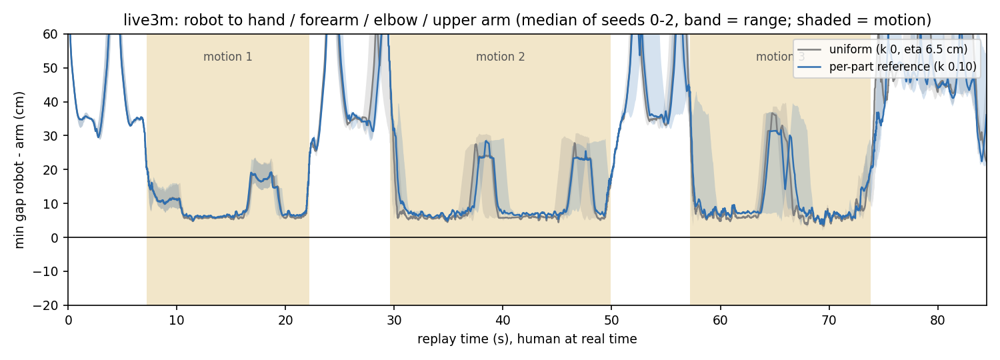
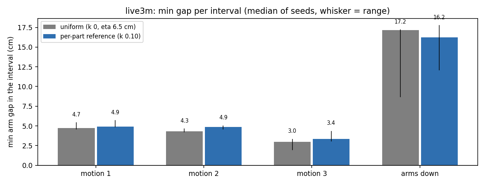

# live3m: uniform vs per-part reference, replay at real time

Recording live3m (human data of the live run) replayed headless with human time = simulated time, live settings (live_t1.yml, scene_live_front.json, frame of the run), seeds 0-2 per mode. Length 84.5 s (5069 steps).
Motions: an arm part (hand, forearm, elbow) within 25 cm of the robot reference path (TCP segment A-B) for >= 3 s (gaps < 0.5 s bridged); found 3.

Values: median [min, max] of seeds 0-2. Gap = robot sphere surface (incl. 0.02 m buffer) to shape surface, cm. eta = zone thickness of that mode at the moment of the min arm gap (cm). Overlap = steps with an arm gap < 0. Pass = steps between arrivals (s).

| interval | mode | hand | forearm | elbow | upper arm | closest | eta | overlap | arrivals | pass s |
|---|---|---|---|---|---|---|---|---|---|---|
| motion 1 (7.2-22.2 s) | uniform | 9.8 [7.4, 13.4] | 4.7 [4.6, 5.4] | 6.6 [5.8, 7.0] | 9.3 [8.2, 10.7] | forearm/forearm/forearm | 6.5 [6.5, 6.5] | 0 [0, 0] | 2 [2, 2] | 5.75 [5.59, 5.82] |
| motion 1 (7.2-22.2 s) | part | 9.9 [7.4, 13.0] | 4.9 [4.9, 5.7] | 7.0 [6.7, 7.4] | 9.6 [9.2, 11.0] | forearm/forearm/forearm | 6.9 [6.7, 7.1] | 0 [0, 0] | 2 [2, 2] | 5.76 [5.49, 5.87] |
| motion 2 (29.6-49.9 s) | uniform | 7.0 [5.7, 8.6] | 4.3 [4.2, 4.6] | 5.1 [5.0, 5.2] | 5.1 [4.9, 5.3] | forearm/forearm/forearm | 6.5 [6.5, 6.5] | 0 [0, 0] | 2 [2, 3] | 8.97 [8.90, 9.11] |
| motion 2 (29.6-49.9 s) | part | 7.7 [6.1, 8.4] | 4.9 [4.6, 5.0] | 5.8 [5.8, 5.8] | 6.3 [6.2, 6.5] | forearm/forearm/forearm | 7.0 [7.0, 7.1] | 0 [0, 0] | 2 [2, 3] | 8.95 [8.94, 9.35] |
| motion 3 (57.2-73.8 s) | uniform | 3.3 [2.0, 3.8] | 3.8 [3.3, 3.8] | 4.8 [4.7, 5.5] | 3.8 [3.0, 3.8] | upper_arm/hand/hand | 6.5 [6.5, 6.5] | 0 [0, 0] | 1 [1, 2] | 8.90 [8.63, 9.03] |
| motion 3 (57.2-73.8 s) | part | 3.8 [3.1, 5.1] | 4.0 [3.8, 4.3] | 6.5 [5.3, 6.6] | 4.7 [3.4, 5.2] | upper_arm/forearm/hand | 6.5 [6.5, 8.5] | 0 [0, 0] | 2 [1, 2] | 8.77 [5.69, 9.23] |
| arms down | uniform | 28.1 [23.9, 28.9] | 22.4 [22.0, 23.5] | 24.1 [23.2, 24.1] | 17.2 [8.7, 17.2] | upper_arm/upper_arm/upper_arm | 6.5 [6.5, 6.5] | 0 [0, 0] | 20 [20, 20] | 2.38 [2.38, 2.42] |
| arms down | part | 28.3 [24.0, 28.9] | 22.4 [22.1, 23.9] | 24.3 [23.2, 24.5] | 16.2 [12.1, 17.8] | upper_arm/upper_arm/upper_arm | 9.0 [7.8, 10.0] | 0 [0, 0] | 20 [20, 20] | 2.43 [2.42, 2.53] |

Per-part minus uniform, min arm gap (median of seeds, cm): motion 1 +0.2, motion 2 +0.5, motion 3 +0.4, arms down -0.9.
First step where the two modes' joint commands differ (per seed, s): 7.18, 7.22, 7.05; before it the two runs are bit-equal (same seed, same human, all zones at eta0). Nearest human shape then (gap cm / segment): 23.9/15, 20.8/15, 27.1/12.
Realtime factor of the replays (headless): uniform 0.42, 0.82, 0.80; part 0.42, 0.82, 0.81.

Video: live3m_compare.mp4 (Kinect colour | uniform | per-part, seed 0, 84.5 s); zone shells on forearms, hands and elbows. Colour frame to replay time offset median 10 ms, max 29 ms. Clips: clip_motion1.mp4 (6.5 s +10 s), clip_motion2.mp4 (29.9 s +10 s), clip_motion3.mp4 (62.4 s +10 s).
## Interpretation

검출된 동작은 3개다. 녹화 순서(편 팔 손끝 -> 팔꿈치 굽힌 손 -> 팔꿈치 내밀기)와 맞는다. 쓰인 팔은 모델 분절 13·15·17이다. 자세는 사람 데이터에서 잰 팔꿈치 굽힘과 어깨-손 거리의 중앙값이다(`direction_L.json`, lv_cmp_direction.py live3m L).

| 동작 | 자세 | 부위별 - 균일, 팔 최소 간격 | 가장 가까운 부위 | 그때 구역 (부위별) |
|---|---|---|---|---|
| 1 편 팔 손끝 (7.2-22.2 s) | 굽힘 21도, 0.61 m | +0.2 cm (4.7 -> 4.9) | 아래팔 3/3 | 6.9 cm |
| 2 굽힌 손 (29.6-49.9 s) | 굽힘 91도, 0.44 m | +0.5 cm (4.3 -> 4.9) | 아래팔 3/3 | 7.0 cm |
| 3 팔꿈치 내밀기 (57.2-73.8 s) | 굽힘 94도, 0.43 m | +0.4 cm (3.3 -> 3.8) | 위팔·아래팔·손 | 6.5 cm |

결론: 이 녹화에서는 부위별 기준이 균일보다 0.2-0.5 cm 더 떨어져 지나갔다. 차이가 작은 이유는 로봇이 손끝 앞이 아니라 아래팔 옆에서 멈춰 섰기 때문이다. 세 방식 모두 겹침(간격 < 0)은 없다.

- 팔을 내린 구간: 두 방식은 0-7.05 s 동안 비트 단위로 같다(seed 0-2 모두). 처음 갈라진 것은 동작 1 시작 직전이다. 아래팔(분절 15, 21-24 cm) 또는 머리(27 cm)가 구역 계산 범위에 들어온 순간이다. 그 뒤 팔 내림 구간의 최소 간격 차이는 1 cm 이내다(-0.9 cm). 원인은 동작 뒤 로봇의 위치가 달라진 것과 부위별 위팔 구역이 9 cm인 것이다. 도착 횟수는 20 대 20으로 같다. 정상이다.
- 예상(팔을 펼수록 손끝 앞 구역이 두껍다)과의 비교:
  - 구역 자체는 예상과 맞다. 로봇이 손 15 cm 안에 있던 순간의 부위별 손 구역 중앙값이 편 팔(동작 1)에서는 9.8 cm(μ 0.91 kg)다. 굽힌 팔(동작 2·3)에서는 6.6 cm(μ 0.55-0.57 kg)다.
  - 그런데 최소 간격 차이로는 나타나지 않았다. 그 순간 로봇이 손에 다가온 방향이 아래팔 축에 대해 cos 중앙값 -0.79(손목 쪽)였다. 손끝 앞 방향(cos > 0.7)은 13 %뿐이다. 실제로 가장 가까웠던 것은 아래팔 옆면이다(축과 수직, cos 0.0). 부위별 아래팔 구역은 그 방향에서 6.9-7.3 cm로 균일 6.5 cm와 거의 같다. 편 팔이 로봇 경로를 가로질러 놓여 로봇이 아래팔 옆에서 기다렸고, 손끝 앞은 지나지 않았다.
- 동작 3: 팔꿈치까지의 간격은 부위별 기준이 1.7 cm 더 멀었다(4.8 -> 6.5). 다만 가장 가까운 부위가 위팔·손이라 팔 최소 간격 차이는 0.4 cm다.
- 동작 중 통과 시간은 두 방식 모두 5.8-9.0 s다(팔 내림 2.4 s). 팔이 경로 위에 있는 동안 로봇이 막혀 기다린 것이고, 두 방식 차이는 없다.
