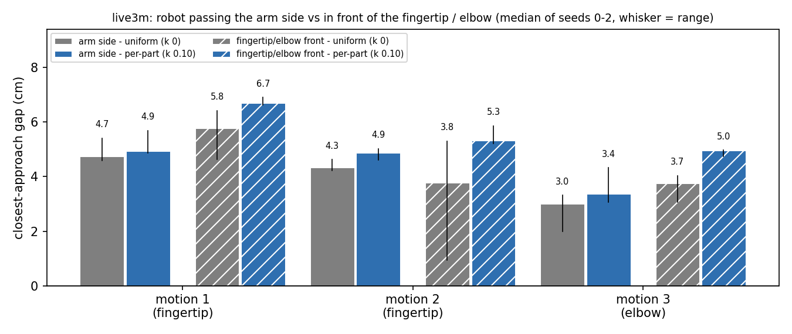

# live3m: fingertip / elbow front pass vs arm side approach

Same recording (live3m), replayed at real time with the live settings, seeds 0-2. Arm side = the recorded robot path (compare/, the arm lay across it and the robot waited beside the forearm). Front pass = a new path per motion: a horizontal line perpendicular to the arm axis just in front of the fingertip (motions 1, 2) or the elbow (motion 3), from the held posture of the motion (compare_tip/scenes.json; offset calibrated so that the robot without human cost passes about 3 cm away; virtual robot base moved for reach, see notes). Front-pass values use the frames that hold the posture.

Gap = robot sphere surface (incl. 0.02 m buffer) to the shape surface. Arm side: closest arm part over the whole motion. Front pass: the target (fingertip / elbow).

| motion | approach | mode | gap (cm) | part / side | eta at min (cm) | pass s | overlap steps |
|---|---|---|---|---|---|---|---|
| motion 1 | arm side (recorded path) | uniform | 4.7 [4.6, 5.4] | forearm/forearm/forearm | 6.5 [6.5, 6.5] | 5.75 [5.59, 5.82] | 0 [0, 0] |
| motion 1 | arm side (recorded path) | part | 4.9 [4.9, 5.7] | forearm/forearm/forearm | 6.9 [6.7, 7.1] | 5.76 [5.49, 5.87] | 0 [0, 0] |
| motion 1 | fingertip front (new path) | uniform | 5.8 [4.6, 6.4] | fingertip / front/up/up | 6.5 [6.5, 6.5] | 3.95 [3.93, 5.95] | 0 [0, 0] |
| motion 1 | fingertip front (new path) | part | 6.7 [6.6, 6.9] | fingertip / up/up/up | 7.1 [7.1, 7.4] | 3.66 [3.33, 4.00] | 0 [0, 0] |
| motion 2 | arm side (recorded path) | uniform | 4.3 [4.2, 4.6] | forearm/forearm/forearm | 6.5 [6.5, 6.5] | 8.97 [8.90, 9.11] | 0 [0, 0] |
| motion 2 | arm side (recorded path) | part | 4.9 [4.6, 5.0] | forearm/forearm/forearm | 7.0 [7.0, 7.1] | 8.95 [8.94, 9.35] | 0 [0, 0] |
| motion 2 | fingertip front (new path) | uniform | 3.8 [0.9, 5.3] | fingertip / up/front/up | 6.5 [6.5, 6.5] | - | 0 [0, 8] |
| motion 2 | fingertip front (new path) | part | 5.3 [5.2, 5.9] | fingertip / up/up/up | 6.5 [6.5, 6.5] | - | 0 [0, 0] |
| motion 3 | arm side (recorded path) | uniform | 3.0 [2.0, 3.3] | upper_arm/hand/hand | 6.5 [6.5, 6.5] | 8.90 [8.63, 9.03] | 0 [0, 0] |
| motion 3 | arm side (recorded path) | part | 3.4 [3.1, 4.3] | upper_arm/forearm/hand | 6.5 [6.5, 8.5] | 8.77 [5.69, 9.23] | 0 [0, 0] |
| motion 3 | elbow front (new path) | uniform | 3.7 [3.1, 4.0] | elbow / front/front/up | 6.5 [6.5, 6.5] | 11.30 [10.77, 11.83] | 0 [0, 0] |
| motion 3 | elbow front (new path) | part | 5.0 [4.8, 5.0] | elbow / front/front/up | 8.0 [7.5, 8.1] | 11.35 [9.85, 11.53] | 0 [0, 0] |

Per-part minus uniform (median, cm): motion 1: arm side +0.2, front +0.9; motion 2: arm side +0.5, front +1.5; motion 3: arm side +0.4, front +1.2.

Paths:
- motion 1: fingertip, offset 0.115 m, base shift [-0.3, 0.0] m, half length 0.30 m, held frames 73 %
- motion 2: fingertip, offset 0.205 m, base shift [0.1, 0.3] m, half length 0.30 m, held frames 35 %
- motion 3: elbow, offset 0.150 m, base shift [-0.1, 0.0] m, half length 0.30 m, held frames 33 %

Human cost off (seed 0): motion 1: min 2.6 cm, per pass 21.0, 3.6, 4.5, 2.6; motion 2: min 4.4 cm, per pass 12.7, 4.4, 13.3, 26.5; motion 3: min -7.0 cm, per pass 15.8, -7.0, 2.5 cm.
## Interpretation

결론: 손끝(동작 3은 팔꿈치) 앞을 지나가게 하자 부위별 기준이 균일보다 0.9 / 1.5 / 1.2 cm 더 멀리 지나갔다(seed 3개 중앙값). 팔 옆 접근에서는 0.2 / 0.5 / 0.4 cm였다. 손끝 앞에서 차이가 2-4배 커졌지만, 정지 장면 V2 정면(4.7 cm)만큼 크지는 않다.

- 차이가 정지 장면보다 작은 이유: 가장 가까웠던 순간의 방향이 대부분 "위"였다(동작 1 부위별 3/3, 동작 2 3/3). 녹화된 팔은 아래로 14-15도 기울어 있다. 길을 손끝 앞 수평선으로 잡았으므로, 로봇 손 위쪽의 큰 구(그리퍼 몸체)가 기울어진 손 위로 먼저 다가왔다. 손 위 방향의 유효질량은 작아서(손 하나 분량), 그 순간 부위별 구역은 7.1-7.4 cm(동작 1), 6.5 cm(동작 2)로 균일 6.5 cm와 거의 같았다. 동작 3(팔꿈치)은 앞쪽에서 가장 가까워졌고 구역이 7.5-8.1 cm라 차이가 1.2 cm로 가장 뚜렷했다.
- 겹침: 동작 2 균일 seed 0에서 8스텝(손끝 0.9 cm까지 접근)뿐이고, 부위별 기준은 모든 동작에서 0이다.
- 한 번 지나가는 데 걸린 시간: 동작 1은 두 방식 3.7-4.0 s, 동작 3은 11.3 s로 차이 없다. 동작 2는 유지 프레임 안에서 도착이 없어 시간을 잴 수 없었다(로봇이 손 앞에서 기다림).
- 길은 녹화된 자세의 유지 구간 중앙값으로 정했다. 녹화된 사람은 로봇에 반응하지 않는다. 유지 프레임 비율은 73 / 35 / 33 %이고, 그 밖의 프레임에서는 손이 움직여 길과의 거리가 달라진다(지표에서 제외).
- 앞선 비교(compare/REPORT.md)의 해석 표에서 동작 3 값을 "3.3 -> 3.8"로 적었는데, 이는 손 열이다. 팔 최소 간격은 3.0 -> 3.4(+0.4 cm)다. 차이 값은 같다. 이 표에는 팔 최소 간격을 썼다.
