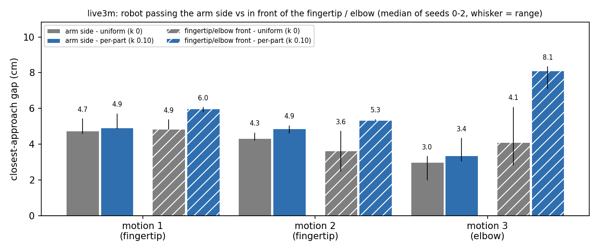

# live3m: fingertip / elbow front pass vs arm side approach

Same recording (live3m), replayed at real time with the live settings, seeds 0-2. Arm side = the recorded robot path (compare/, the arm lay across it and the robot waited beside the forearm). Front pass = a new path per motion: a horizontal line perpendicular to the arm axis just in front of the fingertip (motions 1, 2) or the elbow (motion 3), from the held posture of the motion (compare_tip/scenes.json; offset calibrated so that the robot without human cost passes about 3 cm away; virtual robot base moved for reach, see notes). Front-pass values use the frames that hold the posture.

Gap = robot sphere surface (incl. 0.02 m buffer) to the shape surface. Arm side: closest arm part over the whole motion. Front pass: the target (fingertip / elbow).

| motion | approach | mode | gap (cm) | part / side | eta at min (cm) | pass s | overlap steps |
|---|---|---|---|---|---|---|---|
| motion 1 | arm side (recorded path) | uniform | 4.7 [4.6, 5.4] | forearm/forearm/forearm | 6.5 [6.5, 6.5] | 5.75 [5.59, 5.82] | 0 [0, 0] |
| motion 1 | arm side (recorded path) | part | 4.9 [4.9, 5.7] | forearm/forearm/forearm | 6.9 [6.7, 7.1] | 5.76 [5.49, 5.87] | 0 [0, 0] |
| motion 1 | fingertip front (new path) | uniform | 4.9 [4.8, 5.4] | fingertip / front/up/up | 6.5 [6.5, 6.5] | 2.68 [2.65, 2.72] | 0 [0, 0] |
| motion 1 | fingertip front (new path) | part | 6.0 [5.8, 6.1] | fingertip / up/up/up | 7.2 [6.6, 7.3] | 2.80 [2.68, 3.03] | 0 [0, 0] |
| motion 2 | arm side (recorded path) | uniform | 4.3 [4.2, 4.6] | forearm/forearm/forearm | 6.5 [6.5, 6.5] | 8.97 [8.90, 9.11] | 0 [0, 0] |
| motion 2 | arm side (recorded path) | part | 4.9 [4.6, 5.0] | forearm/forearm/forearm | 7.0 [7.0, 7.1] | 8.95 [8.94, 9.35] | 0 [0, 0] |
| motion 2 | fingertip front (new path) | uniform | 3.6 [2.5, 4.7] | fingertip / front/front/up | 6.5 [6.5, 6.5] | - | 0 [0, 0] |
| motion 2 | fingertip front (new path) | part | 5.3 [5.3, 5.4] | fingertip / up/up/up | 6.5 [6.5, 6.5] | - | 0 [0, 0] |
| motion 3 | arm side (recorded path) | uniform | 3.0 [2.0, 3.3] | upper_arm/hand/hand | 6.5 [6.5, 6.5] | 8.90 [8.63, 9.03] | 0 [0, 0] |
| motion 3 | arm side (recorded path) | part | 3.4 [3.1, 4.3] | upper_arm/forearm/hand | 6.5 [6.5, 8.5] | 8.77 [5.69, 9.23] | 0 [0, 0] |
| motion 3 | elbow front (new path) | uniform | 4.1 [2.8, 6.1] | elbow / front/front/front | 6.5 [6.5, 6.5] | 3.23 [2.97, 10.00] | 0 [0, 0] |
| motion 3 | elbow front (new path) | part | 8.1 [7.1, 8.3] | elbow / front/front/front | 8.3 [8.1, 8.5] | 9.45 [9.07, 9.53] | 0 [0, 0] |

Per-part minus uniform (median, cm): motion 1: arm side +0.2, front +1.1; motion 2: arm side +0.5, front +1.7; motion 3: arm side +0.4, front +4.0.

Paths:
- motion 1: fingertip, offset 0.130 m, base shift [-0.3, 0.0] m, half length 0.30 m, held frames 73 %
- motion 2: fingertip, offset 0.195 m, base shift [0.1, 0.3] m, half length 0.30 m, held frames 35 %
- motion 3: elbow, offset 0.135 m, base shift [-0.1, 0.0] m, half length 0.30 m, held frames 33 %

Human cost off (seed 0): motion 1: min -8.4 cm, per pass -8.4, 2.3, -4.9, 4.8, -5.0; motion 2: min 1.6 cm, per pass 14.9, 1.7, 9.8, 1.6, 7.4, 24.8; motion 3: min 1.8 cm, per pass 1.8, 4.7 cm.

## Interpretation

이 폴더는 compare_tip(손끝·팔꿈치 앞 통과)의 길을 6 cm 낮춘 시험이다(허용 범위 ±10 cm 안). 로봇 손 위쪽 몸체가 손끝·팔꿈치 높이로 지나가게 하려는 것이다. 오프셋은 낮춘 높이에서 정적 간격 약 3 cm 로 다시 맞췄다(13 / 19.5 / 13.5 cm). 받침 이동은 compare_tip 과 같다.

- 동작 3(팔꿈치 앞): 부위별 기준이 균일보다 4.0 cm 더 멀리 지나갔다(4.1 -> 8.1 cm). 가장 가까운 방향은 세 seed 모두 "앞"이고, 그 순간 부위별 구역은 8.1~8.5 cm 다. 정지 장면 V2 정면의 차이(4.7 cm)에 가깝다. 대신 한 번 지나가는 데 걸린 시간이 3.2 -> 9.5 s 로 늘었다(팔꿈치 앞에서 기다림).
- 동작 1·2(손끝 앞): 차이는 +1.1 / +1.7 cm 로, 높이를 바꾸기 전(+0.9 / +1.5)보다 조금 커졌다. 그러나 가장 가까운 방향은 여전히 대부분 "위"다. 아래로 기운 손 위로 로봇 손 몸체가 먼저 다가오는 것은 6 cm 낮춤으로 바뀌지 않았다.
- 사람 비용 없이 돌린 왕복에서 손끝까지 간격이 왕복마다 크게 흔들렸다(동작 1: -8.4 ~ +4.8 cm). 지나가는 방향에 따라 로봇 자세가 달라지기 때문이다. 그래서 이 시험은 "2~4 cm" 조건을 맞추지 못한 탐색 결과다. 같은 길에서 두 방식을 비교했다는 점은 compare_tip 과 같다.
