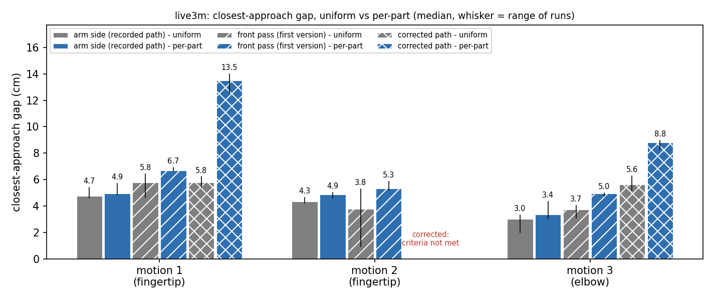

# live3m: 길을 보정한 비교 (손끝이 가리키는 방향 / 팔꿈치가 내민 방향)

같은 녹화(live3m)에서 로봇의 길만 다시 정해, 균일 방식(k 0)과 부위별 기준 방식(k 0.10)을 비교했다.
동작 1(편 팔 손끝)과 동작 3(팔꿈치)은 두 기준을 맞췄고, 자세 보정은 쓰지 않았다. 동작 2(굽힌 손)는 기준을 맞추지 못해 비교하지 않았다.

| 동작 | 균일 (cm) | 부위별 기준 (cm) | 차이 |
|---|---|---|---|
| 동작 1 (손끝) | 5.8 [5.4, 6.2] | 13.5 [12.6, 14.0] | +7.7 cm |
| 동작 3 (팔꿈치) | 5.6 [5.2, 6.3] | 8.8 [8.3, 9.0] | +3.2 cm |
| 동작 2 (굽힌 손) | - | - | 기준 미충족 |

값은 가장 가까웠을 때의 간격이다. 방식마다 6회(seed 0·1·2 × 출발 끝 A·B)의 중앙값 [최소, 최대]다. 겹침은 모든 실행에서 0스텝이다.

## 1. 정한 것

- **목표 방향 d.** 동작 1·2는 아래팔 축(팔꿈치 → 손목)이다. 동작 3은 위팔 축(어깨 → 팔꿈치)이다. 팔꿈치가 내민 방향을 위팔 축으로 잡은 것은 앞선 "팔꿈치 정면" 정의와 같다.
- **기준 (b)의 각도.** "로봇에서 사람 쪽을 향하는 방향"은 d의 반대 방향이어야 한다(로봇이 손끝 앞에 있으므로). 그래서 사람의 가장 가까운 표면 점에서 로봇 구 중심을 향하는 방향과 d 사이의 각도를 쟀다. 두 정의의 각도는 같다.
- **간격.** 로봇 구 전체(MPC 반지름 + 0.02 m) 대 사람 형상 전체다. TCP가 길의 양 끝 10 cm 안에 있는 스텝은 뺐다.
- **유지 구간.** 목표 부위의 형상 끝점이 기준 자세에서 3 cm 안에 머무는 가장 긴 연속 구간이다. 동작 1은 3.9초, 동작 2는 3.1초, 동작 3은 3.2초다. 간격은 이 구간에서만 쟀다.
- **실행 방식.** 사람 자료는 유지 구간과 그 뒤 1.5초만 잘라 실시간으로 틀었다(자료 값은 그대로). 로봇은 유지 구간이 시작할 때 길의 한쪽 끝에서 출발한다. 출발 끝을 A와 B로 바꿔 두 번씩 돌려, 가는 방향과 오는 방향의 첫 통과를 모두 보았다.
- **높이 범위.** 앞선 손끝 앞 통과(compare_tip)의 길 높이에서 ±20 cm 안으로 잡았다.

## 2. 길 보정

비용을 끄면 MPC는 두 끝 사이를 직선으로 가지 않는다. 앞선 길에서는 한 방향만 사람 쪽으로 20 cm 부풀었다(반대 방향은 1~2 cm). 그래서 가상 로봇 받침을 목표 방향의 연장선 위로 옮겨, 길이 로봇 정면에서 좌우 대칭이 되게 했다. 부풂이 양 방향에서 비슷해졌다(4~8 cm).

| 항목 | 동작 1 (손끝) | 동작 3 (팔꿈치) |
|---|---|---|
| 길의 높이 | 38.3 → 22.0 cm (-16.2 cm) | 23.7 → 4.0 cm (-19.7 cm) |
| 사람과의 거리 (기준점 → 길) | 6.5 → 16.3 cm | 11.7 → 15.0 cm |
| 길의 기울기 | 0 (수평, d에 수직) | 0 (수평, d에 수직) |
| 받침 이동 (x, y) | (-0.30, 0) → (-0.64, +0.30) m | (-0.10, 0) → (-0.37, +0.41) m |

- 높이는 받침 좌표의 TCP 높이다. 기준점은 목표 부위에서 d 쪽으로 가장 앞선 표면 점이다.
- 길을 낮춘 이유: 그리퍼가 아래를 향하므로 손목 위쪽 링크(link 6·7)가 가장 앞으로 나온다. 이 부분이 손끝(팔꿈치) 높이 아래로 지나가야 접근 방향이 d와 맞는다.
- 동작 3은 받침을 길 방향으로 3 cm 더 옮겨(blat) 두 방향의 차이를 줄였다.
- 자세 보정([2])은 쓰지 않았다. 동작 1·3은 길 보정만으로 기준 (b)를 맞췄다.

## 3. 기준 확인 (사람 비용 끔, seed 0)

| 동작 | 간격: 가는 방향 A→B (cm) | 간격: 오는 방향 B→A (cm) | 접근 방향 각도 |
|---|---|---|---|
| 동작 1 | 3.6 / 2.8 / 2.9 | 2.4 / 2.3 / 3.9 | 5~23도 |
| 동작 3 | 3.0 / 5.0 | 2.5 / 3.9 | 1~15도 |

- 값은 유지 구간 안의 통과마다 하나다(출발 A 실행과 출발 B 실행을 합침).
- 동작 1은 6번 모두 2~4 cm 안이다. 동작 3은 4번 중 3번이 안이고, 한 번(두 번째 통과)이 5.0 cm다.
- 같은 방향에서도 통과마다 약 ±1 cm 달라진다. MPC 자체의 흔들림이고, 유지 구간 안에서 사람 팔꿈치도 약 1 cm 움직인다. 그래서 ±1 cm 는 이 방식의 한계에 가깝다.
- 정지에서 출발한 첫 통과만 보면 동작 1은 3.6 / 2.3 cm, 동작 3은 3.0 / 3.9 cm다.
- 각도는 모두 30도 안이다. 가장 가까운 사람 부위는 동작 1이 손이다.
- 동작 3은 아래팔 형상이 가장 가까웠다. 4번 중 3번은 그 팔꿈치 쪽 끝이다(기준점에서 0.5~1.1 cm). 출발 A의 첫 통과만 팔꿈치에서 15 cm 떨어진 아래팔 앞을 3.0 cm 로 먼저 스쳤고, 그때 팔꿈치까지는 3.7 cm 였다. 길이 아래팔과 나란해서 생긴 일이고, 방향은 그때도 d에서 10도였다. 팔꿈치만 보면 간격은 3.7 / 5.0, 2.5 / 4.0 cm 다.
- 비교 실행 12회에서는 가장 가까운 점이 모두 팔꿈치 쪽 끝이었다(기준점에서 0.6~1.3 cm).
- 그 방향의 구역 두께(정적 계산)는 동작 1이 부위별 14.5~16.7 cm 대 균일 6.5~6.6 cm, 동작 3이 9.7~10.0 cm 대 6.5~6.6 cm다.

## 4. 비교 결과 (seed 0·1·2 × 출발 A·B, 방식마다 6회)

| 항목 | 동작 1 균일 / 부위별 | 동작 3 균일 / 부위별 |
|---|---|---|
| 최소 간격 (cm) | 5.8 [5.4, 6.2] / 13.5 [12.6, 14.0] | 5.6 [5.2, 6.3] / 8.8 [8.3, 9.0] |
| 차이 | +7.7 cm | +3.2 cm |
| 출발 A / 출발 B (cm) | 5.8 / 5.7, 12.9 / 14.0 | 5.6 / 5.6, 8.8 / 8.4 |
| 가장 가까운 순간의 구역 두께 (cm) | 6.5 / 12.1 [10.3, 14.0] | 6.5 / 9.9 [9.3, 10.3] |
| 가장 가까운 순간의 각도 (도) | 15 [4, 18] / 30 [23, 34] | 11 [10, 15] / 13 [8, 18] |
| 한 번 지나가는 시간 (s) | 2.01 / 2.47 | 1.87 / 2.02 |

- 구역 두께는 실행 기록의 값이다(가장 가까운 짝의 eta).
- 한 번 지나가는 시간은 출발부터 반대쪽 끝 도착까지다. 모든 실행이 도착했다. 비용을 껐을 때는 1.2~1.7초다.
- 동작 1의 부위별 기준 실행은 로봇이 구역에 밀려 돌아가므로, 가장 가까운 순간의 각도가 23~34도로 커졌다. 기준 (b)는 비용을 끈 길에 대한 것이다.

## 5. 앞선 비교와 나란히

| 동작 | 팔 옆 접근 | 손끝 앞 통과 (첫 판) | 보정한 길 |
|---|---|---|---|
| 동작 1 | 4.7 → 4.9 (+0.2) | 5.8 → 6.7 (+0.9) | 5.8 → 13.5 (+7.7) |
| 동작 2 | 4.3 → 4.9 (+0.5) | 3.8 → 5.3 (+1.5) | 기준 미충족 |
| 동작 3 | 3.0 → 3.4 (+0.4) | 3.7 → 5.0 (+1.2) | 5.6 → 8.8 (+3.2) |

- 값은 균일 → 부위별 기준(cm)이다.
- 앞선 두 비교는 seed 3개의 중앙값이고, 동작 전체를 틀었다. 팔 옆 접근은 팔 최소 간격, 첫 판은 목표 부위까지의 간격이다.
- 보정한 길은 유지 구간만 틀었고 6회 중앙값이다. 가장 가까운 부위가 목표 부위여서, 목표 부위만의 간격도 같은 값이다.
- 첫 판에서 차이가 작았던 이유가 접근 방향이었다는 해석과 맞는다. 방향을 맞추자 차이가 커졌다. 정지 장면의 차이(균일 5.3~6.2 대 부위별 10.6~10.9 cm, 약 4.8 cm)와 견주면 동작 1은 더 크고 동작 3은 더 작다.

## 6. 동작 2 (굽힌 손): 기준을 맞추지 못함

왼손 손끝이 가리키는 쪽에 오른손이 있다(손끝에서 옆으로 18 cm, 앞으로 22 cm). 로봇이 왼손 손끝 앞 3 cm 를 지나가면 오른손이 먼저 걸린다.

- **수평 길(정적 계산, 가장 유리한 경우).** 직선으로 지나가고 손목 아래만 있다고 보았다. 높이 범위 전체에서, 왼손 손끝 간격을 3 cm 로 두면 다른 부위(오른손 또는 골반)가 1.4~2.5 cm 로 더 가깝다. 팔을 3·6·9도 들어도 2.2~2.5 cm 이고, 12·15도에서는 오른손과 겹친다(-0.5, -2.0 cm). 그래서 자세 보정으로도 기준 (b)를 맞출 수 없다(`static_motion2.json`).
- **수직 길(실제 실행 2가지).** 길을 d에 수직인 위아래 방향으로 세웠다. 비용을 끈 로봇은 위아래로 갈 때 10 cm 넘게 부풀고, 방향에 따라 다르다. 받침을 앞에 둔 경우 간격이 -5.8 ~ +4.2 cm 였고, 옆에 둔 경우 올라갈 때 오른손과 겹쳤다(-3.7 ~ -4.7 cm). 내려가는 통과 한 번만 손끝 1.6 cm, 7도로 지나갔다.
- 그래서 동작 2는 비교와 영상을 만들지 않았다.

## 7. 한계

- 길은 녹화 뒤에 정했다. 녹화된 사람은 로봇에 반응하지 않는다.
- 가상 로봇 받침을 동작마다 옮겼다(위 표). 자세는 보정하지 않았다.
- 유지 구간이 3~4초로 짧다. 실행마다 통과가 두 번쯤이다.
- 사람 한 명, 녹화 하나, 동작 두 개의 결과다.
- 기준 (a)는 동작 3에서 4번 중 한 번이 벗어났다(5.0 cm).
- 동작 3의 길 높이는 허용 범위의 끝(-19.7 cm)이다.
- 앞선 비교와 실행 방식이 다르다(유지 구간만 틂, 출발 끝 2가지). 표 5의 숫자는 그 차이를 안고 본 것이다.
- 화면은 기록으로 다시 그렸다(메시는 표시용).

## 8. 공개 글에 넣을 만한 문장 (제안, 글은 고치지 않음)

> 로봇이 손끝이 가리키는 방향(편 팔)과 팔꿈치가 내민 방향으로 3 cm 앞을 지나가도록 길을 보정하자, 부위별 기준은 균일보다 7.7 cm(5.8 → 13.5 cm), 3.2 cm(5.6 → 8.8 cm) 더 멀리 지나갔다. 굽힌 손 동작은 반대쪽 손이 길을 막아 같은 조건을 만들지 못했다.

## 9. 파일

- `summary.json`, `summary.md`, `fig_corrected.png`: 요약 표와 그림.
- `clip_corr_motion1.mp4/.gif`, `clip_corr_motion3.mp4/.gif`: 3분할 클립(컬러, 균일, 부위별; seed 0, 출발 A, SMPL 메시).
- `cal/m1b`, `cal/m3b`: 최종 길(`path.json`, 장면, 받침 위치, 분석). `final.json` 에 판 이름이 있다.
- `cal/m1a`, `cal/m3a`, `cal/m2a`, `cal/m2b`, `explore/`: 보정 과정의 시도.
- `static_motion2.json`: 동작 2의 정적 계산.
- 스크립트: `goal1/scripts/lv_corr_*.py`, `lv_corr_cal.sh`, `lv_corr_compare.sh`.
- `cal/*/human_verts.npz`, `human_v2.npz` 는 사람 자료의 조각이다(공개 대상 아님).
