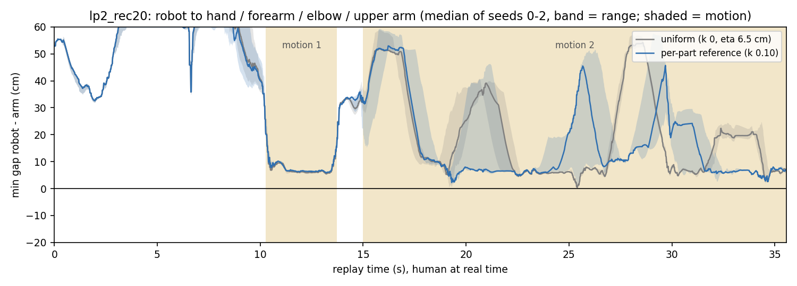
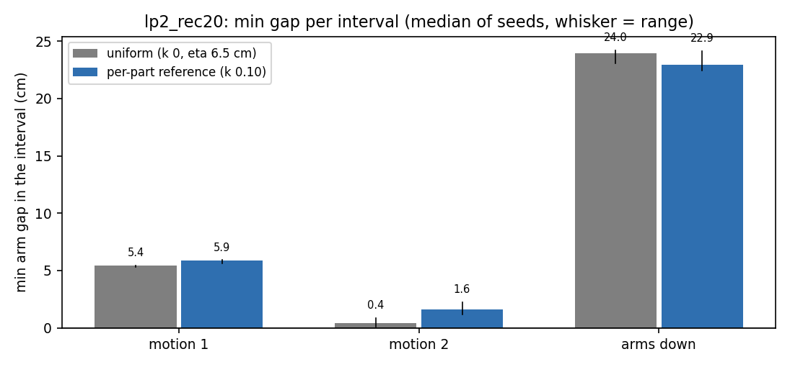

# lp2_rec20: uniform vs per-part reference, replay at real time

Recording lp2_rec20 (human data of the live run) replayed headless with human time = simulated time, live settings (live_t1.yml, scene_live_front.json, frame of the run), seeds 0-2 per mode. Length 35.5 s (2133 steps).
Motions: an arm part (hand, forearm, elbow) within 25 cm of the robot reference path (TCP segment A-B) for >= 3 s (gaps < 0.5 s bridged); found 2.

Values: median [min, max] of seeds 0-2. Gap = robot sphere surface (incl. 0.02 m buffer) to shape surface, cm. eta = zone thickness of that mode at the moment of the min arm gap (cm). Overlap = steps with an arm gap < 0. Pass = steps between arrivals (s).

| interval | mode | hand | forearm | elbow | upper arm | closest | eta | overlap | arrivals | pass s |
|---|---|---|---|---|---|---|---|---|---|---|
| motion 1 (10.3-13.8 s) | uniform | 7.2 [6.3, 7.8] | 5.4 [5.3, 5.5] | 14.0 [13.7, 14.8] | 19.7 [19.4, 20.1] | forearm/forearm/forearm | 6.5 [6.5, 6.5] | 0 [0, 0] | 0 [0, 0] | - |
| motion 1 (10.3-13.8 s) | part | 8.4 [8.0, 8.7] | 5.9 [5.6, 5.9] | 14.7 [13.9, 15.2] | 20.7 [20.0, 20.7] | forearm/forearm/forearm | 7.1 [7.1, 7.1] | 0 [0, 0] | 0 [0, 0] | - |
| motion 2 (15.0-35.6 s) | uniform | 0.4 [0.1, 0.8] | 2.6 [1.8, 5.1] | 10.7 [9.3, 10.8] | 15.0 [13.3, 15.3] | hand/hand/hand | 6.5 [6.5, 6.5] | 0 [0, 0] | 7 [7, 7] | 2.32 [2.03, 2.40] |
| motion 2 (15.0-35.6 s) | part | 1.6 [1.2, 2.3] | 2.6 [2.2, 3.1] | 11.5 [10.3, 12.2] | 15.7 [14.9, 17.3] | hand/hand/hand | 7.6 [7.2, 9.5] | 0 [0, 0] | 4 [4, 4] | 2.47 [2.26, 2.65] |
| arms down | uniform | 24.0 [23.0, 24.2] | 25.6 [24.3, 27.5] | 28.3 [27.0, 30.1] | 28.3 [27.5, 29.6] | hand/hand/hand | 6.5 [6.5, 6.5] | 0 [0, 0] | 5 [5, 5] | 2.36 [2.13, 2.37] |
| arms down | part | 22.9 [22.4, 24.2] | 25.9 [24.5, 27.0] | 29.0 [28.8, 29.6] | 29.8 [28.5, 30.0] | hand/hand/hand | 6.8 [6.5, 7.0] | 0 [0, 0] | 5 [5, 5] | 2.30 [2.07, 2.33] |

Per-part minus uniform, min arm gap (median of seeds, cm): motion 1 +0.4, motion 2 +1.2, arms down -1.0.
First step where the two modes' joint commands differ (per seed, s): 6.58, 6.60, 6.58; before it the two runs are bit-equal (same seed, same human, all zones at eta0). Nearest human shape then (gap cm / segment): 39.6/12, 43.1/12, 38.0/12.
Realtime factor of the replays (headless): uniform 0.44, 0.83, 0.83; part 0.42, 0.82, 0.82.

Video: lp2_rec20_compare.mp4 (Kinect colour | uniform | per-part, seed 0, 35.6 s); zone shells on forearms, hands and elbows. Colour frame to replay time offset median 11 ms, max 29 ms. Clips: clip_motion1.mp4 (8.2 s +10 s), clip_motion2.mp4 (20.4 s +10 s).
