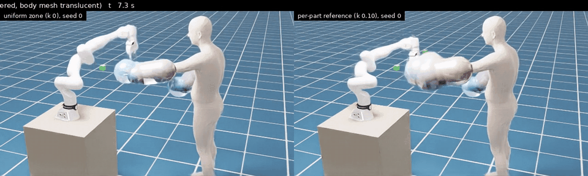
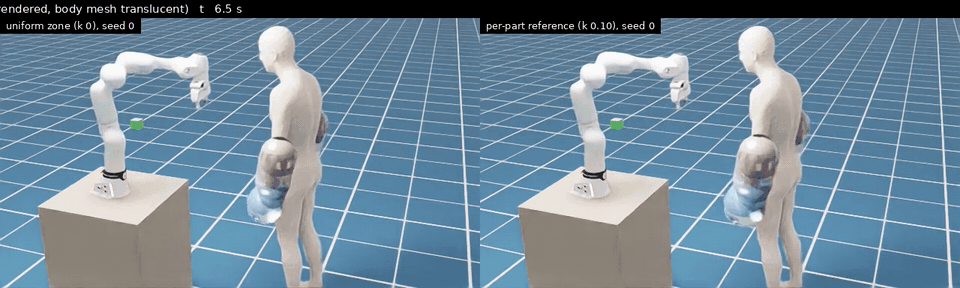
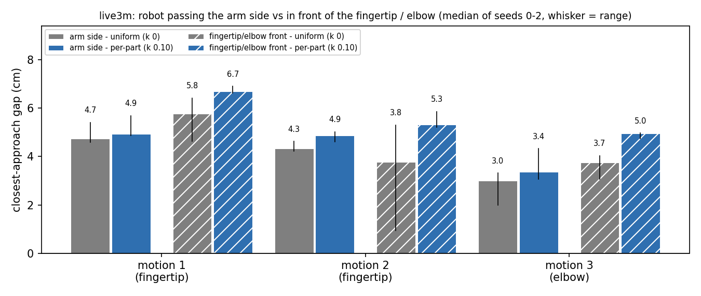
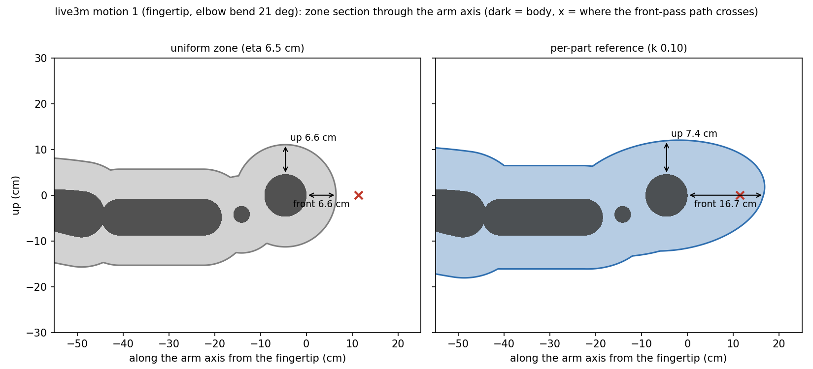
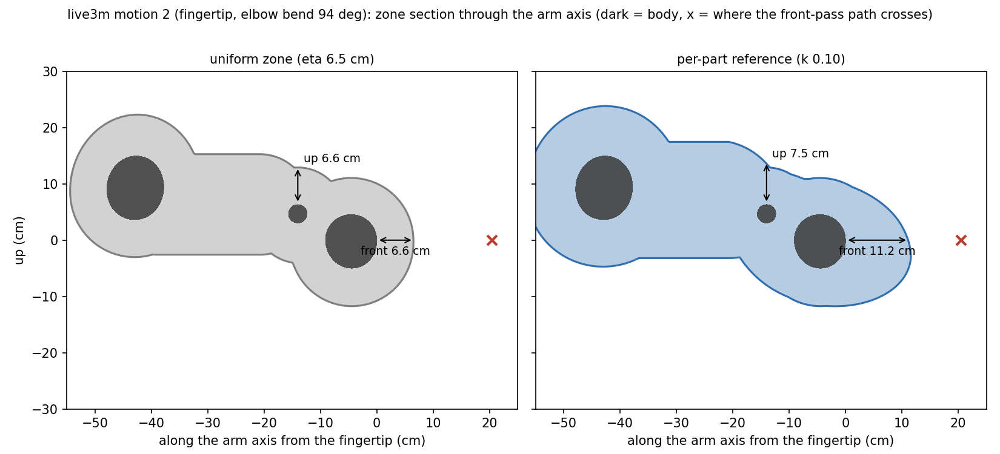
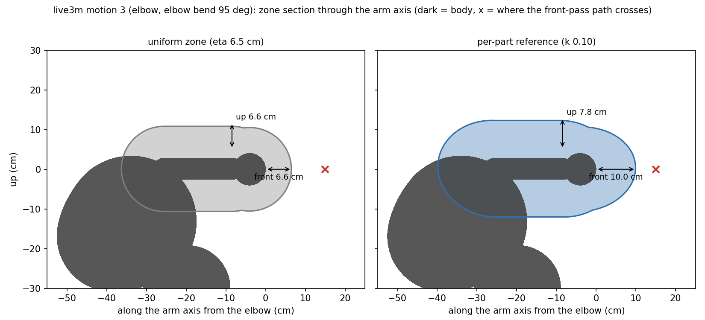
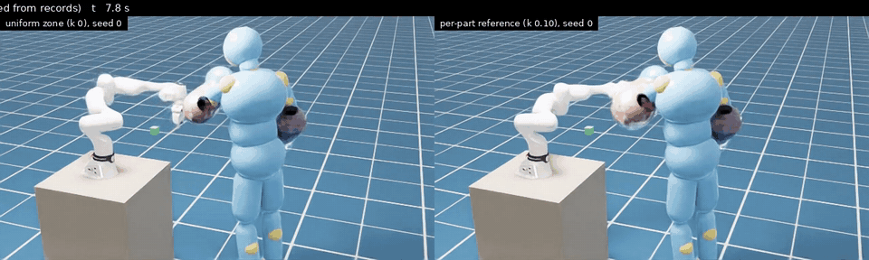

# 실제 Kinect 녹화로 본 손·팔꿈치 회피: 팔 옆 접근과 손끝 앞 통과

이 글은 사람이 실제 Kinect 카메라 앞에서 한 세 동작을 녹화해, 균일 회피와 부위별 기준(제안 방식)을 같은 조건에서 비교한 결과다.
녹화된 사람 움직임을 제 속도로 다시 틀었다. 로봇은 Isaac Sim 의 가상 Franka FR3 다.

*손끝 앞 통과(동작 1, 편 팔). 왼쪽 균일, 오른쪽 부위별 기준, seed 0, 반투명 사람 메시와 회피 구역(손·아래팔·팔꿈치). 부위별 기준의 로봇이 손에서 더 떨어져 지나간다.*

*팔 옆 접근(동작 1, 녹화 당시 로봇 길). 팔이 길을 가로막아 로봇이 아래팔 옆에서 기다린다. 두 방식의 간격 차이는 0.2 cm 다.*

## 1. 무엇을 했나

- **녹화(live3m)**: 한 사람이 카메라 앞에서 팔을 내리고 서 있다가 세 동작을 차례로 했다. 동작 1 = 팔을 편 채 손끝 내밀기, 동작 2 = 팔꿈치를 굽힌 손, 동작 3 = 팔꿈치 내밀기. 각 동작은 15~20초 유지했다.
- **다시 틀기**: 녹화된 사람 자세를 사람 시간 = 시뮬레이션 시간이 되도록 틀었다. 실시간 실행 당시에는 화면이 실제의 약 0.6배로 흘러 로봇이 늦게 피했기 때문이다. 설정은 실시간 실행과 같다(움직임 예측, 사람 근처 속도 상한 0.5 m/s 등).
- **두 방식**: 균일 = 모든 부위·방향에 6.5 cm, 부위별 기준 = 방향별 환산질량을 그 부위의 ISO/TS 15066 기준 질량과 비교해 두께를 정함(k_gain 0.10 m). seed 0·1·2.
- **두 가지 로봇 길**
  - 팔 옆 접근: 녹화 당시의 로봇 길(로봇 앞을 좌우로 왕복). 뻗은 팔이 길을 가로질러, 로봇은 아래팔 옆면에 다가가 기다렸다.
  - 손끝 앞 통과: 동작마다 새로 정한 길. 그 동작에서 자세를 유지한 프레임들의 중앙값 자세를 쓰고, 손끝(동작 3은 팔꿈치) 바로 앞을 팔 축에 직각인 수평선으로 지나가게 했다. 사람 비용 없이 지나가면 약 3 cm 거리가 되도록 손끝에서 떨어진 거리를 맞췄다.
- **간격**: 로봇 충돌 구 표면(여유 2 cm 포함)에서 사람 몸 형상(캡슐) 표면까지의 거리다. 음수면 겹친 것이다.

## 2. 결과

| 동작 | 로봇 길 | 균일 간격 (cm) | 부위별 간격 (cm) | 차이 | 가장 가까운 부위·방향 | 그 순간 부위별 구역 두께 |
|---|---|---|---|---|---|---|
| 1 편 팔 손끝 | 팔 옆 접근 | 4.7 [4.6, 5.4] | 4.9 [4.9, 5.7] | +0.2 | 아래팔 옆 | 6.9 cm |
| 1 편 팔 손끝 | 손끝 앞 통과 | 5.8 [4.6, 6.4] | 6.7 [6.6, 6.9] | +0.9 | 손끝, 주로 위쪽 | 7.1 cm |
| 2 굽힌 손 | 팔 옆 접근 | 4.3 [4.2, 4.6] | 4.9 [4.6, 5.0] | +0.5 | 아래팔 옆 | 7.0 cm |
| 2 굽힌 손 | 손끝 앞 통과 | 3.8 [0.9, 5.3] | 5.3 [5.2, 5.9] | +1.5 | 손끝, 주로 위쪽 | 6.5 cm |
| 3 팔꿈치 내밀기 | 팔 옆 접근 | 3.0 [2.0, 3.3] | 3.4 [3.1, 4.3] | +0.4 | 위팔·손 | 6.5 cm |
| 3 팔꿈치 내밀기 | 팔꿈치 앞 통과 | 3.7 [3.1, 4.0] | 5.0 [4.8, 5.0] | +1.2 | 팔꿈치, 주로 앞쪽 | 8.0 cm |

값은 seed 3개의 중앙값 [최솟값, 최댓값]. 팔 옆 접근은 동작 구간 전체의 팔 최소 간격, 손끝 앞 통과는 자세를 유지한 프레임에서 손끝(팔꿈치)까지의 최소 간격이다. 겹친 스텝은 손끝 앞 통과 동작 2 균일 seed 0 에서만 8스텝이고, 나머지는 모두 0 이다.

### 구역 모양: 녹화된 세 자세

같은 자세, 같은 시점에서 균일 구역(회색)과 부위별 구역(파랑)을 팔 축을 지나는 단면으로 그렸다. x 표시는 손끝 앞 통과 길이 지나는 곳이다.

| 동작 | 손끝(팔꿈치) 앞 두께, 균일 | 부위별 | 위쪽 두께, 균일 | 부위별 |
|---|---|---|---|---|
| 1 편 팔 | 6.6 cm | 16.7 cm | 6.6 cm | 7.4 cm |
| 2 굽힌 손 | 6.6 cm | 11.2 cm | 6.6 cm | 7.5 cm |
| 3 팔꿈치 | 6.6 cm | 10.0 cm | 6.6 cm | 7.8 cm |

*구역 그림은 점 로봇(4.6 kg)으로 그렸다. 실제 실행에서는 로봇 구마다 유효질량이 달라 두께가 조금 다르다.*

### 영상

세 화면은 왼쪽부터 녹화된 Kinect 컬러, 균일, 부위별 기준이다(seed 0). 두 Isaac 화면은 실행 기록(관절 값)으로 다시 그렸고, 사람은 반투명 SMPL 메시로 함께 그렸다. 컬러와 Isaac 화면의 시간 차는 0.03초 이내다.

| 동작 | 손끝 앞 통과 | 팔 옆 접근 |
|---|---|---|
| 1 편 팔 손끝 | [front_motion1.mp4](media/front_motion1.mp4) | [side_motion1.mp4](media/side_motion1.mp4) |
| 2 굽힌 손 | [front_motion2.mp4](media/front_motion2.mp4) | [side_motion2.mp4](media/side_motion2.mp4) |
| 3 팔꿈치 내밀기 | [front_motion3.mp4](media/front_motion3.mp4) | [side_motion3.mp4](media/side_motion3.mp4) |

실시간 실행 그대로의 영상: [live_run_as_executed.mp4](media/live_run_as_executed.mp4). 화면 속 Isaac 은 당시 실제의 약 0.6배로 흘렀다. 위의 비교 영상(제 속도로 다시 튼 것)과 다르다.

### 길을 6 cm 낮춘 시험

로봇 손 위쪽 몸체가 손끝·팔꿈치 높이로 지나가도록 길을 6 cm 낮추고 다시 비교했다. 팔꿈치 앞(동작 3)에서는 가장 가까운 방향이 모두 앞쪽이 되었다. 부위별 기준이 균일보다 4.0 cm 더 멀리 지나갔다(4.1 대 8.1 cm). 손끝 앞(동작 1·2)은 +1.1 / +1.7 cm 로 조금만 커졌다. 이 시험에서는 사람 비용 없이 지나가는 간격이 왕복마다 크게 흔들려, 탐색 결과로 본다.

*팔꿈치 내밀기, 길을 6 cm 낮춤, seed 0. 컬러 화면이 있는 원본: [elbow_front_low_motion3.mp4](media/elbow_front_low_motion3.mp4) (메시 없이 형상 캡슐로 그림)*

## 3. 해석

손끝 앞에서는 팔 길이 방향으로 손에 팔 전체의 관성이 실려 환산질량이 크다. 그래서 부위별 기준의 구역이 균일보다 2~2.5배 두껍다(편 팔 16.7 대 6.6 cm). 반면 아래팔 옆면이나 손 위쪽에서는 그 방향으로 움직이는 질량이 손이나 아래팔 하나 정도뿐이다. 이 질량은 그 부위의 ISO 기준 질량과 비슷해서, 부위별 기준에서도 구역이 6.5~7.5 cm 로 균일과 거의 같다. 팔 옆으로 다가온 녹화에서 두 방식의 차이가 0.2~0.5 cm 에 그친 것은 이 때문이며, 방법이 뜻한 대로의 결과다. 손끝(팔꿈치) 앞을 지나게 하자 차이가 0.9~1.5 cm 로 커졌다. 다만 정지 장면(V2 정면, 4.7 cm 차이)만큼 커지지는 않았다. 녹화된 팔이 아래로 14~15도 기울어 있어서, 로봇 손 위쪽의 큰 구가 손 위에서 먼저 다가왔고, 그 방향의 구역은 얇기 때문이다. 앞쪽에서 가장 가까워진 동작 3(팔꿈치)에서 구역이 8.0 cm 로 가장 두꺼웠다.

## 4. 한계

- 로봇의 길은 녹화가 끝난 뒤에 정했다. 손끝 앞 통과 길은 녹화된 자세에 맞춰 만들었고, 손이 닿도록 가상 로봇 받침을 옮겼다(동작 1: x −0.30 m, 동작 2: x +0.10, y +0.30 m, 동작 3: x −0.10 m).
- 화면은 실행 기록으로 다시 그렸다. 실시간 실행 당시의 화면이 아니다.
- 녹화된 사람은 로봇에 반응하지 않는다. 실제 협업에서는 사람이 로봇을 보고 손을 뺀다.
- 손끝 앞 통과의 지표는 자세를 유지한 프레임(동작별 73 / 35 / 33 %)에서만 냈다. 그 밖의 프레임에서는 손이 움직여 길과의 거리가 달라진다.
- 사람 한 명, 녹화 한 번, seed 3개의 결과다.
- 실물 로봇 결과가 아니다.

근거 파일: `goal1/live/live3m/compare/`(팔 옆 접근), `goal1/live/live3m/compare_tip/`(손끝 앞 통과), `goal1/live/live3m/zone_figs/`(구역 그림).
